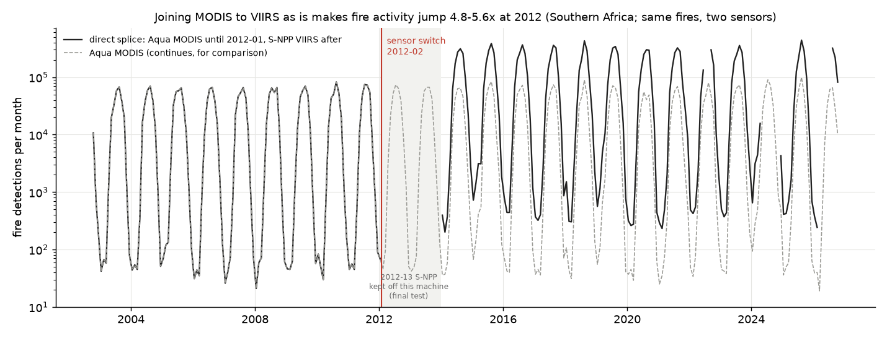

# MODIS × VIIRS 火点协调 / Harmonized Fire Record

**One consistent monthly fire record from 2000 to 2026, across two generations of NASA satellites.**

**[Open the public V2 fire activity explorer](https://inspiratio-fire-activity-v2.hushedotter14.chatgpt.site)** · [V2 source and setup](frontend-v2/README.md)

把 MODIS（2000 年起）和 VIIRS（2012 年起）两代卫星的火点记录，统一成一条可以前后比较的月度序列：全球 0.25° 格子，2000-11 至 2026-10。



## 一分钟看懂

- **问题**：VIIRS 比 MODIS 灵敏得多，同一片火，它数出的火点要多好几倍。直接把两段拼起来，2012 年会出现一个**由换卫星造成的假台阶**，而不是火情真的变了。
- **做法**：用两颗卫星同时在轨的年份训练模型（两段式 LightGBM），只用 MODIS 的信息推出“VIIRS 会看到多少火点”，再把这个换算用到 2012 年以前。
- **证明**：评分规则在看到结果之前就写好并冻结；测试数据只在 GitHub 云端打分，**只考一次**。
- **结果**：
  - 外部盲审：误差比简单比例法低 22%，在完全没见过的地区低 25%（[盲审成绩](reports/final-test.md)）；
  - 全球验证：误差比简单比例法低 14%（[全球分数](reports/global-scores.md)）；
  - 全球 2013 年（模型）1,600 万个火点，2014 年（观测）1,660 万个，交接处没有断层。
- **规模**：5.29 亿条原始火点记录，4 颗卫星，26 年；全球 27.8 万个格子、8,680 万个格子-月份。

## 我想……

| 我想 | 去这里 |
|---|---|
| **直接用数据** | 在 [Releases](https://github.com/team-inspiratio/inspiratio-space-apps-2026/releases) 下载：全球版 `global-v1`，示范区版 `v1`，都是 CC BY 4.0。先读[数据说明卡](docs/data-card.md)。不需要账号或密钥 |
| **做网页** | [前端简报](docs/frontend-agent-brief.md)（含给 AI agent 的开场提示词），以及接口说明 [`data-interface.md`](docs/data-interface.md)、[`data-interface-global.md`](docs/data-interface-global.md) |
| **看方法和证据** | [验证报告](reports/validation.md)，再看[项目经过](docs/project-journey.md)（每个决定为什么这么做） |
| **了解整个方案** | [完整提案](docs/proposal.md) |
| **重跑一遍** | `uv sync` 后运行 `uv run python -X utf8 pipeline.py all --from-release`（约 1.5 小时，自动核对 37 项） |
| **接着开发** | [HANDOFF.md](HANDOFF.md)（接力说明），[PROGRESS.md](PROGRESS.md)（进度） |

<!-- PROGRESS-BOX:BEGIN -->
> **当前进度**：数据线全部任务卡已完成（S00–S15 和全球版 G）。数据已发布：全球版 [Release `global-v1`](https://github.com/team-inspiratio/inspiratio-space-apps-2026/releases/tag/global-v1)，示范区版 [Release `v1`](https://github.com/team-inspiratio/inspiratio-space-apps-2026/releases/tag/v1)，都是 CC BY 4.0。网页由前端队友在单独的 PR 里开发。
> **Status**: all data-track task cards are done (S00–S15 and global stage G). Data released as `global-v1` (global) and `v1` (six demo regions), CC BY 4.0. The website is being built in separate PRs.
<!-- PROGRESS-BOX:END -->

## 仓库结构

每个主要目录都有自己的 README，说明里面每个文件是做什么的。

```
README.md            本文件：从这里开始
docs/                文档：给人看的在前面，过程记录在后面   → docs/README.md
reports/             结果报告和图                           → reports/README.md
harmonization/       数据处理和模型代码，按阶段分           → harmonization/README.md
results/             冻结和盲审的凭据（不要改）             → results/README.md
config/              区域、评分矩形、设置、特征清单（大多已冻结）
pipeline.py          一条命令重跑全部结果并核对
tests/               自动测试（uv run pytest）
tools/               护栏、环境预检
notes/               学习笔记

给 AI 的文件（人不用读）：
AGENTS.md, CLAUDE.md AI 必须遵守的规则（红线、开工流程）
PROGRESS.md          机器可读的进度状态
.claude/, .github/   AI 钩子；CI 和云端阅卷工作流
```

## 关于 AI

这个项目的数据和算法部分大量使用了 AI（Claude Code）。人负责关键决定：选留出区、推送盲审标签、批准发布。AI 写代码、跑实验，每个技术决定都写进[决定记录](docs/decisions/)。为了防止“看了答案再改”，项目设了三层自动护栏（钩子、提交前检查、CI）。详见 [AI 使用说明](docs/ai-usage.md)。

## 约定

- 改动走分支和 Pull Request，不直接推 main。
- 密钥只放在本地 `.env`，不进仓库。
- 原始数据和大文件不进仓库，处理后的数据作为 Release 附件发布，并记录 SHA256。
