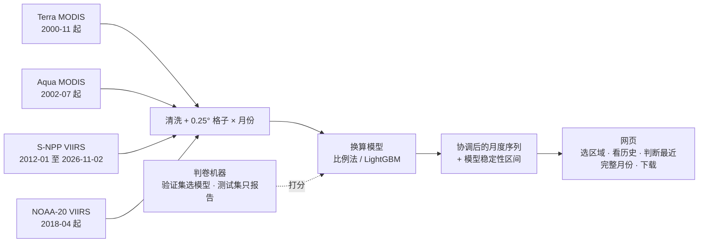

# MODIS × VIIRS 火点协调项目提案（Team Inspiratio）

Team Inspiratio · 2026-11-02

## 项目概览

**一句话：** 我们把卫星二十多年的火点记录“修”成一条前后可比的线，再做成一个网页：在地图上圈一个地方，就能看到那里 2001 年至今每个月的火点活动有多强（VIIRS 等效估计），以及最近一个完整月份是否异常。

**为什么需要：**

- 2012 年以前只有老一代卫星传感器 MODIS，之后有了看得更清楚的 VIIRS。VIIRS 数到的火点多得多。把两段直接拼起来，历史曲线会在 2012 年突然跳高，看上去像火变多了；其中一部分差异来自传感器更换，不能直接解释成真实火情增加。
- 2026 年正好是交接的关键时刻：S-NPP 卫星上的 VIIRS 在 11 月 2 日停止更新，MODIS 也将在 2026 年底到 2027 年初退役。不统一尺度，二十多年的火灾记录就在交接处断开了。

**我们怎么做，三步：**

1. **修数据。** 2012–2021 年两代传感器同时在工作。我们用这段时间训练一个模型，让它学会“老传感器看到这些，新传感器大概会数出多少”，再把这个换算用到 2012 年以前。
2. **证明修对了。** 留一部分两代传感器都有数据的时间不给模型看，最后拿来考试。模型在没见过的数据上也准，才算真的学会。
3. **做成工具。** 网页提供燃烧日历、最近月份的异常提示和数据下载，同时公开方法、考试成绩和协调后的数据集。

**最终交付：** 一套协调算法（代码）、一份公开的协调后数据集、一个网页、一份项目说明（proposal，即提交平台上的项目页）、一个 30 秒 Demo，以及验证报告。每一样的细节见“最终交付物”一节。

| 评分项 | 我们靠什么拿分 |
| --- | --- |
| Impact 影响力 | 面向消防和应急管理人员的具体决策：哪几个月要加强监测、最近一个完整月份是否异常 |
| Creativity 创意 | 以 LightGBM 为核心的协调模型，用 AI 自动优化在验证集上系统地改进，并公开全过程 |
| Validity 有效性 | 按“往回推”方向切分训练、验证、测试；测试集只在模型冻结后考一次；与简单比例法对照；引用已有研究 |
| Relevance 相关性 | 逐条实现题目点名的功能（见附录“题目要求与评分对照”） |
| Presentation 展示 | Demo 以一个真实地区为线索：选区域、看历史、判断最近月份、下载 |

本文前 7 节是主提案，回答“做什么、为什么、怎么做、怎么证明、交付什么”；后面的“附录：执行手册”是给队员的操作细节和全部技术限定条件。任务按依赖顺序列出，不排具体时间。

## 用大白话讲：这个项目在干什么

这一节不需要任何遥感背景。读完你应该能向朋友解释清楚：我们修的是什么、怎么修、怎么证明修对了。

### 1. 火点是什么

卫星上装着能“看见热量”的相机，每天大约两次飞过地球上同一个地方。它发现地面上某一小块比周围烫很多，就在那里记一个点，叫**火点**（hot spot）。

火点不等于一场火。一场大火会被记成很多个点；一场很小的火，或者被云挡住的火，可能一个点都没有。所以我们统计的是“检测到多少个火点”，用它描述卫星记录到的火点活动；它不能直接代表烧毁面积或灾害严重程度。

### 2. 两代相机为什么数出来不一样

想象你每年用体重秤称体重。2012 年换了一台更灵敏的新秤，它每次都比旧秤多显示一些。把 25 年的读数画成一条线，你会看到 2012 年突然“胖了”。其中既可能有真实变化，也可能有新秤带来的读数变化，需要把两者区分开。

卫星也一样：

- **看得更细。** 老相机（MODIS）一个像素约 1 公里，新相机（VIIRS）约 375 米。同一块火，在新相机里会被拆成更多个点。
- **小火看得见。** 很多农田烧秸秆、草地小火，老相机根本察觉不到，新相机能看到。
- **没有漏缝。** 老相机在赤道附近两次飞行之间有空隙，有些地方当天看不到；新相机拍得更宽，没有缝。
- **斜着看不模糊。** 老相机看画面边缘时，像素会被拉大好几倍，小火更容易漏掉；新相机这个问题小得多。

关键在于，**差多少不是一个固定倍数**。热带草原、北方森林、农田的差别都不一样，不同季节、不同角度也不一样。所以不能简单地“全部乘以 2”。

### 3. “修数据”到底怎么修

2012 年到 2021 年，两代相机同时在天上工作，就像有好几年你每天同时站上两台秤。这段时间就是我们的**标准答案**。

我们训练一个模型，给它看老相机记录的各种信息（看到几个火点、这些火有多强、在什么纬度、什么季节、看的角度多斜），让它预测新相机会数出多少个。学会以后，再把这个模型用到 2012 年以前、只有老相机的年份。

这里有一个硬性限制：**模型只能用老相机自己就有的信息当输入**。因为 2012 年以前根本没有新相机，任何依赖新相机的信息都用不了。

### 4. 怎么知道修对了

我们真正要做的是**往回推**：用后来学到的关系，去推算更早的年份。所以考试也往回考：开发时用 2016–2021 年训练、2014–2015 年做“模拟考”，用模拟考选定模型；选定后冻结，再预测锁住的 2012–2013 年。那两年两台相机都有真实数据，可以直接对答案。

这份正式考卷从头到尾锁起来，模型和 AI 都看不到，最后只考一次，用来如实报告成绩，不拿来挑模型。另外再留一个完全没参与训练的地区，考模型换个地方还准不准。

### 5. 用户最后看到什么

设想一位阿根廷的消防规划人员在 10 月打开我们的网页（示意情景）：

1. 她在地图上圈出科尔多瓦省。
2. 网页显示一张大表格：每一行是一年，每一列是一个月，颜色越深表示那个月火点越多。她一眼看出历史上哪些月份检测到的火点较多、哪些年份的火点活动偏高。
3. 一张卡片告诉她：最近一个完整月份的火点数（VIIRS 等效估计）是历史同月中位数的几倍，比历史上多少比例的同月都高。
4. 她把数据下载成表格，放进周报，结合气象、地面信息和现行工作流程，讨论监测安排。

### 6. 为什么现在做特别有意义

S-NPP 的 VIIRS 在 2026 年 11 月 2 日停止更新，MODIS 也即将退役。二十多年的卫星火灾记录正处在交接点上。把不同传感器的记录放到一致的统计尺度上，才能可靠地比较最近月份与长期历史。这正是题目要解决的问题，也是我们故事的开头。

## 最终交付物

除了算法、proposal 和网页，我们还要交一份公开的协调后数据集和一份验证报告。前者是争取 Best Use of Data 的核心证据，后者是 Validity 的核心证据。

| # | 交付物 | 它是什么 | 给谁用 | 对应任务 | 主要服务的评分项 |
| --- | --- | --- | --- | --- | --- |
| 1 | 协调算法（代码仓库） | Python 代码：从下载数据到生成协调结果，一条命令可复现 | 评委、科学家、以后的开发者 | A2–B6、D3 | Validity |
| 2 | 协调后数据集 | 格子 × 月份的表格，附来源与质量标记；估计段附模型稳定性区间，公开下载 | 研究人员、其他开发者 | B6、D2 | Best Use of Data |
| 3 | 数据说明卡 | 一页说明：数据从哪来、怎么处理、每列含义、误差多大、哪里不该用 | 数据使用者 | D2 | Validity |
| 4 | 网页 | 地图圈选、燃烧日历、最近月份异常、下载、方法与验证页 | 应急管理人员、评委 | C1–C7 | Impact、Relevance、Presentation |
| 5 | 验证报告 | 网页“方法与验证”页上的图和分数表 | 评委 | D1 | Validity |
| 6 | Proposal（项目页） | 提交平台上的项目说明文字，相当于对外的方案书 | 评委 | D4 | 全部 |
| 7 | Demo | 30 秒英文字幕视频，或不超过 7 页的英文幻灯片 | 评委 | D5 | Presentation |
| 8 | AI 使用说明 | 用了哪些 AI 工具、做了什么、试了多少种方法、人怎么审核 | 评委（2026 年必填） | B4、D4 | 规则要求 |
| 9 | 可复现笔记本（加分项） | 一个 Colab 笔记本，评委点开就能复现关键图 | 评委、科学家 | D3 | Best Use of Data、Validity |
| 10 | 本文 | 内部执行手册 | 队员 | 无 | 无 |

交付物之间的关系：算法（1）生成数据集（2）；数据集喂给网页（4）；验证报告（5）证明数据集可信；proposal（6）和 Demo（7）把以上内容讲给评委听。

## 方案：用机器学习把历史统一到 VIIRS 尺度

核心是一个 LightGBM 模型：输入是历史时期就能获得的 MODIS 信息和固定地理信息，输出“这个格子这个月，S-NPP VIIRS 大概会数到多少个火点”。

| 时期 | 数据来源 |
| --- | --- |
| 2000-11 至 2002-06 | 只有 Terra MODIS，先换算到 Aqua 尺度再用模型估计，标为低置信度 |
| 2002-07 至 2012-01 | Aqua MODIS 输入模型得到的估计值（2012 年 1 月 S-NPP 只有部分数据，整月仍用估计） |
| 2012-02 至 2026-10 | S-NPP VIIRS 实测计数，不换算 |
| 2026-11 起 | NOAA-20 VIIRS 计数换算到 S-NPP 尺度（通过检验才宣称连续） |

**模型看什么：** MODIS 火点数、火点强度（FRP）的分布、像元尺寸（反映观测角度）、纬度、月份、夜间火点占比、周围格子的火点数。年份、地区名称和任何 VIIRS 信息都不能作为输入。

**三个必做版本：**

| 版本 | 做法 | 作用 |
| --- | --- | --- |
| 直接拼接 | 2012 年前用 MODIS，之后用 VIIRS，不做任何换算 | 展示传感器差异造成的问题 |
| 简单比例 | 按格子和月份，看重叠期 VIIRS 平均是 MODIS 的几倍，就乘几倍 | 容易理解的对照基线和保底方案 |
| LightGBM | 机器学习模型，学习上述输入与 VIIRS 火点数之间的复杂关系 | 项目的主要协调模型 |

简单比例法有一个明显盲区：MODIS 看到 0 个火点时，它只能预测 0，补不出 MODIS 漏掉的小火。LightGBM 能利用周围格子和火的强度等信息处理这种情况，这是用机器学习的主要理由。

**扩展项（时间够再做）：** 负二项回归（更好解释）、LightGBM 与回归的集成、只保留强火的“共同门槛”对照。

**AI 自动优化：** 用 autoresearch 类框架，在验证集上自动尝试 LightGBM 的特征和参数，预算为最多 150 次实验或 8 小时（先到为准）。项目价值体现在模型比简单比例法改进了多少；实验次数只是过程记录。

**每个输出值都附带来源标记**（实测、估计、低置信度、近实时、缺测）；估计段另附模型稳定性区间。所有结果统称“历史火点活动（VIIRS 等效估计）”，不代表火灾次数、烧毁面积或灾害严重程度。区间的确切含义和限制见附录“生成最终序列”。

## 验证：怎么证明模型可信

最主要的证据是：在两代传感器都有数据、但模型没见过的年份里，只给模型 MODIS 输入，看它预测的 VIIRS 火点数和真实 VIIRS 差多少，并与简单比例法比较。

| 数据 | 时间（训练区域） | 用途 |
| --- | --- | --- |
| 训练集 | 2016-01 至 2021-06 | 训练模型 |
| 验证集 | 2014-01 至 2015-12 | 选特征、参数和最终模型；AI 自动优化只看这里的分数 |
| 测试集（锁住） | 2012-02 至 2013-12，外加一个完全留出的地区 | 模型冻结后考一次，如实报告，不用于任何选择 |

验证集和测试集都比训练集更早，因为真实任务就是“用较晚的关系推算更早的年份”。

**三条原则：**

1. **选模型只看验证集。** 测试集哪怕只被用来“从几个模型里挑最高分”，报告出来的成绩也会偏乐观。
2. **测试成绩照实写。** 即使 LightGBM 在测试集上不如预期，也如实报告，并与简单比例法并列。
3. **不要求“2012 年的台阶消失”。** 真实火情本来就可能逐年变化。协调后的曲线出现变化是正常的，只要模型在留出年份上预测准确即可。

**除了主分数，还单独报告：** VIIRS 记录为 0 的区域-月份里模型给出正估计的比例、火点很少的月份的误差、区域总量的偏差。

细节见附录“验证体系”。

## 网页成果

网页围绕一条连续的使用流程：**选区域 → 查看协调后的历史 → 判断最近一个完整月份是否异常 → 下载结果。** 机器学习负责估计历史时期的 VIIRS 等效火点数，网页负责让用户用上这条历史记录。

1. **选区域：** 在地图上画框或多边形，输入经纬度，或点选预设示范区域。
2. **看历史：** 燃烧日历，每行一年、每列一月，颜色深浅表示火点活动强弱；鼠标悬停可看数值、来源标记和稳定性区间；可切换“协调后 / 直接拼接”对比。
3. **判断最近月份：** 一张卡片显示最近一个完整月份相对历史同月中位数的倍数和历史百分位，并用“偏高 / 正常 / 偏低”的文字说明。
4. **下载：** 月度结果 CSV、区域内原始火点 CSV、日历图片。

不做未来火灾预测：核心成果已经完整，预测会分散精力，也超出题目要求。

## 实施范围

先保证必须完成的部分全部做完，再做加分项。

| 层级 | 内容 |
| --- | --- |
| 必须完成 | 数据下载、清洗和网格化（A1–A5）；判卷机器（B1）；直接拼接与简单比例（B2）；LightGBM 与 AI 自动优化（B4）；冻结模型与最终测试（B5）；生成数据集（B6）；网页核心流程（C1–C5、C7）及最简方法与验证说明（C6）；验证报告（D1）；数据集发布（D2）；代码仓库（D3）；proposal（D4）；Demo（D5） |
| 加分项 | 负二项回归与集成（B3）；预测区间；Colab 笔记本；Zenodo DOI；土地覆盖特征；方法页的扩展交互 |
| 明确不做 | 未来火灾预测；烧毁面积或灾害严重程度估计；全球任意区域的实时计算 |

简单比例法（B2）一做完，就先用它生成一版完整数据交给网页，保证无论机器学习进展如何，项目都能完整交付。

# 附录：执行手册

以下是给队员的执行细节：题目要求对照、奖项、数据、科学背景、算法与验证细节、AI 优化、网页、逐项任务、提交物、风险和参考资料。

## 题目要求与评分对照

官方题目是 [Harmonization of MODIS and VIIRS Hot Spots](https://www.spaceappschallenge.org/2026/challenges/modis-and-viirs-hot-spots/)，难度 Intermediate / Advanced，学科 Earth Science + Software。官方建议分两部分：先协调数据，使“来自哪个传感器”不再重要；再做一个以协调后数据为输入的网页应用。

| 题目要求或建议 | 必须/可选 | 我们的实现 | 对应评分项 |
| --- | --- | --- | --- |
| MODIS 与 VIIRS 火点协调成一致的时间序列 | 必须 | 任务 A3–A4、B1–B6 | Validity |
| 网页应用，以协调后数据为输入 | 必须 | 任务 C1–C7 | Relevance |
| 用户选区域和日期范围 | 必须 | 地图圈选 + 经纬度输入 + 日期滑块 | Relevance |
| 燃烧活动日历：2000 年代初至今每月火点数 | 必须 | 月×年热力图 | Relevance, Impact |
| 哪些月份火多、哪些年份火多、最近完整月份与有效历史同月比较 | 必须 | 月度中位数行 + 年度合计列 + 最近完整月份卡片 | Impact |
| 用颜色渐变表示差异 | 建议 | 色盲友好的顺序色带 | Presentation |
| 下载分析结果与可视化 | 建议 | CSV 下载 + 图片导出 | Relevance |
| 下载检索范围内的火点 CSV | 建议 | 原始火点和月度汇总两种 CSV | Relevance |
| 交互式地图，可画区域或输入经纬度 | 可选 | 两种都做 | Presentation |
| 无障碍配色 | 可选 | 默认用色盲友好色带 | Presentation |
| 与多年平均比较的异常、检测火点数 | 可选 | 异常 = 当月值相对历史同月中位数的比值 | Impact |

**评分标准（按 2025 年版本，2026 年版 11 月 13 日发布后需核对）：** Impact、Creativity、Validity、Relevance、Presentation 五项。评审分三层：Universal Event 评委选出 Global Nominees，NASA 与合作机构专家选出 Global Finalists 和 Honorable Mentions，执行委员会选出 10 个 Global Winners。

**与本题最相关的奖项：** Best Use of Data、Best Use of Science、Galactic Impact、Local Impact（[奖项说明](https://www.spaceappschallenge.org/awards/)）。

**硬性规则（来自 [Participant FAQs](https://www.spaceappschallenge.org/resources/participant-faqs/)）：**

- Universal Event 队伍至少 2 人才有全球评审资格，每队最多 6 人。
- 提交在队伍页面的 Project 标签页完成，11 月 14 日 9:00 开放，11 月 15 日 23:59（活动当地时间）截止。
- 必须说明开发过程中如何使用了 AI 工具（2026 年官方称为 Super Intelligence, SI）。
- 官方规定比赛开始前不得开始做项目；挑战资源 11 月 13 日发布。

## 奖项：评委怎么选，我们怎么争取

奖项不能报名。评委先按五项标准挑出最好的一批项目，最后由执行委员会决定每个奖项给谁。所以我们的策略是：五项都做扎实，同时让“数据用得好”和“科学做得严”这两点特别突出。

### 评选流程

1. **活动评委（Universal Event）** 选出进入全球评审的项目，称为 Global Nominees。
2. **NASA 与合作机构的专家** 评审所有 Nominees，选出 Global Finalists 和 Honorable Mentions。
3. **执行委员会**（NASA 与合作机构的领导）从 Finalists 中选出 10 个全球冠军，每个奖项一个（[奖项说明](https://spaceappschallenge.org/2025/awards)）。

官方没有公开每个奖项的具体打分细则。2026 年的评审指南 11 月 13 日发布，届时再看是否有更多细节。下面的对应关系是我们根据官方定义做的理解。

### 与本项目最相关的四个奖项

| 奖项 | 官方定义 | 我们拿什么证明 |
| --- | --- | --- |
| Best Use of Data | 最好地让太空数据变得易于使用，或把它用于独特应用 | 把 4 颗卫星、二十多年的火点变成“圈一下就有”的日历；公开协调后数据集和说明卡；可复现笔记本 |
| Best Use of Science | 最好、最有效地运用科学或科学方法 | 倒着考的验证设计、锁住的测试集、年代偏移检查、不确定性区间、诚实列出局限 |
| Galactic Impact | 最有潜力改善地球或宇宙中的生活 | 应急管理人员可以据此安排巡逻和资源 |
| Local Impact | 对某个地方影响潜力最大 | 用一个具体地区（例如阿根廷）的完整故事展示 |

### 往年 Best Use of Data 得主

- **2025 年 Resonant Exoplanets**：自动分析大量望远镜和卫星数据，寻找系外行星并检测可能的生命迹象（[NASA 公告](https://www.nasa.gov/?p=939125)）。
- **2022 年 Starflock**：用 NASA 航空观测数据研究野火烟雾的化学成分是否随地点变化（[Space Apps 博客](https://www.spaceappschallenge.org/blog/2022-global-winners/)）。

我们从中看到的共同点：把大量 NASA 数据加工成别人原本拿不到的东西，而且加工过程本身有分量。这是我们的理解，不是官方说法。

### 让“Best Use of Data”一眼可见的具体做法

- **数清楚用了哪些数据。** 项目页列出每个 NASA 数据集（MODIS Terra、MODIS Aqua、VIIRS S-NPP、VIIRS NOAA-20、可选的 NOAA-21 和 MODIS 土地覆盖、FIRMS 缺测清单），各写一句它起什么作用。
- **用数字说话。** 在项目页和 Demo 里给出：处理了多少个火点、覆盖多少年、几个卫星、测试集误差多少。数字在任务 D1 完成后填入。
- **让别人能接着用。** 协调后数据集公开下载，附说明卡和可复现笔记本。评委不只是看到一个网页，而是看到一份可以被别人继续使用的数据产品。
- **讲清楚时机。** S-NPP 刚停、MODIS 将退役，这个项目恰好让火灾记录在交接时不断档。这句话放在 Demo 的前 5 秒。
- **方法页展示数据流。** 用流程图画出数据从卫星到日历经过的每一步。

## 数据

所有核心数据都来自 NASA FIRMS 的[存档下载](https://firms.modaps.eosdis.nasa.gov/download/)，现在就公开可下载，格式可选 CSV、shapefile 或 JSON。

| 数据集 | 覆盖时间 | 像元 | 过境时间 | 在本项目中的角色 |
| --- | --- | --- | --- | --- |
| MODIS Collection 6.1（Terra + Aqua） | 2000-11-01 至今 | 1 km | Terra 上午、Aqua 下午约 13:30（2021 年起漂移） | 2001–2011 年唯一的历史来源 |
| VIIRS S-NPP 375 m | 2012-01-20 至 2026-11-02 | 375 m | 下午约 13:30 | 与 Aqua 配对学换算关系 |
| VIIRS NOAA-20 375 m | 2018-04-01 至今 | 375 m | 与 S-NPP 同轨道面，相隔约 50 分钟 | S-NPP 停止后的延续 |
| VIIRS NOAA-21 375 m | 2023-03-01 至今 | 375 m | 同上 | 备用和交叉检查 |

### 三条会改变设计的最新情况

1. **S-NPP 已停止更新。** FIRMS 的 S-NPP 数据在 2026 年 11 月 2 日 15:40 UTC 停止向用户提供（以 NOAA 10 月 30 日的最终通知为准，早先公告为 13:00），历史数据继续可下载，官方建议改用 NOAA-20 和 NOAA-21（[FIRMS 说明](https://www.earthdata.nasa.gov/news/blog/transitioning-from-suomi-npp-viirs-omps-what-firms-users-need-know)）。所以我们的“VIIRS 统一尺度”必须把 S-NPP 和 NOAA-20 接起来，不能只用一颗卫星。
2. **MODIS 即将退役，而且轨道在漂移。** NASA 说明 Terra 和 Aqua 将在 2026 年底到 2027 年初陆续停止运行，两颗卫星都已偏离设计轨道（[Earthdata 公告](https://www.earthdata.nasa.gov/data/alerts-outages/transition-from-modis-viirs)）。Aqua 于 2021 年 7 月开始向更晚的过境时间漂移（[LAADS 公告](https://ladsweb.modaps.eosdis.nasa.gov/alerts-and-issues/171807)）。因此 Aqua 和 S-NPP“同一时间看同一地方”的最佳窗口是 **2012 年 1 月至 2021 年 6 月**，换算关系主要从这段学。
3. **最近几个月只有近实时数据。** 近实时（NRT）数据大约 5 个月后才被科学质量的标准数据替换。历史分析用标准数据；最近几个月用 NRT 补上，并在网页上标注。

### CSV 字段与用法

| 字段 | 含义 | 我们怎么用 |
| --- | --- | --- |
| latitude, longitude | 火点像元中心 | 判断是否在用户选的区域内；网格化 |
| acq\_date, acq\_time | 观测日期；时间为 UTC 的 HHMM，前导零会被省略 | 按月汇总；配对时比较时间差 |
| satellite | MODIS 为 T（Terra）或 A（Aqua）；VIIRS 区分 S-NPP、NOAA-20、NOAA-21 | 分卫星统计，Terra 与 Aqua 分开处理 |
| confidence | MODIS 为 0–100；VIIRS 为 low / nominal / high | 过滤低置信度，作为可调参数 |
| scan, track | 像元实际尺寸（km） | 作为观测角度的替代指标（CSV 不含观测天顶角） |
| frp | 火辐射功率（MW） | 按强度阈值对齐两传感器的探测能力 |
| daynight | D = 白天，N = 夜间 | 白天和夜间分别建换算关系 |
| type | 0 植被火、1 火山、2 其他固定热源、3 水上；仅标准数据有 | 只保留 0，去掉工厂、气田等固定热源 |

字段定义见 [FIRMS 属性说明](https://earthdata.nasa.gov/data/tools/firms/active-fire-data-attributes-modis-viirs)。

### 下载方式

1. **存档下载（主力）：** 用 Earthdata 账号或邮箱验证码登录，选国家或自定义区域，选数据源和日期，选 CSV。提交后系统处理完会发邮件给下载链接，所以要提前提交。
2. **API（补最近几天，以及网页里的实时查询）：** 免费申请 [MAP\_KEY](https://firms.modaps.eosdis.nasa.gov/api/map_key/)；接口形如 `/api/area/csv/{MAP_KEY}/{SOURCE}/{西,南,东,北}/{天数}`，限额为每 10 分钟 5,000 次事务，多天查询会按天计次。
3. **缺测日期清单：** FIRMS 提供官方缺测日期接口（`/api/missing_data/`）。缺测月份在日历里必须显示为“无数据”，不能当成 0。

### 示范区域（建议选 2–3 个，团队定）

| 候选区域 | 选它的理由 |
| --- | --- |
| 美国加州 | 野火季节明显，评委熟悉，有大火年份可讲故事 |
| 阿根廷（如巴拉那河三角洲或科尔多瓦） | 题图来自阿根廷航天局 CONAE，草地和湿地火常见 |
| 非洲南部或澳大利亚北部稀树草原 | 火点数量大、季节性强；位于 MODIS 赤道附近的观测缝隙带，最能体现协调的必要性 |

选区域时注意：Aqua MODIS 在南北纬 30° 之间每天有轨道间缝隙会漏火，而 VIIRS 幅宽 3,000 km 没有缝隙（[Li 等 2018](https://repository.library.noaa.gov/view/noaa/49896/noaa_49896_DS1.pdf)）。低纬度区域的两传感器差异会更大。

## 科学背景：两个传感器为什么数不一样

VIIRS 比 MODIS 多数到火点，主要因为像元更小、像元大小随观测角度变化小、没有轨道缝隙。这个差距不是一个固定倍数，它随观测角度、纬度、生态系统和白天夜间而变，所以不能用一个全球统一的系数一换了之。

| 差异来源 | 已有研究的结论 | 对我们协调方法的含义 |
| --- | --- | --- |
| 像元大小随角度变化 | MODIS 像元在扫描边缘可放大到约 9.67 倍；VIIRS 375 m 像元从约 0.36×0.38 km 增到 0.78×0.80 km（[Zheng 等 2026](https://mdpi-res.com/d_attachment/remotesensing/remotesensing-18-01650/article_deploy/remotesensing-18-01650.pdf)） | 用 CSV 里的 scan × track 区分近天底和边缘观测 |
| 最小可探测火 | MODIS 最小 FRP 从天底约 4.1 MW 升到边缘 33.6 MW 以上；VIIRS 只从约 1.4 MW 升到 2.2 MW（同上） | 可以只保留 MODIS 也看得到的强度以上的 VIIRS 火点，对齐探测门槛 |
| 火点数随角度衰减 | MODIS 火点数从天底到 60° 观测角下降 67%，VIIRS 基本稳定（[Li 等 2018](https://repository.library.noaa.gov/view/noaa/49896/noaa_49896_DS1.pdf)） | 换算系数要允许随区域内的观测几何不同而不同 |
| 赤道附近的轨道缝隙 | Aqua MODIS 在南北纬 30° 之间漏掉轨道间的火；去重后 VIIRS 火点数在热带比 MODIS 多约 70%（同上） | 低纬度区域的换算系数应明显更大，按区域分别估计 |
| 重复检测 | MODIS 相邻扫描的重复检测最多占火点数 9.8%，VIIRS 最多 5.4%（同上） | 统计前先去重，或至少在格网上计“有火的格子数” |
| 生态系统 | 农田和稀树草原中两者 FRP 差约 1%；北方森林大火中 VIIRS FRP 明显偏低，与烟羽中 CO₂ 吸收有关（同上） | 按区域、按月份分别建关系，北方森林要特别检查 |
| 过境时间 | Terra 上午过境；Aqua–S-NPP 的换算系数不应直接套用到 Terra（[Zheng 等 2026](https://mdpi-res.com/d_attachment/remotesensing/remotesensing-18-01650/article_deploy/remotesensing-18-01650.pdf)） | 主线只用 Aqua 与 VIIRS 配对；Terra 单独处理或作为补充 |

**已有的融合研究能给我们什么。** Zheng 等 2026 年用 2012–2024 年的 Aqua MODIS 和 S-NPP VIIRS 做了“先校正、后融合”：去重、在 MODIS 像元内配对（时间差不超过 5 分钟）、云校正、按观测角校正 FRP，再以 VIIRS 优先融合。融合后火点像元约为原 MODIS 的 3.82 倍。他们关注的是 FRP，我们关注的是**月度火点数**，但这些步骤提供设计参考；采用前需确认输入字段和目标一致。只有火点 CSV 时，不能声称已复现其像元配对、云校正或扫描去重。

**现有工具做到哪一步。** 欧盟的 GWIS 会把 VIIRS 和 MODIS 的热异常数**分别**与过去 10 年平均比较（[GWIS 应用说明](https://gwis.jrc.ec.europa.eu/applications)）；阿根廷 CONAE 有 MODIS/VIIRS 火点目录。本项目的交付重点是示范区域的长期协调序列、可复现的评估和可下载的结果；我们不据此声称其他工具都没有类似功能。

**一个必须对评委讲清楚的前提：** 一个火点不等于一场火，一场大火可能产生很多火点。我们的日历统计的是“检测到的火点数（VIIRS 等效）”，不是“火灾次数”。

## 协调算法与方法选择

最佳方案是：用 Aqua MODIS 与 S-NPP VIIRS 同时在轨的数据，训练一个**只看 MODIS 自身信息、就能预测 VIIRS 月度火点数**的模型。2012-02 至 2026-10 使用 S-NPP 单星观测计数；此前由 MODIS 估计；2026-11 起使用换算到 S-NPP 尺度的 NOAA-20 单星计数。候选模型从简单比例到机器学习，由同一台判卷机器打分，最终用哪一个由验证集决定，测试集只用于最终报告。



上图是从 4 个数据源到网页的完整流程。换算模型只在 Aqua 与 S-NPP 同时下午过境的年份训练，判卷机器在旁边给每个候选模型打分；S-NPP 完整月份保留观测计数，NOAA-20 接续月份需要单独校准。

### 为什么输入只能用 MODIS 的信息

模型最终要用在 2002–2011 年，那时只有 MODIS。所以训练时的输入特征必须是“2012 年以前也算得出来的东西”。下表把两代传感器的每一种差距，对应到一个能代表它的特征：

| 差距来源 | 能代表它的特征（2012 年以前也能算） |
| --- | --- |
| 小火 MODIS 看不见 | 该格子该月 MODIS 火点的 FRP 分布：中位数、75 分位数、低 FRP 火点占比 |
| 斜着看更模糊 | MODIS 火点的平均像元尺寸（scan × track） |
| 赤道附近轨道缝隙 | 纬度 |
| 火的类型不同（农田、草原、森林） | 纬度等地理信息；可选：对应年份的 MODIS 土地覆盖类型（MCD12Q1，2001 年起有）。不使用地区名称编码 |
| 季节不同 | 月份 |
| 白天、夜间差别 | 夜间火点占比 |
| 火多与火少时比例不同 | MODIS 火点数本身、有火天数、周围 8 个格子的 MODIS 火点数之和 |

**绝对不能当特征的：** 年份（模型会学到“2014 年以后是什么样”，往回推时出错）、地区名称（留出地区在训练时没出现过），以及任何来自 VIIRS 的信息。

### 基本单位与数据准备

- **网格：** 0.25° × 0.25°（赤道附近约 28 km）。太小则很多格子只有几个火点，噪声大；太大则用户圈选时边缘误差大。
- **时间：** 自然月，统一按 UTC 聚合。先为每颗卫星保存原始计数，再应用固定的筛选规则。
- **0 的含义：** 格子-月份里没有火点记录，就记为 0，意思是“没有记录到火点”，不是“确定没有火”：云、烟或观测间隔都可能造成漏检，仅凭火点 CSV 无法判断。官方缺测日期所在的月份单独标记为“缺测”（或按缺测天数标为“部分缺测”），不当作 0 参与训练和评分。
- **质量控制：** 只保留植被火（`type = 0`）；去掉低置信度检测。近实时数据若缺少 type，只使用有独立来源和版本记录的固定热源掩膜；没有可靠掩膜时保留，并标为“热源分类未校验”。不能把频繁出现的热点一律当作固定工业热源。
- **去重（主线）：** 只合并重复下载的记录：按卫星、观测日期和分钟、经纬度识别；标准与近实时产品重复时优先保留标准产品，并记录来源。相邻像元即使在同一分钟，也可能是不同的真实检测，不能仅凭距离删除。扫描重叠去重只作为扩展，必须有扫描标识或像元几何等依据，并报告与主线结果的差异。不同过境时刻的检测一律保留。
- **空格子的特征：** 没有 MODIS 检测时，计数、有火天数和邻格计数照常计算；FRP 分位数、平均像元尺寸和夜间占比记为缺失，并加“无检测”标记，不能填成有效的物理观测值。LightGBM 直接处理缺失值；其他模型的填补参数只从本次训练数据学习。
- **留出地区：** 该地区全部 VIIRS 标签、比值和诊断图在模型冻结前都不可用于选方法。新地区的 M1s 回退到只由训练地区估计的合并月份比例；主模型不依赖地区名称或当地 VIIRS 校准。邻域特征预留缓冲边界，避免边界外缺失被当成 0。
- **四条原始序列：** A = Aqua MODIS（2002-07 起）；T = Terra MODIS（只用来补 2002-07 以前）；V = S-NPP VIIRS（2012-01 至 2026-11-02）；N = NOAA-20 VIIRS（2018-04 起，用于接续 S-NPP）。

### 候选模型

| 编号 | 方法 | 大白话 | 层级 |
| --- | --- | --- | --- |
| M0 | 直接拼接 | 2012 年前用 MODIS，之后用 VIIRS | 必做：展示问题 |
| M1s | 简单比例（带收缩） | 看重叠期 VIIRS 平均比 MODIS 多几倍，就乘几倍；火点少的格子向区域平均靠拢 | 必做：对照基线和保底方案 |
| M3 | LightGBM | 机器学习模型，学习特征之间复杂的组合规律 | 必做：主要协调模型，AI 自动优化的对象 |
| M2 | 负二项回归 | 比例随特征变化，每个特征有一个可读的系数 | 扩展 |
| M5 | 集成 | M2 与 M3 的预测按验证集成绩加权平均 | 扩展 |
| M4 | 共同门槛 | 只保留 MODIS 也看得到的强火，两边按同一标准数 | 扩展：物理对照 |

M1s 的比例（g 为格子，c 为日历月，R 为区域，λ 为收缩强度，求和只在训练年份上进行）：

```latex
k_{g,c} = \frac{\sum_{y} V_{g,c,y} + \lambda \, k_{R,c}}{\sum_{y} A_{g,c,y} + \lambda}
```

M1s 的预测为 Ĥ = k × A。k\_R,c 只从当前训练地区合并估计：训练格子使用局地收缩比例，新地区直接使用 k\_R,c。A = 0 时比例基线仍然预测 0，这是它的限制；收缩只能稳定比例，补不出 MODIS 完全漏掉的火点。训练月份的分母为 0 时，回退到更宽的季节或全局训练比例，并记录原因。

扩展项 M2 的形式（x 为上表的特征，μ 为预测的 VIIRS 月度火点数，θ 为离散参数）：

```latex
\log \mu_{g,t} = \log(A_{g,t} + 0.5) + \beta_0 + \boldsymbol{\beta}^{\top}\mathbf{x}_{g,t} + \gamma_{\text{month}}, \quad V_{g,t} \sim \text{NegBin}(\mu_{g,t}, \theta)
```

**M3 的关键设计，以及每一项的理由：**

- **直接预测火点数，用 Poisson 或 Tweedie 目标函数。** Poisson 是计数任务的自然起点；Tweedie（1 < p < 2）适合含大量 0 的非负数据，可作为候选，但它不是专为整数计数设计的。两者由固定的验证方案比较，输出允许是非整数期望值。区域加总后是否有偏，不做保证，而是在验证集上用区域总量偏差检验。直接预测数量，还能处理“MODIS 看到 0 个、VIIRS 看到很多小火”的格子，这是比例法做不到的。
- **对 MODIS 火点数加单调约束。** MODIS 看到的火越多，预测的 VIIRS 火点数不应变少。这能防止模型学到怪规律，也更容易向评委解释。
- **树要浅、叶子要大。** 例如每棵树最多 15–31 个叶子、每个叶子至少 50 条数据，防止背答案。
- **用验证结果解释模型。** 特征重要性描述模型依赖哪些输入；再结合删减特征实验和预测关系图检查规律。与论文方向一致只能作为合理性线索，不能替代独立测试，也不能解释成因果证据。

**选用规则：** 只在验证集上比较。LightGBM 满足附录“验证体系”中的选定规则，就用 LightGBM（若做了集成且更好，就用集成）；否则用简单比例法 M1s。选定后模型冻结，再到测试集上考一次并如实报告。M1s 做完时项目就已经可以交付，之后的一切都是加分。

### 生成最终序列

- **2012-02 至 2026-10：** 使用 S-NPP 单星、同一质量控制下的完整月计数。
- **2026-11 起：** 整月统一使用 NOAA-20，再换算到 S-NPP 尺度；不把 11 月 1–2 日的 S-NPP 与其余日期的 NOAA-20 相加。任何月份都不把多颗 VIIRS 卫星的计数相加。接续比例的估计和检验见下一小节；只有通过检验才宣称连续，否则网页把 NOAA-20 段单独显示，并标注跨段比较受限。
- **2002-07 至 2012-01：** 用选定模型的估计值。2012-01 的 S-NPP 只覆盖部分月份，不用来替代整月估计，也不作为完整月训练标签。
- **2000-11 至 2002-06：** 只有 Terra。先用当前训练阶段允许使用的 Terra 与 Aqua 重叠年份，按 M1s 学“Terra → Aqua”的比例，再接上述模型。网页标注为低置信度。
- **模型稳定性区间（必做）：** 按年份做块状重采样：每次随机重抽训练年份、重训模型，重复约 100 次；每次先把格子加总成区域总量（或月份总量），再取 5% 和 95% 分位数。它表示“换一批训练年份，估计值会变动多少”，不是完整误差范围：不包括漏检、长期分布变化，以及 Terra 桥接和 NOAA-20 接续的误差，也不表示真实值有 90% 的可能落在其中。预设示范区域给出完整区间；自定义区域保存约 20 个重采样版本（只存非零值）在前端加总，文件过大时只显示估计值并注明。
- **预测区间（加分项）：** 若要构造观测值的预测区间，需要从开发数据中另留校准数据，不能同时反复调参和校准；可比较分位数回归或按时空分组的校准方法，并在锁住的测试集上报告实际覆盖率。常规保形预测的覆盖保证依赖可交换性等条件，不能直接承诺适用于跨年代往回推。
- **上线版本：** 测试成绩报告之后，再用训练地区 2012-02 至 2021-06 的全部重叠数据重新训练一次作为上线版本；报告的测试成绩只属于重训前的冻结模型。

### 接续和桥接的隔离

- 评估版本的所有比例、收缩参数、填补值和校准，都只使用相应的训练部分；锁住地区不估计当地比例，也不看它的 VIIRS 图。上线版本可在已声明的范围内重新拟合，来源标签照常保留。
- **NOAA-20 → S-NPP 接续比例：** 先在开发地区较早的完整重叠年份拟合，再用较晚的完整年份检验月总量偏差和季节稳定性，并按白天、夜间检查。排除故障月和不完整月；稀疏格子向训练地区的合并月份比例收缩，样本不足时不报告局地比例。选 NOAA-20 而不是 NOAA-21，是因为它与 S-NPP 的重叠期更长（8 年多对 3 年多）；这只是工程上的理由，是否准确由上述检验决定。

### 从格子到用户区域

- 预先算好每个格子每个月的协调值。用户圈一个区域时，把落在区域内的格子加总；格子与边界部分重叠时，按重叠面积比例分配。这假设格子内的火点均匀分布，是一种近似：小范围圈选可能有明显边界误差。对小于一个格子的区域，只给近似总量并提示这个限制。
- 原始火点 CSV 下载直接按用户区域过滤点数据，不受格子影响。

### 异常指标

- **只评价已结束的完整月份。** 当月尚未结束时，只显示“截至某日的累计火点数”，不给异常结论。
- **最近月份异常倍数** = 该月估计值 ÷ 历史同月中位数。
- **历史百分位：** 只与目标年份之前、同一日历月、且完整可用的年份比较，目标月份不加入自己的参考集。设参考值为 x₁…xₙ、目标为 h，百分位 = 100 × \[小于 h 的个数 + 0.5 × 等于 h 的个数\] ÷ n，并显示参考年数。
- **活动等级：** 有至少 10 个有效同月年份时，百分位 ≥ 90 记“偏高”，≤ 10 记“偏低”，其余记“正常”（即处于历史常见范围）。这是描述性分级，不是统计显著性检验，也不是灾害风险等级。少于 10 个有效年份时不判等级，只显示数值并注明“历史不足”。
- **中位数为 0 或很小时（例如小于 5）：** 不显示倍数，只显示百分位，并说明“该月历史上通常很少记录到火点”。
- **缺测：** 目标月份部分缺测时，显示已有计数、缺测日期和“覆盖不完整”，不判等级；参考月份也排除已知覆盖不完整的年份。云和烟造成的漏检无法校正，列为局限。
- **近实时数据：** 最近月份若来自近实时数据，标注“初步结果”。
- **基准期可切换：** 默认从 2001 年起、取目标年份之前的有效同月记录；也可只用 2012-02 至 2026-10 的 S-NPP 完整月份，这样不依赖 MODIS 估计，也不包含 NOAA-20 接续换算。页面同时显示基准期、数据版本、参考年数和截至日期。
- **措辞：** 一律写“火点活动偏高 / 正常 / 偏低（VIIRS 等效估计）”，不写成火灾次数、烧毁面积或灾害严重程度。

## 验证体系（“判卷机器”）

数据分成三份：训练集用来训练；验证集用来选特征、参数和最终模型，AI 自动优化也只看它；测试集在模型冻结后只考一次，如实报告，不参与任何选择。因为真实任务是往回推，验证集和测试集都比训练集更早。

### 为什么这么严格

两代传感器同时在轨、可以当标准答案的时间只有 2012-01 到 2021-06 约 9 年半。同一年里各个格子会一起变化，相邻格子之间也相关，所以不能把大量格子行数当作同等数量的独立样本；真正的“经验量”取决于时间、空间和火情的相关结构，远少于行数。

机器学习容易把这几个火季的偶然特点背下来；AI 优化会试很多方案，从中挑最好的这一步本身也会“碰运气”。所以选择只能在验证集上做。测试集一旦被用来挑模型，哪怕每个模型只考一次、最后挑了最高分，报告出来的成绩也会偏乐观（[scikit-learn 关于嵌套交叉验证的说明](https://scikit-learn.org/stable/auto_examples/model_selection/plot_nested_cross_validation_iris.html)）。

### 数据怎么切

| 用途 | 训练时间 | 验证/测试时间 | 空间 | 用来做什么 |
| --- | --- | --- | --- | --- |
| 主验证窗口 | 2016-01 至 2021-06 | 2014-01 至 2015-12 | 训练区域 | 选特征、参数和最终模型；AI 自动优化的打分依据 |
| 辅助倒推窗口 | 2018-01 至 2021-06 | 2016-01 至 2017-12 | 训练区域 | 检查选出的模型在另一段年份是否同样稳定；按地区和完整年份汇总 |
| 测试 1（锁住） | 2014-01 至 2021-06 | 2012-02 至 2013-12 | 训练区域 | 模型冻结后考一次，只报告 |
| 测试 2（锁住） | 2014-01 至 2021-06 | 2012-02 至 2021-06 | 一个完全留出的区域 | 同上，检验换个地方是否仍然可用 |

两个验证窗口的训练期都至少有 3.5 年，并且都是“用较晚年份推较早年份”，与真实任务方向一致。

**流程：**

1. 候选模型按两个验证窗口拟合和比较，选定并冻结最终模型（包括特征、参数和树的轮数）。
2. 用训练区域 2014-01 至 2021-06 的数据重新训练这个冻结的模型，在两份测试集上各考一次。所有结果如实报告，包括简单比例法的成绩。
3. 报告之后，允许用训练区域 2012-02 至 2021-06 的全部数据训练上线版本，留出地区仍然隔离。评估版本与上线版本各自记录代码、特征、树轮数、训练范围和模型文件；测试成绩只属于第 2 步的评估版本，不能写成上线版本的实测成绩。

从 2012 年 2 月开始，是因为 S-NPP 数据从 1 月 20 日才有。S-NPP 刚上天的头两年产品可能有早期特点；如果测试 1 的结果异常，在模型冻结、测试完成之后再分析这两年，并参照测试 2。

### 评分指标

- 在每个区域内用固定随机种子生成 200 个 1°–5° 的矩形，模拟用户圈选；对每个矩形的每个月，比较模型估计值与 VIIRS 观测计数。
- **主分数 = 平均绝对对数误差（MALE），越低越好**，只统计 VIIRS 月度火点数不少于 10 的矩形-月份：

```latex
\text{MALE} = \frac{1}{N}\sum_{i=1}^{N} \left| \ln(\hat{H}_i + 1) - \ln(V_i + 1) \right|
```

- **同时报告全体有效样本的 MALE**、样本数和因缺测被排除的比例，防止只在火点较多的月份上给出好看的分数。
- **零火点和低火点单独报告：** VIIRS 观测计数为 0 的矩形-月份中，模型估计不少于 1 个和不少于 5 个的比例；观测计数为 1–9 的样本的平均绝对误差。它们描述的是相对 VIIRS 标签的偏离，不是相对地面真实火灾的误报率。
- **区域总量偏差：** 预测总数 ÷ VIIRS 观测总数 − 1，按区域、完整年份分别报告；观测总数为 0 时报告绝对偏差，不计算比值。
- **季节形状：** 12 个月季节曲线的相关系数。
- **所有指标都与简单比例法 M1s 并列报告。** 重叠的随机矩形不是独立的重复实验，不据此计算显著性。

### 展示性检查（不作为成功标准）

- **2012 年前后的曲线：** 画出直接拼接与协调后的序列作为展示，但不以“台阶消失”为目标去调模型。真实火情本可能变化；只要模型在留出年份预测准确，协调后的曲线保留真实变化是对的。
- **年代差异调查：** 训练一个分类器，只看模型的输入特征去猜“来自 2002–2011 年还是 2014–2021 年”。如果猜得很准，就调查原因：可能是 MODIS 轨道或产品变化，也可能是真实的土地利用或火情变化。记录并在报告中说明，不为了降低这个分数而直接删除特征。

### 网页正确性检查

- 日历按同一覆盖范围和边界面积权重加总后，与后端结果一致；缺测不能在加总时悄悄变成 0。
- 下载的原始火点 CSV 行数等于区域内过滤后的火点数。
- 缺测月份显示为“缺测”，不显示为 0。
- 用人工构造的小数据集测试异常倍数、百分位，以及中位数为 0、当月未结束、参考年数不足 10 等特殊情况。

### 选定模型的规则（只看验证集，阈值在实验前固定）

LightGBM（或集成）要同时满足以下四条，才被选为最终模型；否则用简单比例法 M1s：

1. 主验证窗口和辅助倒推窗口的 MALE，先按地区、完整年份各自求均值，再等权汇总；相对 M1s 至少改善 10%。这是预先约定的采用门槛，不是预期结果。两个窗口都不能明显退步。
2. 对火点足够多的区域分别检查总量偏差，以 ±10% 为预设目标；达不到就如实说明。
3. VIIRS 零检测样本上的正估计比例、1–9 个检测样本的误差完整报告；可容许的变化幅度在实验前固定，不能看了分数再调整。
4. 通过标签泄漏审查，并用删减特征后的验证结果、预测关系图和重要性图说明模型依赖什么。重要性只说明模型用了哪些输入，不证明因果机制。

模型冻结后才看测试集。测试成绩不理想也照实写并分析原因，不回头修改模型再考。

## AI 自动实验循环

autoresearch 不是一种模型，而是一个“不停改方法、不停打分、好就留下”的循环。我们用它改进 LightGBM 的特征、目标函数和参数（时间够的话也包括负二项回归和集成权重）。循环只看得到验证集分数，看不到测试集。预算为最多 150 次实验或 8 小时，先到为准。项目的价值在于模型比简单比例法改进了多少，实验次数只是过程记录。

### 选哪个框架

| 框架 | 适合情况 | 我们的用法 |
| --- | --- | --- |
| [codex-autoresearch](https://github.com/lhl/codex-autoresearch) | 团队用 Codex | 默认选择：一条路往上爬，可同时试 3 个想法 |
| [Claude Code 版 autoresearch](https://github.com/sloki13/autoresearch) | 团队用 Claude Code | 与上面等价 |
| [AIDE](https://pypi.org/project/aideml) | 想让 AI 多分支探索 | 树搜索，可以回到之前某一版重新分叉 |
| [OpenEvolve](https://huggingface.co/blog/codelion/openevolve) | 想找一个简洁的换算公式 | 参考它的符号回归例子，用来改进 M2 |

### 评估隔离与接口约束

`harmonize.py` 必须提供两个函数：

- `fit(train_table)`：训练表里有 MODIS 特征，也有 VIIRS 真实值。
- `predict(feature_table)`：评估脚本传进来的表**只有 MODIS 特征**，没有任何 VIIRS 列，也没有年份列。

这个接口能减少标签混入，但不能阻止代码直接读取其他文件或网络资源。所以开发环境只挂载允许的训练和验证数据；测试标签、凭据和结果放在隔离的评估环境，由负责人运行冻结代码。记录文件清单和代码版本；如果环境没有真正隔离，就只能称为流程约束，不能声称技术上无法访问。

### AI 可以改什么，不能改什么

| 可以改（搜索范围） | 不能改 |
| --- | --- |
| 新特征：FRP 的各种分位数、像元尺寸统计、邻域平滑、土地覆盖组合 | `prepare.py`、`evaluate.py` 和数据切分 |
| 目标函数：Poisson、Tweedie 及其参数 | 网格大小（由数据准备决定） |
| 单调约束、树的深度和数量、正则化强度 | 使用年份、地区名称或任何 VIIRS 信息作为特征 |
| M2 的特征组合和正则化 | 超过实测后固定的单次运行时间和 CPU 预算 |
| M2 与 M3 的集成权重 | 读取测试集数据 |

### 文件结构

```
harmonization/
  prepare.py        # 固定：读数据、质量控制、切分训练集与验证集
  evaluate.py       # 固定：在两个验证窗口上打分，输出 MALE 和辅助指标
  harmonize.py      # AI 唯一可以改的文件：fit() 和 predict()
  program.md        # 人写：目标、约束、背景
  final_test.py     # 固定：测试集，只在模型冻结后由负责人在隔离环境运行
  experiments.csv   # 每次实验：编号、改动摘要、分数、是否保留
```

### program.md 模板

```markdown
# 目标
降低 evaluate.py 输出的验证集 MALE（越低越好），同时 VIIRS 零检测样本的正估计比例和区域总量偏差不能变差。

# 你可以改
只有 harmonize.py。fit() 拿到带 VIIRS 真实值的训练表；predict() 只拿到 MODIS 特征。
当前起点：LightGBM（Tweedie 目标，对 MODIS 火点数单调递增约束）。

# 硬性规定
- 不能修改 prepare.py、evaluate.py。
- 不能把年份、地区名称或任何 VIIRS 信息当特征。
- 必须保留对 MODIS 火点数的单调递增约束。
- 先计时基线的全套验证流程，再固定单次运行时间与 CPU 核数；总共最多 150 次实验或 8 小时。连续 30 次无提升可提前停止。
- 每次改动都要能用一句话说明理由。

# 值得尝试的方向
- FRP 分布特征：中位数、75 分位数、低于 10 MW 的占比
- 平均像元尺寸，或按像元尺寸分档的火点数
- 周围格子的 MODIS 火点数之和
- 夜间火点占比
- Tweedie 的 variance_power 在 1.1 到 1.9 之间
- 更浅的树、更大的叶子，减少过拟合

# 背景
VIIRS 像元更小、没有赤道附近的轨道缝隙、斜视时更清楚，所以数到更多火点。
差距随观测角度、纬度、火的类型而变。
```

### 运行与审核

1. 人先手写好 M1s 和 LightGBM 初版，记录它们的验证集分数，作为循环起点。
2. 每次实验自动提交到单独的 git 分支，并在 `experiments.csv` 追加一行。
3. 达到预算上限，或连续 30 次没有提升，就停止。
4. 审核人取验证集分数前 3 名，逐个读代码，结合删减特征实验和预测关系图检查：是否偷看数据、规律是否讲得通（例如像元尺寸越大，VIIRS 与 MODIS 的比值应越大），并检查辅助倒推窗口的稳定性。
5. 按“验证体系”的选定规则，在验证集上决定最终模型并冻结；之后才运行一次 `final_test.py`。
6. `experiments.csv` 和审核记录直接用于项目页的 AI 使用说明：试了多少种、最终选了什么、相对简单比例法改进了多少。

## Web 应用

网页按一条流程组织：选区域 → 查看协调后的历史 → 判断最近一个完整月份是否异常 → 下载结果。左边地图选区域，右边是燃烧日历和结论卡片，下方是下载按钮，另有一页“方法与验证”。数据全部预先算好，部署为静态网站，评审期间不依赖任何服务器。页面上一律称为“历史火点活动”和“VIIRS 等效估计”，不称为火灾次数、烧毁面积或灾害严重程度。

### 功能与交互

| 功能 | 用户怎么用 | 实现要点 |
| --- | --- | --- |
| 选区域 | 在地图上画矩形或多边形；或输入经纬度范围；或点选预设示范区域 | Leaflet + leaflet-draw；用 turf.js 判断格子与区域的重叠面积 |
| 选时间 | 年份范围滑块，2001 至今 | 默认显示全部年份 |
| 燃烧日历 | 行 = 年份，列 = 月份，格子颜色深浅 = 协调后火点数 | 颜色按对数刻度，因为火点数跨几个数量级 |
| 悬停提示 | 鼠标移到格子上 | 显示数值、适用时的模型稳定性区间、数据来源（MODIS 估计 / VIIRS 实测 / NOAA-20 接续 / 近实时 / 缺测） |
| 协调开关 | 在“协调后”和“直接拼接”之间切换 | 对比原始拼接与协调结果；标出传感器切换，不预设台阶必须消失 |
| 汇总行和列 | 日历底部一行 = 各月历史中位数；右侧一列 = 年度合计 | 回答“哪些月份火多、哪些年份火多” |
| 最近月份卡片 | 自动显示最近一个完整月份 | 数值、相对历史同月中位数的倍数、历史百分位，并用“偏高 / 正常 / 偏低”说明；基准期可切换为“2001 年起有效历史”或“仅 S-NPP 完整观测月” |
| 年度折线 | 三条线：原始 MODIS、原始 VIIRS、协调后 | 与日历联动，点击某一年高亮该行 |
| 下载 | 三个按钮 | 月度日历 CSV；区域内原始火点 CSV（含卫星和置信度列）；日历 PNG |
| 方法与验证页 | 独立页面 | 协调前后对比图、成绩表、局限性说明、数据引用 |

### 无障碍和可读性

- 默认使用色盲友好的顺序色带（viridis 或 cividis），提供一个切换选项。
- 颜色之外再给信息：异常等级同时用文字标注；缺测格子用斜线纹理，低置信度格子用虚线边框。
- 字号不小于 12 px，主要操作都能用键盘完成。

### 技术栈（建议，团队可替换）

| 层 | 选择 | 理由 |
| --- | --- | --- |
| 数据处理 | Python：pandas、geopandas、pyarrow | 处理百万级火点记录足够 |
| 中间数据 | Parquet；导出给前端时按示范区域切成压缩 JSON | 前端只加载用户选中的区域 |
| 前端 | Vite + React（或纯 JavaScript） | 团队熟悉哪个用哪个 |
| 地图 | Leaflet + leaflet-draw | 轻量，画区域的插件成熟 |
| 图表 | Plotly 或 ECharts 的热力图 | 自带悬停提示和导出 PNG |
| 部署 | GitHub Pages 或 Vercel | 免费、稳定，链接直接放进项目页 |

不在前端调用 FIRMS API：MAP\_KEY 会暴露在浏览器里。若要显示最近几天的数据，就在构建时用脚本拉取并写进静态文件。

## 任务详解

全部工作分四条线、24 个任务：A 数据、B 算法、C 网页、D 交付。总表告诉你每件事是什么、要等谁；后面逐个说明做什么、为什么、最佳做法、要避开的坑、怎样算完成。角色可以一人兼多个，另设一名审核人（同时负责保管测试数据），审核人不审自己写的东西。

**贯穿所有任务的一条规则：** 模型冻结之前，开发者看到的任何图、表、统计都不能包含 2012-02 至 2013-12 的 VIIRS 数据，也不能包含留出地区的 VIIRS 数据。这些内容由负责人在最终评估时生成。

### 总表

| 编号 | 任务 | 一句话说明 | 依赖 | 产出 |
| --- | --- | --- | --- | --- |
| A1 | 选示范区域 | 定下 2–3 个训练展示区域和 1 个留出区域 | 无 | `regions.json` |
| A2 | 下载数据 | 把各区域所有年份的 MODIS、VIIRS 火点下载到本地 | A1 | 原始 CSV、`data/README.md` |
| A3 | 清洗 | 去掉误报和固定热源，合并重复下载，统一格式 | A2 | `clean/*.parquet`、清洗报告 |
| A4 | 网格化与特征 | 把火点变成“格子 × 月份”表，算出模型输入特征 | A3 | `cell_month.parquet` |
| A5 | 数据体检 | 画图确认问题真的存在，找出数据异常（只用允许的年份和地区） | A4 | 4 张诊断图、发现记录 |
| B1 | 判卷机器 | 写好切分、打分和锁住的测试集 | A4 | `prepare.py`、`evaluate.py`、`final_test.py` |
| B2 | 基线 M0 与 M1s | 做出开发版“问题图”和保底方法 | B1 | `harmonize.py` 初版、分数表 |
| B3 | （扩展）负二项回归 M2 | 可解释的负二项回归，时间不够可跳过 | B2 | M2 代码、系数表 |
| B4 | LightGBM 主模型与 AI 优化 | LightGBM 初版，再让 AI 循环系统改进 | B2 | `experiments.csv`、审核记录、特征重要性图 |
| B5 | 冻结模型与最终测试 | 在验证集上选定并冻结模型，再在测试集上考一次、如实报告 | B2、B4（B3 可选） | 决策记录 |
| B6 | 生成最终数据集 | 产出 2000-11 至今的协调数据和区间 | B5 | `harmonized_cell_month.parquet` |
| C1 | 前端数据导出 | 把数据切成网页能快速加载的文件 | B2（先用基线数据） | 每区域一个压缩 JSON |
| C2 | 地图与选区 | 画框、输入经纬度、选预设区域 | C1 | 地图组件 |
| C3 | 燃烧日历 | 月 × 年热力图和各种开关 | C1 | 日历组件 |
| C4 | 最近月份卡片与年度折线 | 异常提示和长期趋势 | C3 | 两个组件 |
| C5 | 下载 | 三种下载 | C2 | 三个下载按钮 |
| C6 | 方法与验证页 | 把验证报告放进网页 | D1 | 方法页 |
| C7 | 部署与测试 | 上线并全面测试 | C2–C6 | 公开网址 |
| D1 | 验证报告与核心图 | 证明模型可信的图和表 | A5、B5、B6 | 6 项核心图表与成绩表 |
| D2 | 数据集发布与说明卡 | 公开协调后数据集 | B6 | 下载链接 |
| D3 | 代码仓库、README 与笔记本 | 让任何人都能复现 | B6 | 公开仓库、Colab 笔记本 |
| D4 | Proposal（项目页） | 写提交平台上的项目说明 | D1–D3 | 项目页 |
| D5 | Demo | 30 秒视频或 7 页幻灯片 | C7、D1 | 公开链接 |
| D6 | 最终检查与提交 | 逐项核对后提交 | 全部 | 已提交的项目 |

**可以并行的地方：** B2 完成后，网页（C 线）立刻用 M1s 的结果开工，不必等机器学习；D2、D3 也可以先用基线数据搭好框架，B6 完成后替换。

### A 线：数据

**A1 选示范区域**

- **做什么：** 选出 2–3 个用于训练和展示的区域，外加 1 个完全留出、只用于测试 2 的区域。
- **为什么：** 全球数据量太大。区域选得好，Demo 更有故事，考试也更有说服力。
- **最佳做法：**
  1. 依据地理位置、生态系统和公开背景资料列 5–6 个候选，预先固定训练与留出区域；不查看锁住年份或留出地区的 VIIRS 标签来挑容易得高分的区域。
  2. 按三条标准挑选：每年都有明显火季；火的类型互不相同（森林、草原、农田）；至少一个位于南北纬 30° 之间。
  3. 推荐组合：美国加州、阿根廷中部、非洲南部稀树草原用于训练和展示；澳大利亚北部作为留出区域。团队可替换。
  4. 每个区域定一个 5°–10° 见方的经纬度矩形，写入 `regions.json`，字段为名称、西南东北边界、角色（train 或 holdout）。
- **避坑：** 区域太小则火点太少，分数全是噪声。留出区域一旦定下就不能换，也不能拿它来调模型。
- **完成标准：** `regions.json` 完成，团队确认。

**A2 下载数据**

- **做什么：** 下载所有区域、所有年份的 MODIS 和 VIIRS 火点。
- **为什么：** 后面所有工作都依赖它，而且存档下载要排队、等邮件。
- **最佳做法：**
  1. 注册 Earthdata 账号，申请 FIRMS MAP\_KEY。
  2. 在 FIRMS 存档下载页，为每个区域分别提交 MODIS C6.1、VIIRS S-NPP、VIIRS NOAA-20 三份请求（NOAA-21 可选），日期从各自最早可用到最新，格式 CSV。
  3. 用 API 补齐标准数据尚未覆盖的最近几个月。
  4. 下载官方缺测日期清单。
  5. 可选：用 NASA AppEEARS 或 Earthdata Search 获取对应区域的 MODIS 土地覆盖（MCD12Q1）。
  6. 在 `data/README.md` 记录每个文件的来源、下载日期和行数。
  7. 下载完成后，由负责人把 2012-02 至 2013-12 的 VIIRS 记录和留出地区的全部 VIIRS 记录移到隔离位置，开发目录里不保留。
- **避坑：** 不要下载全球数据。标准数据和近实时数据重叠的日期，只保留标准数据。
- **完成标准：** 每个数据源的起止日期与“数据”一节的覆盖表一致；测试数据已隔离。

**A3 清洗**

- **做什么：** 把原始火点表变成干净、格式统一的表。
- **为什么：** 工厂和气田等固定热源、低置信度误报、重复记录，都会让火点数失真。但清洗规则太激进，也会把真实火点删掉，让模型去学清洗规则造成的偏差。
- **最佳做法：**
  1. 统一 MODIS 和 VIIRS 的列名与类型（两者亮温列的名字不同）；把 `acq_time` 补足 4 位，与 `acq_date` 合成 UTC 时间。
  2. 只保留 `type = 0`；近实时数据只有在存在独立、可追溯的热源掩膜时才过滤，否则保留并标记“热源分类未校验”。
  3. 去掉低置信度：MODIS confidence 是 0–100 的数值，预先固定阈值（初始方案为 ≥ 30）；VIIRS 保留 nominal 和 high。两者的置信度不能当作相同的概率。若改变阈值，必须同步重建输入与标签，并记为一次方法变更。
  4. 合并标准与近实时、分批下载造成的重复记录：按卫星、时间和坐标识别，优先保留标准产品，并保留审计记录。
  5. 不按“同一分钟且距离近”删除相邻像元；仅凭 FIRMS CSV 不能可靠确认扫描重复。若取得足够的扫描或几何信息，可另做去重敏感性分析。不同过境时刻的检测一律保留。
  6. 输出 Parquet，并记录每一步去掉了多少条；主线使用保守去重版本，扩展去重另存，禁止覆盖主线数据。
  7. 随机抽 20 条被去掉的记录人工检查。
- **避坑：** 按“同一天、距离近”就删，会误删相邻的真实火点和不同过境时刻的检测。FIRMS CSV 的时间只精确到分钟，且前导零被省略。
- **完成标准：** 清洗规则在建模前定稿；清洗报告写明每条规则去掉的数量，抽查无误删。

**A4 网格化与特征**

- **做什么：** 把火点汇总成“格子 × 月份”表，并计算模型的输入特征。
- **为什么：** 模型和网页都以格子-月份为单位工作。
- **最佳做法：**
  1. 给每个火点分配 0.25° 格子编号。
  2. 按卫星（Terra、Aqua、S-NPP、NOAA-20）分别统计每个格子每月的火点数。
  3. 只用 MODIS 计算特征：FRP 中位数和 75 分位数、低 FRP（例如低于 10 MW）火点占比、平均像元尺寸、夜间占比、有火天数、周围 8 格火点数之和；再加纬度、月份，以及可选的对应年份土地覆盖。地区名称只用于分组报告，不作为主模型特征。
  4. 补齐所有格子 × 月份的组合。没有火点记录的记为 0，含义是“没有记录到火点”；此时 FRP 类特征记为缺失并加“无检测”标记。
  5. 官方缺测日期所在的月份单独标记为“缺测”或“部分缺测”，不当作 0。
  6. 检查：所有格子计数之和等于清洗后火点总数。
- **避坑：** 漏掉 0 值行；把缺测当成 0；特征里混入 VIIRS 信息。云和烟造成的漏检无法从火点 CSV 判断，要在说明卡里写明。
- **完成标准：** 表完整，总数一致，0 与缺测区分清楚。

**A5 数据体检**

- **做什么：** 建模前先画图，确认问题真的存在，并找出数据里的意外。
- **为什么：** 下载或清洗错误越早发现越省事。
- **隔离要求：** 开发阶段的图只用训练区域，VIIRS 只画 2014-01 以后的部分；2012-02 至 2013-12 和留出地区的 VIIRS 图由负责人在模型冻结后生成。MODIS 的全部年份可以正常画。
- **最佳做法：**
  1. 每个训练区域画月度火点序列：Terra、Aqua 全时段，S-NPP 和 NOAA-20 从 2014-01 起。
  2. 画 2014–2026 年 S-NPP 与 Aqua 月度比值随时间的变化，检查 2021 年后 Aqua 漂移是否可见。
  3. 用同一时段画这个比值随纬度、随平均像元尺寸的变化，看是否与论文一致。
  4. 画 NOAA-20 与 S-NPP 的比值，检查是否接近 1。
  5. 写一页发现记录。
- **避坑：** 不要跳过这一步直接建模。如果比值在 2014–2021 年间本身有明显趋势，要先找出原因。
- **完成标准：** 4 张图和发现记录完成，全队看过；图中没有锁住数据。

### B 线：算法

**B1 判卷机器**

- **做什么：** 写一套固定的打分程序，所有方法都用它评价。
- **为什么：** 没有统一的考卷，就无法公平比较方法，也无法证明模型可信。
- **最佳做法：**
  1. `prepare.py` 按“验证体系”切出主验证窗口和辅助倒推窗口；测试数据不在开发环境中。
  2. 用固定随机种子为每个区域生成 200 个矩形，存成文件，所有方法共用。
  3. `evaluate.py` 在两个验证窗口上打分，输出 MALE、VIIRS 零检测样本的正估计比例、低火点误差、区域总量偏差。调用 `predict()` 时只传 MODIS 特征。
  4. `final_test.py` 在两份测试集上计算同样的指标，只在模型冻结后由负责人在隔离环境运行。
  5. 用“永远预测 0”和“直接用 MODIS 数”两个假方法测试，确认分数合理地差；连跑两次，结果完全一致。
- **避坑：** 随机切月份；`predict()` 拿到了 VIIRS 列；用测试集挑模型。
- **完成标准：** 负责人确认后冻结，之后只有负责人能改。

**B2 基线 M0 与 M1s**

- **做什么：** 实现 M0（直接拼接）和 M1s（简单比例）。
- **为什么：** M0 用来展示问题；M1s 是对照基线和保底方案，LightGBM 必须明显胜过它才有意义。
- **最佳做法：**
  1. 实现 M0，画开发版“问题图”：MODIS 全时段加 2014 年以后的 S-NPP，2012–2013 年的 VIIRS 留空。包含 2012 年切换点的完整版由负责人在模型冻结后生成，交给 D1。
  2. 实现 M1s，在 λ ∈ {0, 5, 20, 50, 100} 中选验证集分数最好的。
  3. 计算 Terra → Aqua 的桥接比例，以及 NOAA-20 → S-NPP 的接续比例；评估阶段都遵守时间和地区隔离。
  4. 把结果写进分数表。
- **避坑：** MODIS 为 0 的格子，比例的分母为 0，要靠收缩项或回退规则处理，不能出现无穷大。
- **完成标准：** 用 M1s 生成一版完整数据，供网页先用。

**B3（扩展）负二项回归 M2**

- **做什么：** 实现负二项回归 M2。
- **为什么：** 比 M1s 灵活，又比机器学习好解释：每个特征有一个系数，可以描述模型中的关联，但不把系数解释为因果效应。
- **最佳做法：**
  1. 用 statsmodels 的负二项 GLM，以 log(A + 0.5) 作为偏移项。
  2. 连续特征标准化；月份作为类别变量，地区名称不进入模型；加 L2 正则化防止过拟合。
  3. 检查系数方向是否符合物理常识，例如像元尺寸越大、纬度越低，比例应越大。
  4. 输出系数表和验证集分数。
- **避坑：** 特征之间高度相关（例如本格火点数和邻格火点数）时系数不稳定，靠正则化解决。
- **完成标准：** 验证集分数优于 M1s，或至少给出一张清晰可讲的系数表。

**B4 LightGBM 主模型与 AI 优化**

- **做什么：** 手写 LightGBM 主模型初版，再交给 AI 自动优化，在验证集上系统地改进。
- **为什么：** LightGBM 是项目的主要协调模型；AI 自动优化能在有限时间里比较大量设计，这是我们 Creativity 的亮点。
- **最佳做法：**
  1. 手写初版：Tweedie 目标（variance\_power 从 1.3 起步），对 MODIS 火点数加单调递增约束，每棵树 15–31 个叶子，每个叶子至少 50 条数据，学习率 0.05。树的轮数用训练集内部、与倒推方向一致的时间窗口确定；最终重训时沿用冻结的轮数，不用测试标签早停。
  2. 按“AI 自动实验循环”搭好目录和 `program.md`，以初版为起点运行；预算最多 150 次实验或 8 小时。
  3. 时间够的话，加入扩展项：与负二项回归按验证集成绩加权的集成。
  4. 循环结束后，审核人审核验证集前 3 名：读代码、看特征重要性、检查辅助倒推窗口的稳定性、确认没有偷看数据。
  5. 画出最终候选的特征重要性图，交给 D1。
- **避坑：** 把年份或地区名称当特征；树太深；在噪声里无休止地刷分。
- **完成标准：** `experiments.csv`、审核记录和特征重要性图齐全。

**B5 冻结模型与最终测试**

- **做什么：** 在验证集上选定最终模型并冻结，然后在测试集上考一次，如实报告。
- **为什么：** 这是整个项目可信度的关键一步。选择和最终评估必须分开，否则报告的成绩会偏乐观。
- **最佳做法：**
  1. 按“验证体系”的选定规则，在验证集上决定用 LightGBM（或集成）还是 M1s。
  2. 冻结模型：记录特征列表、参数、树轮数、代码版本。
  3. 用训练区域 2014-01 至 2021-06 重新训练冻结的模型，运行一次 `final_test.py`，同时报告 M1s 的测试成绩作为对照。
  4. 测试完成后，负责人生成包含 2012–2013 年和留出地区的完整图表，交给 D1。
  5. 把验证集和测试集的全部结果写进决策记录。
- **避坑：** 看了测试成绩再改模型重考；用测试成绩在几个模型之间挑选；只报告好看的数字。
- **完成标准：** 决策记录写明选了谁、为什么，以及测试成绩（无论好坏）。

**B6 生成最终数据集**

- **做什么：** 生成 2000-11 至今的最终数据。
- **为什么：** 网页、数据集发布和验证报告都用它。
- **最佳做法：**
  1. 用冻结的模型设置，在训练区域 2012-02 至 2021-06 的全部重叠数据上训练上线版本。
  2. 按“生成最终序列”的规则生成各时期的数值，并接好 NOAA-20。
  3. 按年份块状重采样约 100 次得到模型稳定性区间：每次先加总成区域或月份总量，再取分位数；为自定义区域保存约 20 个重采样版本。
  4. 给每个值加来源标记：VIIRS 实测、MODIS 估计、Terra 时期低置信度估计、NOAA-20 接续、近实时、缺测。
  5. 抽查：2012-02 至 2026-10 的完整月份与经过同一质量控制的 S-NPP 计数一致；2012-01 和 NOAA-20 接续段按各自来源标记核验。
- **避坑：** 把稳定性区间说成“真实值 90% 落在其中”。
- **完成标准：** `harmonized_cell_month.parquet` 生成并通过抽查。

### C 线：网页

**C1 前端数据导出**

- **做什么：** 把数据切成网页能快速加载的文件。
- **最佳做法：**
  1. 每个区域一个压缩 JSON：格子编号与边界、每月协调值、区间、来源标记。单个文件控制在约 5 MB 以内。
  2. 原始火点按区域、按年份切成压缩 CSV，下载时按需加载。
  3. 先用 B2 的 M1s 结果导出一版，让前端立刻开工；B6 完成后替换。
- **避坑：** 一次性把所有原始火点塞进浏览器会卡死。
- **完成标准：** 任一区域能在 2 秒内加载完成。

**C2 地图与选区**

- **做什么：** 让用户选择分析区域。
- **最佳做法：**
  1. Leaflet 地图，把示范区域做成预设按钮。
  2. 用 leaflet-draw 提供矩形和多边形工具，另有经纬度输入框。
  3. 用 turf.js 求出与所选区域相交的格子及重叠面积比例。
  4. 限制可选区域的最大面积，并提示“目前只覆盖示范区域”；区域小于一个格子时提示只是近似值。
- **完成标准：** 画完区域后 1 秒内更新日历。

**C3 燃烧日历**

- **做什么：** 核心可视化：月 × 年热力日历。
- **最佳做法：**
  1. 行 = 年份，列 = 月份；颜色按对数刻度，用色盲友好色带（viridis 或 cividis）。
  2. 悬停提示：数值、模型稳定性区间（仅适用的估计段）、来源与质量标记。
  3. 缺测格子用斜线纹理，低置信度格子用虚线边框。
  4. 底部一行显示各月历史中位数，右侧一列显示年度合计。
  5. “协调后 / 直接拼接”开关。
  6. 运行“网页正确性检查”：逐格核对前端加总与后端结果。
- **完成标准：** 正确性检查全部通过。

**C4 最近月份卡片与年度折线**

- **做什么：** 回答“最近一个完整月份正常吗”和“长期趋势如何”。
- **最佳做法：**
  1. 结论卡片按“异常指标”的规则：只评价已结束的完整月份；只与目标年份之前的同月比较；少于 10 个有效年份不判等级；历史中位数为 0 或很小时不显示倍数；近实时数据标注“初步结果”。
  2. 用“火点活动偏高 / 正常 / 偏低（VIIRS 等效估计）”的文字说明。
  3. 基准期开关：2001 年起的有效历史，或仅 S-NPP 完整观测月。
  4. 年度折线：原始 MODIS、原始 VIIRS、协调后三条线；点击某一年，高亮日历中的对应行。
- **完成标准：** 用人工构造的小数据（含中位数为 0、当月未结束、参考年数不足的情况）测试通过。

**C5 下载**

- **做什么：** 让用户把结果带走。
- **最佳做法：**
  1. 月度日历 CSV：年、月、协调值、区间下限、区间上限、来源与质量标记。
  2. 原始火点 CSV：按所选区域过滤，保留卫星、置信度、FRP 列。
  3. 日历 PNG：用图表库自带的导出功能。
  4. 每个下载附带数据来源和引用方式。
- **完成标准：** 原始火点 CSV 行数与过滤后的点数一致；月度 CSV 行数与所选月份数一致，缺测月份保留质量标记。

**C6 方法与验证页**

- **做什么：** 把验证报告做成网页上的一页。
- **最佳做法：**
  1. 放入 D1 的核心图表和成绩表，每张图的标题就是结论。
  2. 写清方法（一段话加流程图）、局限性、数据引用和 AI 使用说明。
  3. 放上数据集和代码仓库的链接。
- **完成标准：** 不懂遥感的人读完能说出“修了什么、怎么证明修对了”。最简版（方法、验证结果、局限）属于必做。

**C7 部署与测试**

- **做什么：** 上线并全面测试。
- **最佳做法：**
  1. 部署到 GitHub Pages 或 Vercel。
  2. 在无痕窗口、手机和另一台电脑上分别打开测试。
  3. 再跑一遍网页正确性检查。
  4. 请一位没参与开发的人试用 5 分钟，记下卡住的地方并修正。
- **完成标准：** 公开网址稳定可用。

### D 线：交付

**D1 验证报告与核心图**

- **做什么：** 做出证明模型可信的图和表。包含锁住数据的图全部在 B5 测试完成后制作。
- **最佳做法：** 6 项核心图表，每张的标题就是结论：
  1. 问题图：一个区域直接拼接的月度序列，标出 2012 年传感器切换。
  2. 主要证据图：测试年份里，只给 MODIS 输入，LightGBM 和简单比例法各自估计的 VIIRS 火点数，与真实 VIIRS 对比。
  3. 成绩表：验证集和测试集上的 MALE、VIIRS 零检测样本的正估计比例、低火点误差、区域总量偏差，LightGBM 与 M1s 并列。
  4. 解释图：特征重要性和预测关系图，并与论文结论对照（只作合理性线索）。
  5. 结果图：协调后的完整历史序列，带模型稳定性区间；说明 2012 年前后的变化没有被强行抹平。
  6. 年代差异调查：分类器结果和原因分析。

  另附一份局限性列表。
- **完成标准：** 每张图都能独立讲清一件事。

**D2 数据集发布与说明卡**

- **做什么：** 公开发布协调后数据集，并附说明卡。
- **为什么：** 这是 Best Use of Data 最直接的证据：别人能直接拿去用。
- **最佳做法：**
  1. 导出 CSV 和 Parquet 两种格式。
  2. 写说明卡：数据来源与引用、处理步骤、每列含义、区间是怎么来的、已知局限、适合与不适合的用途。
  3. 发布到 GitHub Release；时间允许的话同时发布到 Zenodo，获得一个可引用的 DOI。
  4. 选择开放许可（例如 CC BY 4.0），并注明原始数据来自 NASA FIRMS。
- **完成标准：** 链接公开可下载，说明卡齐全。

**D3 代码仓库、README 与笔记本**

- **做什么：** 让任何人都能复现我们的结果。
- **最佳做法：**
  1. 仓库结构：`data/`、`src/`、`harmonization/`、`web/`、`notebooks/`、`docs/`。
  2. README：一句话介绍、截图、网页链接、数据集链接、一条命令复现（例如 `make all`）、引用方式、许可证。
  3. 写一个 Colab 笔记本，读取已发布的数据集，复现 D1 的核心图。
  4. 锁定依赖版本（`requirements.txt`）。
- **避坑：** MAP\_KEY 等密钥不要提交进仓库。
- **完成标准：** 一位队友在干净环境里按 README 能跑通。

**D4 Proposal（项目页）**

- **做什么：** 写提交平台上的项目页文字，也就是对外的方案书。
- **最佳做法：** 按“提交物与 Demo”一节的结构撰写，以英文为主；所有数字来自 D1；附 AI 使用说明。
- **完成标准：** 所有必填项完成，至少一位队友通读过。

**D5 Demo**

- **做什么：** 制作 30 秒视频或 7 页幻灯片。
- **最佳做法：** 按“提交物与 Demo”一节的脚本；先录网页操作素材，再剪辑并加英文字幕；剪完用播放器确认时长。
- **完成标准：** 公开链接在无痕窗口可以播放。

**D6 最终检查与提交**

- **做什么：** 提交前逐项核对。
- **最佳做法：** 按“提交前检查清单”逐项打勾；至少提前几小时提交，留出修改余地。
- **完成标准：** 项目已提交，确认页截图保存。

## 提交物与 Demo

提交平台上要交的是：项目页文字（proposal）、一个公开的 Demo 链接、网页和代码等项目链接。以下按 2025 年规则准备，11 月 13 日新版提交指南发布后逐项核对。

### Proposal（项目页）结构

| 部分 | 写什么 | 来自哪个任务 |
| --- | --- | --- |
| 标题与一句话摘要 | 做了什么、给谁用 | D4 |
| 问题 | 两代传感器、2012 年台阶、S-NPP 刚停、MODIS 将退役 | A5 |
| 我们做了什么 | 算法、数据集、网页三件套 | B6、C7、D2 |
| 怎么做的 | 一段话讲方法，配流程图 | “协调算法”一节 |
| 怎么证明是对的 | 倒着考、新地区考、成绩表 | D1 |
| 影响与用户 | 应急管理人员如何用它做决策；一个具体地区的例子 | D4 |
| 使用的 NASA 数据 | 每个数据集一行：名称、链接、用途 | A2 |
| 局限与下一步 | 换算假设、低置信度时期、仅覆盖示范区域 | D1 |
| AI 使用说明 | 工具、用途、试了多少种方法、人工审核方式 | B4 |
| 链接与引用 | 网页、代码、数据集、论文 | D2、D3 |

### 英文摘要草稿（方括号内的数字在 D1 完成后填写）

```markdown
Two decades of satellite fire records are split between MODIS (2000–present, retiring) and VIIRS (2012–present), and their hotspot counts are not directly comparable: stitched together, fire activity appears to jump in 2012. With Suomi NPP VIIRS ending on November 2, 2026 and MODIS approaching end of mission, we built [Project Name], which harmonizes MODIS hotspots into VIIRS-equivalent monthly counts using models trained on the years both sensors observed together. Validated on held-out years and a held-out region (error [X]), the harmonized record powers a web app where users draw an area and see a burning-activity calendar from 2001 to today, how the latest complete month compares with earlier complete same-calendar months, and downloadable data. We also release the harmonized dataset ([N] hotspots, [Y] years, [Z] satellites) for anyone to reuse.
```

### 30 秒视频脚本（英文字幕）

| 时间 | 画面 | 旁白要点 |
| --- | --- | --- |
| 0–5 秒 | 火点地图；字幕“S-NPP stopped on Nov 2, 2026” | 二十多年的卫星火灾记录正处在交接点 |
| 5–11 秒 | 日历切到“直接拼接”，标出 2012 年传感器切换 | 两代传感器的数不能直接比 |
| 11–18 秒 | 测试年份：模型只看 MODIS 估计出的 VIIRS 曲线，与真实 VIIRS 曲线重叠对比 | 我们的模型在没见过年份上的实际误差由测试结果说明 |
| 18–25 秒 | 圈一个区域，看协调后的历史，结论卡片显示最近完整月份的活动等级，点下载 | 选区域、看历史、判断最近月份、下载 |
| 25–30 秒 | 测试成绩（与简单比例法对比）+ 团队名 + 网址 | 开放数据集，任何人都能复用 |

超过 30 秒会失去全球评审资格，剪完后用播放器确认时长。

### 7 页幻灯片备选

1. 标题、团队名、一句话摘要
2. 问题：两代传感器、2012 年台阶图、S-NPP 和 MODIS 的退役时间
3. 方法：流程图
4. 验证：倒着考的设计和成绩表
5. 网页：日历、地图、当月卡片截图
6. 影响与数据产品：谁用、怎么用、公开数据集
7. 局限、下一步、所有链接

### 提交前检查清单

- [ ] 队伍至少 2 名成员，全部已注册 Universal Event
- [ ] Demo 链接在无痕窗口可直接打开
- [ ] 视频不超过 30 秒且有英文字幕，或幻灯片不超过 7 页且全英文
- [ ] 网页、代码仓库、数据集链接均可公开访问
- [ ] 项目页所有必填项已填，含 AI 使用说明
- [ ] 摘要中的方括号数字已全部替换为真实结果
- [ ] 数据引用和论文引用已列出
- [ ] 已对照 11 月 13 日发布的 2026 年提交指南和评审指南逐项检查
- [ ] 在 11 月 15 日 23:59（活动当地时间）之前提交

## 风险与开放问题

最大的科学风险是“2012 年以后学到的关系对 2012 年以前同样成立”这个假设无法直接验证；最大的执行风险是数据下载排队和网页来不及。

| 风险 | 影响 | 应对 |
| --- | --- | --- |
| 换算关系不能直接验证 2012 年以前 | 评委质疑 Validity | 明确写出假设；用留出年份和留出区域检验；网页显示模型稳定性区间，并标明结果是估计值 |
| 存档下载需要排队、等邮件 | 数据迟迟到不了 | 尽早提交请求；先用 API 拉一个小区域开工 |
| 某些区域协调效果差（低纬缝隙带、北方森林大火） | 日历在这些区域不可信 | 按区域分别报告分数；分数差的区域在网页上标注 |
| Aqua 2021 年后轨道漂移、MODIS 即将停止 | 2021 年后 MODIS 与 VIIRS 关系改变 | 校准窗口止于 2021-06；2012-02 后的日历使用单颗 VIIRS 卫星，NOAA-20 接续段另作校准 |
| S-NPP 已于 2026-11-02 停止更新 | 最新月份没有 S-NPP | 用 NOAA-20 接续，并检查两者比值 |
| AI 循环刷分或过拟合 | 选出看似好、实则差的方法 | 只在验证集上选模型、测试集只报告、人工审核、实验预算 |
| 用户画很大的区域时网页变慢 | 演示卡顿 | 预先算好格子数据；限制可选区域的最大面积 |
| 2026 年规则与 2025 年不同 | Demo 或项目页不合格 | 11 月 13 日新指南发布后逐项核对 |
| 官方规定比赛开始前不得开始做项目 | 被认定违规可能失去评审资格 | 准备阶段以学习、读文献和熟悉通用数据格式为主；项目实现、处理与正式实验按赛事允许的时间启动，下载安排也须核对当年官方说明 |
| 机器学习模型背答案（过拟合） | 练习分数好看，往回推却出错 | 浅树、单调约束、禁用年份特征；验证集选模型、测试集只报告；与简单比例法对照 |
| S-NPP 头两年（2012–2013）产品有早期特点 | 倒推考的成绩被干扰 | 模型冻结、最终测试完成后再分析这两年的结果及产品说明，并参照新地区测试；不提前查看锁住标签 |

### 开放问题

- 网格大小：0.25° 是否合适，是否需要按区域调整？
- 日历主指标：用“火点数”还是“有火的格子-天数”？
- 是否纳入 2000-11 至 2002-06 的 Terra 单独时期，还是日历从 2002 年 7 月开始？
- 最终选哪 2–3 个示范区域，哪个作为留出区域？
- 团队由几人组成，各自承担哪些角色？

## 参考资料

**比赛官方**

- [Harmonization of MODIS and VIIRS Hot Spots 挑战页](https://www.spaceappschallenge.org/2026/challenges/modis-and-viirs-hot-spots/)
- [Participant FAQs（2026 时间线与规则）](https://www.spaceappschallenge.org/resources/participant-faqs/)
- [NASA Space Apps 奖项说明](https://www.spaceappschallenge.org/awards/)

* [2025 年奖项定义与评选流程](https://spaceappschallenge.org/2025/awards)
* [NASA：2025 年全球获奖名单](https://www.nasa.gov/?p=939125)
* [Space Apps：2022 年全球获奖名单](https://www.spaceappschallenge.org/blog/2022-global-winners/)

**数据与数据公告**

- [FIRMS 存档下载](https://firms.modaps.eosdis.nasa.gov/download/)
- [FIRMS 火点属性字段说明](https://earthdata.nasa.gov/data/tools/firms/active-fire-data-attributes-modis-viirs)
- [FIRMS：S-NPP VIIRS 停止更新与替代数据](https://www.earthdata.nasa.gov/news/blog/transitioning-from-suomi-npp-viirs-omps-what-firms-users-need-know)
- [Earthdata：S-NPP 观测于 2026-11-02 停止](https://www.earthdata.nasa.gov/data/alerts-outages/suomi-npp-data-product-delivery-cease-november-1-2026)
- [Earthdata：从 MODIS 过渡到 VIIRS](https://www.earthdata.nasa.gov/data/alerts-outages/transition-from-modis-viirs)
- [LAADS：Aqua MODIS 轨道漂移公告](https://ladsweb.modaps.eosdis.nasa.gov/alerts-and-issues/171807)

* [NOAA：S-NPP 数据于 2026-11-02 15:40 UTC 停止提供（第 3 次更新）](https://www.nesdis.noaa.gov/news/update-3-cessation-of-suomi-national-polar-orbiting-partnership-s-npp-data-users-november-02-2026-1540-utc-and-decommissioning-issued-october-30-2026-1400-utc)
* [scikit-learn：嵌套交叉验证与测试集偏乐观](https://scikit-learn.org/stable/auto_examples/model_selection/plot_nested_cross_validation_iris.html)

- [NASA FIRMS：云与缺测说明（Earthdata 论坛）](https://forum.earthdata.nasa.gov/viewtopic.php?t=5177)
- [LightGBM：目标函数与参数](https://lightgbm.readthedocs.io/en/stable/Parameters.html)

**论文**

- [Li 等 2018，Comparison of Fire Radiative Power Estimates From VIIRS and MODIS Observations，JGR Atmospheres](https://repository.library.noaa.gov/view/noaa/49896/noaa_49896_DS1.pdf)
- [Zheng 等 2026，Fire Radiative Power Correction and Spatiotemporal Fusion Based on MYD14 and VNP14IMG，Remote Sensing 18:1650](https://mdpi-res.com/d_attachment/remotesensing/remotesensing-18-01650/article_deploy/remotesensing-18-01650.pdf)

**同类工具**

- [GWIS 应用（与过去 10 年平均比较的热异常统计）](https://gwis.jrc.ec.europa.eu/applications)
- [CONAE 火点目录使用手册](https://catalogos5.conae.gov.ar/catalogofocos/Docs/035_CONAE_AQUA_TERRA_NOAA20_MODIS_VIIRS_FC_VISOR_ManualUsuarios_e02.pdf)

**AI 实验框架**

- [codex-autoresearch](https://github.com/lhl/codex-autoresearch) · [Claude Code 版 autoresearch](https://github.com/sloki13/autoresearch) · [AIDE](https://pypi.org/project/aideml) · [OpenEvolve](https://huggingface.co/blog/codelion/openevolve)
