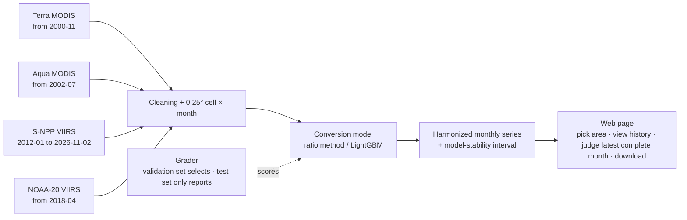

# MODIS × VIIRS Hotspot Harmonization Proposal (Team Inspiratio)

Team Inspiratio

## Project overview

**In one sentence:** We "repair" more than twenty years of satellite hotspot records into one line that is comparable from start to finish, and build a web page around it: circle a place on the map and see how strong hotspot activity there has been in every month from 2001 to today (VIIRS-equivalent estimate), and whether the latest complete month is unusual.

**Why it is needed:**

- Before 2012 there was only the older satellite sensor, MODIS; after that came VIIRS, which sees more clearly. VIIRS counts far more hotspots. Joined directly, the historical curve suddenly jumps in 2012 and looks as if fires increased; part of that difference comes from the change of sensor and cannot be read as a real increase in fire activity.
- 2026 is exactly the critical handover moment: VIIRS on the S-NPP satellite stopped updating on November 2, and MODIS will also be retired between late 2026 and early 2027. Without a common scale, more than twenty years of fire records break apart at the handover.

**How we do it, in three steps:**

1. **Repair the data.** From 2012 to 2021 both sensor generations were working at the same time. We use this period to train a model that learns "given what the old sensor saw, roughly how many hotspots the new sensor would count", then apply this conversion to the years before 2012.
2. **Prove the repair is right.** We hold back part of the period in which both sensors have data, never show it to the model, and use it as the final exam. Only a model that is also accurate on data it has never seen has really learned.
3. **Turn it into a tool.** The web page offers a burning calendar, an anomaly alert for the latest month and data downloads, and we publish the method, the exam scores and the harmonized dataset.

**Final deliverables:** a harmonization algorithm (code), a public harmonized dataset, a web page, a project description (the proposal, i.e. the project page on the submission platform), a 30-second demo, and a validation report. Details of each are in the "Final deliverables" section.

| Judging criterion | How we earn points |
| --- | --- |
| Impact | Concrete decisions for firefighting and emergency management staff: which months need stronger monitoring, and whether the latest complete month is unusual |
| Creativity | A harmonization model built around LightGBM, systematically improved on the validation set through AI-driven automated optimization, with the whole process made public |
| Validity | Training, validation and test splits in the "predict backward" direction; the test set is taken only once, after the model is frozen; comparison with a simple ratio method; citations of existing research |
| Relevance | Every feature the challenge names is implemented point by point (see the appendix section "Challenge requirements and judging criteria") |
| Presentation | The demo follows one real region: pick an area, view its history, judge the latest month, download |

The first 7 sections of this document are the main proposal and answer "what, why, how, how we prove it, and what we deliver"; the "Appendix: Execution handbook" that follows contains the operational details and all technical constraints for team members. Tasks are listed in dependency order, without a specific schedule.

## In plain language: what this project does

This section needs no remote-sensing background. After reading it you should be able to explain to a friend what we are repairing, how we repair it, and how we prove the repair is right.

### 1. What a hotspot is

Satellites carry cameras that can "see heat", and they pass over the same place on Earth about twice a day. When a camera finds a small patch of ground that is much hotter than its surroundings, it records a point there, called a **hotspot**.

A hotspot is not the same as a fire. A large fire is recorded as many points; a very small fire, or a fire hidden by cloud, may produce no point at all. So what we count is "how many hotspots were detected", which describes the hotspot activity recorded by the satellite; it does not directly represent burned area or how severe a disaster is.

### 2. Why the two camera generations count differently

Imagine you weigh yourself on a bathroom scale every year. In 2012 you switch to a more sensitive new scale that always shows a bit more than the old one. Plot 25 years of readings as one line and you will see that you suddenly "gained weight" in 2012. Some of that may be real change and some may come from the new scale's readings, and the two need to be told apart.

Satellites are the same:

- **Finer detail.** The old camera (MODIS) has pixels of about 1 km; the new camera (VIIRS) about 375 m. The same fire is split into more points by the new camera.
- **Small fires become visible.** Many crop-residue burns and small grass fires go completely unnoticed by the old camera but are seen by the new one.
- **No gaps.** Near the equator the old camera leaves gaps between consecutive passes, so some places are not seen on a given day; the new camera images a wider swath with no gaps.
- **No blur when looking sideways.** When the old camera looks toward the edge of its view, pixels are stretched several times over and small fires are more easily missed; the new camera has much less of this problem.

The key point is that **the difference is not a fixed multiple**. It differs between tropical savanna, boreal forest and farmland, and also by season and viewing angle. So you cannot simply "multiply everything by 2".

### 3. How the data is actually "repaired"

From 2012 to 2021 both camera generations were in the sky at the same time, as if for several years you stood on both scales every day. This period is our **answer key**.

We train a model that is shown various information recorded by the old camera (how many hotspots it saw, how intense those fires were, at what latitude, in what season, how oblique the viewing angle was) and asks it to predict how many the new camera would count. Once it has learned, we apply the model to the years before 2012, when only the old camera existed.

There is one hard constraint: **the model may only take as input information that the old camera has on its own**. Because the new camera did not exist before 2012, nothing that depends on it can be used.

### 4. How we know the repair is right

What we actually need to do is **predict backward**: use a relationship learned later to estimate earlier years. So the exam also runs backward: during development we train on 2016–2021 and use 2014–2015 as a "mock exam" to select the model; once selected, the model is frozen and then predicts the locked years 2012–2013. Both cameras have real data for those two years, so the answers can be checked directly.

This formal exam paper stays locked from start to finish, hidden from both the model and the AI. It is taken only once at the end, to report the score honestly, and is never used to pick a model. In addition, we hold out a region that never takes part in training, to test whether the model stays accurate in a different place.

### 5. What users see in the end

Picture a fire planner in Argentina opening our web page in October (an illustrative scenario):

1. She circles Córdoba Province on the map.
2. The page shows a large table: each row is a year, each column a month, and the darker the color, the more hotspots that month. At a glance she sees which months historically had more detected hotspots and which years had higher hotspot activity.
3. A card tells her how many times the historical same-month median the latest complete month's hotspot count (VIIRS-equivalent estimate) is, and what share of past same months it exceeds.
4. She downloads the data as a table, puts it into her weekly report and, together with weather, ground information and existing workflows, discusses how to arrange monitoring.

### 6. Why doing this now matters especially

The VIIRS on S-NPP stopped updating on November 2, 2026, and MODIS is about to be retired. More than twenty years of satellite fire records are at a handover point. Only by putting records from different sensors on a consistent statistical scale can the latest months be reliably compared with long-term history. That is exactly the problem the challenge sets out to solve, and it is where our story begins.

## Final deliverables

Besides the algorithm, the proposal and the web page, we also deliver a public harmonized dataset and a validation report. The first is the core evidence for Best Use of Data; the second is the core evidence for Validity.

| # | Deliverable | What it is | Who uses it | Tasks | Main judging criterion served |
| --- | --- | --- | --- | --- | --- |
| 1 | Harmonization algorithm (code repository) | Python code from data download to harmonized results, reproducible with one command | Judges, scientists, future developers | A2–B6, D3 | Validity |
| 2 | Harmonized dataset | A cell × month table with source and quality flags; estimated periods carry model-stability intervals; publicly downloadable | Researchers, other developers | B6, D2 | Best Use of Data |
| 3 | Data card | A one-page description: where the data comes from, how it was processed, what each column means, how large the errors are, where it should not be used | Data users | D2 | Validity |
| 4 | Web page | Map selection, burning calendar, latest-month anomaly, downloads, methods and validation page | Emergency managers, judges | C1–C7 | Impact, Relevance, Presentation |
| 5 | Validation report | The figures and score tables on the web page's "Methods and validation" page | Judges | D1 | Validity |
| 6 | Proposal (project page) | The project description text on the submission platform, serving as the public proposal | Judges | D4 | All |
| 7 | Demo | A 30-second video with English subtitles, or English slides of at most 7 pages | Judges | D5 | Presentation |
| 8 | AI usage statement | Which AI tools were used, what they did, how many methods were tried, how people reviewed the work | Judges (required in 2026) | B4, D4 | Rule requirement |
| 9 | Reproducible notebook (bonus) | A Colab notebook that judges can open to reproduce the key figures | Judges, scientists | D3 | Best Use of Data, Validity |
| 10 | This document | Internal execution handbook | Team members | None | None |

How the deliverables relate: the algorithm (1) produces the dataset (2); the dataset feeds the web page (4); the validation report (5) shows that the dataset can be trusted; the proposal (6) and the demo (7) present all of this to the judges.

## Approach: using machine learning to bring history onto the VIIRS scale

At the core is a LightGBM model: its input is MODIS information that was already available in the historical period plus fixed geographic information, and its output is "roughly how many hotspots S-NPP VIIRS would count in this cell in this month".

| Period | Data source |
| --- | --- |
| 2000-11 to 2002-06 | Terra MODIS only; first converted to the Aqua scale, then estimated with the model; flagged as low confidence |
| 2002-07 to 2012-01 | Estimates obtained by feeding Aqua MODIS into the model (S-NPP has only partial data for January 2012, so the whole month still uses the estimate) |
| 2012-02 to 2026-10 | Observed S-NPP VIIRS counts, not converted |
| 2026-11 onward | NOAA-20 VIIRS counts converted to the S-NPP scale (continuity is claimed only if the check passes) |

**What the model looks at:** the MODIS hotspot count, the distribution of hotspot intensity (FRP), pixel size (which reflects the viewing angle), latitude, month, the share of night-time hotspots, and the hotspot count of surrounding cells. Year, region name and any VIIRS information may not be used as inputs.

**Three required versions:**

| Version | Method | Purpose |
| --- | --- | --- |
| Direct stitching | MODIS before 2012, VIIRS after, with no conversion | Shows the problem caused by the sensor difference |
| Simple ratio | For each cell and month, see how many times the MODIS average the VIIRS average is over the overlap period, and multiply by that | An easy-to-understand baseline and fallback |
| LightGBM | A machine-learning model that learns the complex relationship between the inputs above and the VIIRS hotspot count | The project's main harmonization model |

The simple ratio method has an obvious blind spot: when MODIS sees 0 hotspots it can only predict 0 and cannot fill in the small fires MODIS missed. LightGBM can use information such as surrounding cells and fire intensity to handle this case, which is the main reason for using machine learning.

**Extensions (if time allows):** negative binomial regression (easier to interpret), an ensemble of LightGBM and the regression, and a "common threshold" comparison that keeps only strong fires.

**AI-driven automated optimization:** use an autoresearch-style framework to automatically try LightGBM features and parameters on the validation set, with a budget of at most 150 experiments or 8 hours, whichever comes first. The project's value lies in how much the model improves on the simple ratio method; the number of experiments is only a record of the process.

**Every output value carries a source flag** (observed, estimated, low confidence, near real-time, missing); estimated periods also carry a model-stability interval. All results are collectively called "historical hotspot activity (VIIRS-equivalent estimate)" and do not represent the number of fires, burned area or disaster severity. The exact meaning and limits of the interval are in the appendix section "Producing the final series".

## Validation: how we show the model can be trusted

The most important evidence: in years for which both sensor generations have data but which the model has never seen, give the model only MODIS inputs, measure how far its predicted VIIRS hotspot count is from the real VIIRS count, and compare it with the simple ratio method.

| Data | Period (training regions) | Purpose |
| --- | --- | --- |
| Training set | 2016-01 to 2021-06 | Train the model |
| Validation set | 2014-01 to 2015-12 | Select features, parameters and the final model; AI-driven optimization sees only scores from here |
| Test set (locked) | 2012-02 to 2013-12, plus one fully held-out region | Taken once after the model is frozen and reported honestly; never used for any selection |

Both the validation and test sets are earlier than the training set, because the real task is "use the later relationship to estimate earlier years".

**Three principles:**

1. **Select models on the validation set only.** If the test set is used even just to "pick the top scorer among a few models", the reported score will be optimistic.
2. **Report test scores as they are.** Even if LightGBM does worse than expected on the test set, report it honestly, side by side with the simple ratio method.
3. **Do not require "the 2012 step to disappear".** Real fire activity can genuinely change from year to year. Changes in the harmonized curve are normal, as long as the model predicts the held-out years accurately.

**Besides the main score, we report separately:** the share of region-months with zero VIIRS detections for which the model gives a positive estimate, the error in months with very few hotspots, and the bias in regional totals.

Details are in the appendix section "Validation framework".

## What the web page delivers

The web page is built around one continuous workflow: **pick an area → view the harmonized history → judge whether the latest complete month is unusual → download the results.** Machine learning estimates VIIRS-equivalent hotspot counts for the historical period; the web page lets users put that historical record to use.

1. **Pick an area:** draw a box or polygon on the map, type in latitude and longitude, or click a preset demonstration region.
2. **View the history:** a burning calendar with one row per year and one column per month, where color depth shows the strength of hotspot activity; hovering shows the value, source flag and stability interval; users can toggle between "harmonized / direct stitching" to compare.
3. **Judge the latest month:** a card shows the latest complete month as a multiple of the historical same-month median and as a historical percentile, with a text label of "high / normal / low".
4. **Download:** monthly results CSV, raw hotspot CSV for the area, and a calendar image.

We do not forecast future fires: the core deliverable is already complete, forecasting would spread our effort thin, and it goes beyond what the challenge asks for.

## Implementation scope

First make sure every required part is finished, then work on the bonus items.

| Tier | Contents |
| --- | --- |
| Required | Data download, cleaning and gridding (A1–A5); the grader (B1); direct stitching and simple ratio (B2); LightGBM and AI-driven optimization (B4); model freeze and final test (B5); dataset generation (B6); core web workflow (C1–C5, C7) and a minimal methods and validation page (C6); validation report (D1); dataset release (D2); code repository (D3); proposal (D4); demo (D5) |
| Bonus | Negative binomial regression and ensemble (B3); prediction intervals; Colab notebook; Zenodo DOI; land-cover features; extended interactivity on the methods page |
| Explicitly out of scope | Forecasting future fires; estimating burned area or disaster severity; real-time computation for arbitrary regions worldwide |

As soon as the simple ratio method (B2) is done, use it to generate a complete version of the data and hand it to the web page, so that the project can be delivered in full however the machine learning turns out.

# Appendix: Execution handbook

What follows are execution details for team members: challenge requirements, awards, data, scientific background, algorithm and validation details, AI optimization, the web page, task-by-task instructions, submission materials, risks and references.

## Challenge requirements and judging criteria

The official challenge is [Harmonization of MODIS and VIIRS Hot Spots](https://www.spaceappschallenge.org/2026/challenges/modis-and-viirs-hot-spots/), difficulty Intermediate / Advanced, subjects Earth Science + Software. The official suggestion has two parts: first harmonize the data so that "which sensor it came from" no longer matters; then build a web application that takes the harmonized data as input.

| Challenge requirement or suggestion | Required/optional | Our implementation | Judging criterion |
| --- | --- | --- | --- |
| Harmonize MODIS and VIIRS hotspots into a consistent time series | Required | Tasks A3–A4, B1–B6 | Validity |
| A web application that takes the harmonized data as input | Required | Tasks C1–C7 | Relevance |
| Users select an area and a date range | Required | Map selection + latitude/longitude input + date slider | Relevance |
| Burning activity calendar: monthly hotspot counts from the early 2000s to today | Required | Month × year heatmap | Relevance, Impact |
| Which months have more fire, which years have more fire, how the latest complete month compares with valid historical same months | Required | Monthly median row + annual total column + latest complete month card | Impact |
| Show differences with a color gradient | Suggested | Color-blind-friendly sequential color scale | Presentation |
| Download analysis results and visualizations | Suggested | CSV download + image export | Relevance |
| Download a CSV of the hotspots within the query area | Suggested | Two CSVs: raw hotspots and monthly summary | Relevance |
| Interactive map on which users can draw an area or enter coordinates | Optional | Both | Presentation |
| Accessible color scheme | Optional | Color-blind-friendly scale by default | Presentation |
| Anomaly against a multi-year average, number of detected hotspots | Optional | Anomaly = ratio of the month's value to the historical same-month median | Impact |

**Judging criteria (per the 2025 version; to be checked against the 2026 version after it is published on November 13):** Impact, Creativity, Validity, Relevance, Presentation. Judging has three tiers: Universal Event judges select the Global Nominees, experts from NASA and partner agencies select the Global Finalists and Honorable Mentions, and an executive committee selects the 10 Global Winners.

**Awards most relevant to this challenge:** Best Use of Data, Best Use of Science, Galactic Impact, Local Impact ([award descriptions](https://www.spaceappschallenge.org/awards/)).

**Hard rules (from the [Participant FAQs](https://www.spaceappschallenge.org/resources/participant-faqs/)):**

- Universal Event teams need at least 2 members to be eligible for global judging; teams have at most 6 members.
- Submission is done in the Project tab of the team page; it opens at 9:00 on November 14 and closes at 23:59 on November 15 (local event time).
- Teams must state how AI tools were used during development (in 2026 the official term is Super Intelligence, SI).
- Official rules say that work on the project may not begin before the event starts; challenge resources are released on November 13.

## Awards: how judges choose and how we compete

Nobody can apply for an award. Judges first pick the best group of projects against the five criteria, and the executive committee makes the final decision on who receives each award. So our strategy is to make all five criteria solid while making "uses the data well" and "does the science rigorously" stand out in particular.

### Selection process

1. **Event judges (Universal Event)** select the projects that go on to global judging, called Global Nominees.
2. **Experts from NASA and partner agencies** review all Nominees and select the Global Finalists and Honorable Mentions.
3. **The executive committee** (leaders from NASA and partner agencies) selects 10 global winners from the Finalists, one per award ([award descriptions](https://spaceappschallenge.org/2025/awards)).

The detailed scoring rubric for each award is not public. The 2026 judging guide is released on November 13, and we will check then whether it adds more detail. The mapping below is our own reading of the official definitions.

### The four awards most relevant to this project

| Award | Official definition | How we show it |
| --- | --- | --- |
| Best Use of Data | Best makes space data accessible, or uses it in a unique application | Turn hotspots from 4 satellites over more than twenty years into a calendar you get "just by circling an area"; publish the harmonized dataset and data card; reproducible notebook |
| Best Use of Science | Makes the best and most effective use of science or the scientific method | Backward-exam validation design, locked test set, era-shift check, uncertainty intervals, limitations listed honestly |
| Galactic Impact | Has the most potential to improve life on Earth or in the universe | Emergency managers can use it to plan patrols and resources |
| Local Impact | Has the most potential impact on a particular place | A complete story about one concrete region (for example Argentina) |

### Past Best Use of Data winners

- **2025, Resonant Exoplanets:** automatically analyzed large amounts of telescope and satellite data to find exoplanets and detect possible signs of life ([NASA announcement](https://www.nasa.gov/?p=939125)).
- **2022, Starflock:** used NASA airborne observation data to study whether the chemical composition of wildfire smoke varies by location ([Space Apps blog](https://www.spaceappschallenge.org/blog/2022-global-winners/)).

The common thread we see: they turned large amounts of NASA data into something others could not get before, and the processing itself carried real weight. This is our interpretation, not an official statement.

### Concrete ways to make "Best Use of Data" obvious at a glance

- **Be clear about which data we used.** The project page lists every NASA dataset (MODIS Terra, MODIS Aqua, VIIRS S-NPP, VIIRS NOAA-20, and optionally NOAA-21, MODIS land cover and the FIRMS missing-data list), each with one sentence on its role.
- **Let the numbers speak.** The project page and the demo give how many hotspots were processed, how many years and satellites are covered, and the test-set error. The numbers are filled in after task D1 is done.
- **Let others build on it.** The harmonized dataset is publicly downloadable, with a data card and a reproducible notebook. Judges see not just a web page but a data product that others can keep using.
- **Explain the timing.** S-NPP has just stopped and MODIS is about to retire; this project keeps the fire record from breaking at the handover. This line goes in the first 5 seconds of the demo.
- **Show the data flow on the methods page.** A flowchart shows every step the data passes through from satellite to calendar.

## Data

All core data comes from the NASA FIRMS [archive download](https://firms.modaps.eosdis.nasa.gov/download/), which is publicly downloadable now, in CSV, shapefile or JSON format.

| Dataset | Coverage | Pixel | Overpass time | Role in this project |
| --- | --- | --- | --- | --- |
| MODIS Collection 6.1 (Terra + Aqua) | 2000-11-01 to present | 1 km | Terra in the morning, Aqua in the afternoon around 13:30 (drifting since 2021) | The only historical source for 2001–2011 |
| VIIRS S-NPP 375 m | 2012-01-20 to 2026-11-02 | 375 m | Afternoon, around 13:30 | Paired with Aqua to learn the conversion |
| VIIRS NOAA-20 375 m | 2018-04-01 to present | 375 m | Same orbital plane as S-NPP, about 50 minutes apart | Continuation after S-NPP stops |
| VIIRS NOAA-21 375 m | 2023-03-01 to present | 375 m | Same as above | Backup and cross-check |

### Three recent developments that change the design

1. **S-NPP has stopped updating.** FIRMS stopped delivering S-NPP data to users at 15:40 UTC on November 2, 2026 (per NOAA's final notice of October 30; an earlier notice said 13:00). Historical data remains downloadable, and the official advice is to switch to NOAA-20 and NOAA-21 ([FIRMS note](https://www.earthdata.nasa.gov/news/blog/transitioning-from-suomi-npp-viirs-omps-what-firms-users-need-know)). So our "unified VIIRS scale" must join S-NPP and NOAA-20 and cannot rely on a single satellite.
2. **MODIS is about to retire, and its orbits are drifting.** NASA states that Terra and Aqua will stop operating one after the other between late 2026 and early 2027, and both satellites have drifted from their designed orbits ([Earthdata notice](https://www.earthdata.nasa.gov/data/alerts-outages/transition-from-modis-viirs)). Aqua began drifting toward a later overpass time in July 2021 ([LAADS notice](https://ladsweb.modaps.eosdis.nasa.gov/alerts-and-issues/171807)). So the best window in which Aqua and S-NPP "look at the same place at the same time" is **January 2012 to June 2021**, and the conversion is learned mainly from this period.
3. **Only near real-time data exists for the last few months.** Near real-time (NRT) data is replaced by science-quality standard data only after about 5 months. Historical analysis uses standard data; the last few months are filled in with NRT and flagged on the web page.

### CSV fields and how we use them

| Field | Meaning | How we use it |
| --- | --- | --- |
| latitude, longitude | Center of the hotspot pixel | Decide whether it lies within the user's area; gridding |
| acq\_date, acq\_time | Observation date; the time is UTC HHMM with leading zeros dropped | Monthly aggregation; compare time differences when pairing |
| satellite | MODIS is T (Terra) or A (Aqua); VIIRS distinguishes S-NPP, NOAA-20, NOAA-21 | Per-satellite statistics; Terra and Aqua handled separately |
| confidence | MODIS 0–100; VIIRS low / nominal / high | Filter out low confidence, as a tunable parameter |
| scan, track | Actual pixel size (km) | Proxy for viewing angle (the CSV has no view zenith angle) |
| frp | Fire radiative power (MW) | Align the detection capability of the two sensors with an intensity threshold |
| daynight | D = day, N = night | Build separate day and night conversions |
| type | 0 vegetation fire, 1 volcano, 2 other static land source, 3 offshore; standard data only | Keep only 0, removing static heat sources such as factories and gas fields |

Field definitions are in the [FIRMS attribute description](https://earthdata.nasa.gov/data/tools/firms/active-fire-data-attributes-modis-viirs).

### How to download

1. **Archive download (main route):** log in with an Earthdata account or an email verification code, choose a country or a custom area, choose the data source and dates, and choose CSV. After submission the system emails a download link once processing is done, so submit early.
2. **API (to fill in the last few days, and for live queries from the web page):** request a free [MAP\_KEY](https://firms.modaps.eosdis.nasa.gov/api/map_key/); endpoints look like `/api/area/csv/{MAP_KEY}/{SOURCE}/{west,south,east,north}/{days}`, the limit is 5,000 transactions per 10 minutes, and multi-day queries are counted per day.
3. **List of missing-data dates:** FIRMS provides an official missing-data endpoint (`/api/missing_data/`). Missing months must show as "no data" in the calendar and must not be treated as 0.

### Demonstration regions (suggest 2–3; the team decides)

| Candidate region | Why choose it |
| --- | --- |
| California, USA | Clear wildfire season, familiar to judges, big-fire years to tell stories with |
| Argentina (e.g. the Paraná Delta or Córdoba) | The challenge image comes from Argentina's space agency CONAE; grassland and wetland fires are common |
| Southern African or northern Australian savanna | Large hotspot counts and strong seasonality; lies in the MODIS near-equatorial gap band, so it best shows why harmonization is needed |

When choosing regions, note that Aqua MODIS has gaps between orbits every day between 30°N and 30°S and misses fires there, while VIIRS, with its 3,000 km swath, has no gaps ([Li et al. 2018](https://repository.library.noaa.gov/view/noaa/49896/noaa_49896_DS1.pdf)). The difference between the two sensors is larger in low-latitude regions.

## Scientific background: why the two sensors count differently

VIIRS counts more hotspots than MODIS mainly because its pixels are smaller, its pixel size changes less with viewing angle, and it has no orbital gaps. The gap is not a fixed multiple; it varies with viewing angle, latitude, ecosystem and day versus night, so it cannot be handled with a single global conversion coefficient.

| Source of difference | Findings from existing research | Implication for our harmonization |
| --- | --- | --- |
| Pixel size changes with angle | MODIS pixels can grow to about 9.67 times their size at the scan edge; VIIRS 375 m pixels grow from about 0.36×0.38 km to 0.78×0.80 km ([Zheng et al. 2026](https://mdpi-res.com/d_attachment/remotesensing/remotesensing-18-01650/article_deploy/remotesensing-18-01650.pdf)) | Use scan × track from the CSV to distinguish near-nadir from edge observations |
| Minimum detectable fire | The MODIS minimum FRP rises from about 4.1 MW at nadir to more than 33.6 MW at the edge; VIIRS only from about 1.4 MW to 2.2 MW (same source) | We can keep only VIIRS hotspots above an intensity that MODIS can also see, aligning the detection thresholds |
| Hotspot counts fall with angle | MODIS hotspot counts drop by 67% from nadir to a 60° viewing angle, while VIIRS stays roughly stable ([Li et al. 2018](https://repository.library.noaa.gov/view/noaa/49896/noaa_49896_DS1.pdf)) | The conversion factor must be allowed to vary with the viewing geometry within a region |
| Orbital gaps near the equator | Aqua MODIS misses fires between orbits between 30°N and 30°S; after deduplication, VIIRS counts about 70% more hotspots than MODIS in the tropics (same source) | Conversion factors for low-latitude regions should be clearly larger and estimated separately by region |
| Duplicate detections | Duplicate detections from adjacent MODIS scans make up at most 9.8% of hotspots, VIIRS at most 5.4% (same source) | Deduplicate before counting, or at least count "cells with fire" on the grid |
| Ecosystem | In cropland and savanna the two sensors' FRP differs by about 1%; in large boreal forest fires VIIRS FRP is clearly lower, which is related to CO₂ absorption in the smoke plume (same source) | Build relationships separately by region and by month; check boreal forest in particular |
| Overpass time | Terra passes in the morning; the Aqua–S-NPP conversion factor should not be applied directly to Terra ([Zheng et al. 2026](https://mdpi-res.com/d_attachment/remotesensing/remotesensing-18-01650/article_deploy/remotesensing-18-01650.pdf)) | The main line pairs only Aqua with VIIRS; Terra is handled separately or as a supplement |

**What existing fusion research offers us.** Zheng et al. 2026 used Aqua MODIS and S-NPP VIIRS from 2012–2024 to "correct first, then fuse": deduplication, pairing within MODIS pixels (time difference of no more than 5 minutes), cloud correction, FRP correction by viewing angle, and then fusion with VIIRS taking priority. After fusion there were about 3.82 times as many fire pixels as in the original MODIS. They focus on FRP while we focus on **monthly hotspot counts**, but these steps serve as a design reference; before adopting any of them we must confirm that the input fields and the goals match. With only the hotspot CSVs, we cannot claim to have reproduced their pixel pairing, cloud correction or scan deduplication.

**How far existing tools go.** The EU's GWIS compares VIIRS and MODIS thermal anomaly counts **separately** with the average of the past 10 years ([GWIS applications](https://gwis.jrc.ec.europa.eu/applications)); Argentina's CONAE has a MODIS/VIIRS hotspot catalog. This project's deliverables focus on long-term harmonized series for the demonstration regions, reproducible evaluation and downloadable results; we do not use this to claim that no other tool has similar features.

**A premise we must make clear to the judges:** one hotspot is not one fire, and a large fire can produce many hotspots. Our calendar counts "detected hotspots (VIIRS-equivalent)", not "number of fires".

## Harmonization algorithm and method choice

The best plan is to use data from the period when Aqua MODIS and S-NPP VIIRS were both in orbit to train a model that **predicts monthly VIIRS hotspot counts from MODIS's own information alone**. From 2012-02 to 2026-10 we use observed counts from S-NPP alone; before that, MODIS-based estimates; from 2026-11 onward, counts from NOAA-20 alone converted to the S-NPP scale. Candidate models range from the simple ratio to machine learning and are all scored by the same grader; which one is used is decided by the validation set, and the test set is used only for the final report.



The figure above shows the full flow from the 4 data sources to the web page. The conversion model is trained only on years when Aqua and S-NPP both made their afternoon overpasses, while the grader scores each candidate model on the side; complete S-NPP months keep their observed counts, and the NOAA-20 continuation months need separate calibration.

### Why the inputs may only use MODIS information

The model will ultimately be applied to 2002–2011, when only MODIS existed. So the input features used in training must be "things that can also be computed before 2012". The table below maps each difference between the two sensor generations to a feature that represents it:

| Source of difference | Feature that represents it (also computable before 2012) |
| --- | --- |
| MODIS cannot see small fires | The FRP distribution of MODIS hotspots in this cell in this month: median, 75th percentile, share of low-FRP hotspots |
| Blurrier when looking obliquely | Mean pixel size of MODIS hotspots (scan × track) |
| Orbital gaps near the equator | Latitude |
| Different fire types (cropland, grassland, forest) | Latitude and other geographic information; optional: the MODIS land-cover type for the corresponding year (MCD12Q1, available from 2001). No region-name encoding |
| Different seasons | Month |
| Day versus night differences | Share of night-time hotspots |
| The ratio differs between high-fire and low-fire conditions | The MODIS hotspot count itself, number of fire days, sum of MODIS hotspots in the 8 surrounding cells |

**Never to be used as features:** year (the model would learn "what things look like after 2014" and go wrong when predicting backward), region name (the held-out region never appears in training), and any information from VIIRS.

### Basic units and data preparation

- **Grid:** 0.25° × 0.25° (about 28 km near the equator). Too small and many cells have only a few hotspots, which is noisy; too large and the edge error is large when users select areas.
- **Time:** calendar months, aggregated uniformly in UTC. First store the raw counts for each satellite, then apply fixed filtering rules.
- **What 0 means:** a cell-month with no hotspot record gets 0, meaning "no hotspot recorded", not "certainly no fire": cloud, smoke or gaps between observations can all cause missed detections, and the hotspot CSV alone cannot tell which. Months containing official missing-data dates are flagged separately as "missing" (or "partially missing", depending on the number of missing days) and are not treated as 0 in training or scoring.
- **Quality control:** keep only vegetation fires (`type = 0`); remove low-confidence detections. If near real-time data lacks the type field, use only a static heat-source mask that has an independent source and a version record; without a reliable mask, keep the detections and flag them "heat-source classification unverified". Frequently recurring hotspots must not all be assumed to be static industrial sources.
- **Deduplication (main line):** merge only records that were downloaded more than once, identified by satellite, observation date and minute, and latitude/longitude; when standard and near real-time products duplicate each other, keep the standard product and record the source. Adjacent pixels, even within the same minute, may be different real detections and must not be deleted on distance alone. Scan-overlap deduplication is only an extension; it requires evidence such as scan identifiers or pixel geometry, and its difference from the main-line results must be reported. Detections from different overpass times are always kept.
- **Features for empty cells:** when there is no MODIS detection, the count, fire days and neighbor counts are computed as usual; the FRP percentiles, mean pixel size and night share are recorded as missing, with a "no detection" flag, and must not be filled in with values that look like valid physical observations. LightGBM handles missing values directly; for other models, imputation parameters are learned only from the current training data.
- **Held-out region:** none of that region's VIIRS labels, ratios or diagnostic plots may be used to choose methods before the model is frozen. For a new region, M1s falls back to the pooled monthly ratio estimated only from the training regions; the main model does not depend on region names or local VIIRS calibration. Neighborhood features reserve a buffer margin so that missing values outside the boundary are not treated as 0.
- **Four raw series:** A = Aqua MODIS (from 2002-07); T = Terra MODIS (used only to fill in before 2002-07); V = S-NPP VIIRS (2012-01 to 2026-11-02); N = NOAA-20 VIIRS (from 2018-04, used to continue S-NPP).

### Candidate models

| ID | Method | In plain terms | Tier |
| --- | --- | --- | --- |
| M0 | Direct stitching | MODIS before 2012, VIIRS after | Required: shows the problem |
| M1s | Simple ratio (with shrinkage) | See how many times the MODIS average VIIRS was over the overlap period and multiply by that; cells with few hotspots are pulled toward the regional average | Required: baseline and fallback |
| M3 | LightGBM | A machine-learning model that learns complex combinations of the features | Required: main harmonization model and the target of AI-driven optimization |
| M2 | Negative binomial regression | The ratio varies with the features, each with a readable coefficient | Extension |
| M5 | Ensemble | Average of M2 and M3 predictions weighted by validation performance | Extension |
| M4 | Common threshold | Keep only the strong fires that MODIS can also see, so both sides count by the same standard | Extension: physical comparison |

The M1s ratio (g is the cell, c the calendar month, R the region, λ the shrinkage strength; sums run over training years only):

```latex
k_{g,c} = \frac{\sum_{y} V_{g,c,y} + \lambda \, k_{R,c}}{\sum_{y} A_{g,c,y} + \lambda}
```

The M1s prediction is Ĥ = k × A. k\_R,c is estimated only from the current training regions pooled together: training cells use the locally shrunk ratio, while new regions use k\_R,c directly. When A = 0 the ratio baseline still predicts 0; this is its limitation, and shrinkage only stabilizes the ratio and cannot fill in hotspots that MODIS missed entirely. When the denominator for a training month is 0, fall back to a broader seasonal or global training ratio and record the reason.

The form of the extension M2 (x are the features in the table above, μ is the predicted monthly VIIRS hotspot count, θ is the dispersion parameter):

```latex
\log \mu_{g,t} = \log(A_{g,t} + 0.5) + \beta_0 + \boldsymbol{\beta}^{\top}\mathbf{x}_{g,t} + \gamma_{\text{month}}, \quad V_{g,t} \sim \text{NegBin}(\mu_{g,t}, \theta)
```

**Key design choices for M3, and the reason for each:**

- **Predict hotspot counts directly, with a Poisson or Tweedie objective.** Poisson is the natural starting point for a count task; Tweedie (1 < p < 2) suits non-negative data with many zeros and can be a candidate, but it is not designed specifically for integer counts. The two are compared under a fixed validation scheme, and outputs may be non-integer expected values. We do not guarantee that regional sums are unbiased; instead this is checked on the validation set with the regional total bias. Predicting counts directly also handles cells where "MODIS sees 0 but VIIRS sees many small fires", which the ratio method cannot do.
- **Monotonic constraint on the MODIS hotspot count.** The more fires MODIS sees, the predicted VIIRS hotspot count should not go down. This keeps the model from learning strange patterns and is easier to explain to the judges.
- **Shallow trees, large leaves.** For example at most 15–31 leaves per tree and at least 50 rows per leaf, to keep the model from memorizing the answers.
- **Explain the model with validation results.** Feature importance describes which inputs the model relies on; feature-ablation experiments and prediction-relationship plots then check the patterns. Agreement with the direction found in published papers is only a plausibility hint; it cannot replace independent testing and cannot be read as causal evidence.

**Selection rule:** compare on the validation set only. If LightGBM meets the selection rule in the "Validation framework" section, use LightGBM (or the ensemble, if one was built and is better); otherwise use the simple ratio method M1s. Once selected, the model is frozen, then taken to the test set once and reported honestly. When M1s is done the project is already deliverable; everything after that is a bonus.

### Producing the final series

- **2012-02 to 2026-10:** use complete-month counts from S-NPP alone, under the same quality control.
- **2026-11 onward:** use NOAA-20 for whole months, then convert to the S-NPP scale; do not add S-NPP counts for November 1–2 to NOAA-20 counts for the remaining days. In no month are counts from several VIIRS satellites added together. Estimating and testing the continuation ratio is covered in the next subsection; continuity is claimed only if the test passes, otherwise the web page shows the NOAA-20 segment separately and notes that comparisons across segments are limited.
- **2002-07 to 2012-01:** estimates from the selected model. S-NPP covers only part of 2012-01, so it neither replaces the whole-month estimate nor serves as a complete-month training label.
- **2000-11 to 2002-06:** Terra only. First learn a "Terra → Aqua" ratio with M1s, using the Terra–Aqua overlap years that the current training stage is allowed to use, then chain it into the model above. Flagged as low confidence on the web page.
- **Model-stability interval (required):** block resampling by year: each time, randomly redraw the training years and retrain the model, about 100 times in total; each time, first sum the cells into regional totals (or monthly totals), then take the 5% and 95% quantiles. It shows "how much the estimate would move with a different set of training years"; it is not a full error range: it does not include missed detections, long-term distribution shifts, or errors from the Terra bridge and the NOAA-20 continuation, and it does not mean the true value has a 90% chance of falling inside it. Preset demonstration regions get full intervals; for custom regions, about 20 resampled versions (non-zero values only) are stored and summed in the front end, and if the files become too large only the estimate is shown, with a note.
- **Prediction intervals (bonus):** to build prediction intervals for observed values, separate calibration data must be set aside from the development data; the same data cannot be used for repeated tuning and calibration. Quantile regression or calibration grouped by space and time can be compared, and the actual coverage is reported on the locked test set. The coverage guarantee of standard conformal prediction depends on conditions such as exchangeability and cannot simply be promised for backward prediction across eras.
- **Production version:** after the test scores are reported, retrain once on all overlap data from the training regions for 2012-02 to 2021-06 to produce the production version; the reported test scores belong only to the frozen model before this retraining.

### Isolation for the continuation and the bridge

- All ratios, shrinkage parameters, imputation values and calibration in the evaluation version use only the corresponding training portion; the locked region gets no local ratio estimate, and its VIIRS plots are not looked at. The production version may be refitted within the declared scope, keeping the source labels as usual.
- **NOAA-20 → S-NPP continuation ratio:** first fit it on the earlier complete overlap years in the development regions, then test monthly total bias and seasonal stability on the later complete years, checking day and night separately. Exclude months with outages and incomplete months; sparse cells shrink toward the pooled monthly ratio of the training regions, and no local ratio is reported when there are too few samples. NOAA-20 is chosen over NOAA-21 because its overlap with S-NPP is longer (more than 8 years versus more than 3); this is only an engineering reason, and whether it is accurate is decided by the tests above.

### From cells to user areas

- Precompute the harmonized value for every cell and every month. When a user circles an area, sum the cells that fall inside it; cells that partly overlap the boundary are apportioned by overlap area. This assumes hotspots are evenly distributed within a cell, which is an approximation: small selections may have noticeable boundary error. For areas smaller than one cell, give only an approximate total and point out this limitation.
- The raw hotspot CSV download filters the point data by the user's area directly and is not affected by the cells.

### Anomaly indicators

- **Only evaluate complete months that have ended.** While the current month is still running, show only "cumulative hotspot count as of a given date", with no anomaly verdict.
- **Latest-month anomaly multiple** = the month's estimate ÷ the historical same-month median.
- **Historical percentile:** compare only with complete, usable years for the same calendar month before the target year; the target month is not part of its own reference set. With reference values x₁…xₙ and target h, percentile = 100 × \[number of values less than h + 0.5 × number equal to h\] ÷ n, and the number of reference years is shown.
- **Activity level:** with at least 10 valid same-month years, a percentile ≥ 90 is labeled "high", ≤ 10 "low", and anything else "normal" (that is, within the usual historical range). This is a descriptive grading, not a statistical significance test and not a disaster-risk level. With fewer than 10 valid years no level is given; only the values are shown, with the note "insufficient history".
- **When the median is 0 or very small (for example below 5):** show no multiple, only the percentile, with the explanation "few hotspots are usually recorded in this month historically".
- **Missing data:** if the target month is partly missing, show the available count, the missing dates and "incomplete coverage", and give no level; reference months also exclude years known to have incomplete coverage. Missed detections due to cloud and smoke cannot be corrected and are listed as a limitation.
- **Near real-time data:** if the latest month comes from near real-time data, label it "preliminary".
- **Switchable baseline period:** by default, valid same-month records from 2001 up to the year before the target; alternatively, only complete S-NPP months from 2012-02 to 2026-10, which does not depend on MODIS estimates and does not include the NOAA-20 continuation conversion. The page also shows the baseline period, data version, number of reference years and the as-of date.
- **Wording:** always write "hotspot activity high / normal / low (VIIRS-equivalent estimate)", never number of fires, burned area or disaster severity.

## Validation framework (the "grader")

The data is split three ways: the training set is used for training; the validation set is used to select features, parameters and the final model, and is the only thing AI-driven optimization sees; the test set is taken only once after the model is frozen, reported honestly, and takes no part in any selection. Because the real task is predicting backward, both the validation and test sets are earlier than the training set.

### Why so strict

The period in which both sensor generations were in orbit and can serve as an answer key is only about nine and a half years, from 2012-01 to 2021-06. Cells within the same year vary together, and neighboring cells are correlated, so the large number of cell rows cannot be treated as the same number of independent samples; the real "amount of experience" depends on the temporal, spatial and fire-regime correlation structure and is far smaller than the row count.

Machine learning easily memorizes the chance features of these few fire seasons; AI optimization tries many options, and picking the best of them is itself partly "luck". So selection may only be done on the validation set. Once the test set is used to pick a model, even if each model takes the test only once and the top scorer is picked at the end, the reported score will be optimistic ([scikit-learn on nested cross-validation](https://scikit-learn.org/stable/auto_examples/model_selection/plot_nested_cross_validation_iris.html)).

### How the data is split

| Purpose | Training period | Validation/test period | Space | What it is used for |
| --- | --- | --- | --- | --- |
| Main validation window | 2016-01 to 2021-06 | 2014-01 to 2015-12 | Training regions | Select features, parameters and the final model; the scoring basis for AI-driven optimization |
| Auxiliary backward window | 2018-01 to 2021-06 | 2016-01 to 2017-12 | Training regions | Check whether the selected model is equally stable on another span of years; summarized by region and complete year |
| Test 1 (locked) | 2014-01 to 2021-06 | 2012-02 to 2013-12 | Training regions | Taken once after the model is frozen; report only |
| Test 2 (locked) | 2014-01 to 2021-06 | 2012-02 to 2021-06 | One fully held-out region | Same as above; checks whether the model still works in a different place |

The training periods of both validation windows are at least 3.5 years long, and both "use later years to predict earlier years", matching the direction of the real task.

**Process:**

1. Fit and compare the candidate models on both validation windows; select and freeze the final model (including features, parameters and number of trees).
2. Retrain this frozen model on training-region data from 2014-01 to 2021-06 and take each of the two test sets once. Report all results honestly, including the simple ratio method's scores.
3. After reporting, a production version may be trained on all training-region data from 2012-02 to 2021-06, with the held-out region still isolated. The evaluation version and the production version each record their code, features, number of trees, training range and model files; the test scores belong only to the evaluation version from step 2 and must not be presented as measured scores of the production version.

We start from February 2012 because S-NPP data only begins on January 20. Products from S-NPP's first two years in orbit may have early-mission characteristics; if the Test 1 results look unusual, analyze those two years after the model is frozen and testing is complete, with reference to Test 2.

### Metrics

- Within each region, generate 200 rectangles of 1°–5° with a fixed random seed to simulate user selections; for each month of each rectangle, compare the model estimate with the VIIRS observed count.
- **Main score = mean absolute log error (MALE), lower is better**, counted only over rectangle-months whose monthly VIIRS hotspot count is at least 10:

```latex
\text{MALE} = \frac{1}{N}\sum_{i=1}^{N} \left| \ln(\hat{H}_i + 1) - \ln(V_i + 1) \right|
```

- **Also report the MALE over all valid samples**, the sample count and the share excluded because of missing data, so that a good-looking score is not produced only on months with many hotspots.
- **Report zero and low hotspot counts separately:** among rectangle-months whose VIIRS observed count is 0, the share for which the model estimates at least 1 and at least 5; and the mean absolute error for samples with observed counts of 1–9. These describe deviation from the VIIRS labels, not false-alarm rates relative to real fires on the ground.
- **Regional total bias:** predicted total ÷ VIIRS observed total − 1, reported by region and by complete year; when the observed total is 0, report the absolute bias and do not compute a ratio.
- **Seasonal shape:** correlation coefficient of the 12-month seasonal curve.
- **All metrics are reported side by side with the simple ratio method M1s.** Overlapping random rectangles are not independent repeated experiments, and no significance is computed from them.

### Presentation checks (not success criteria)

- **The curve before and after 2012:** plot the directly stitched and harmonized series for presentation, but do not tune the model with "the step disappears" as a goal. Real fire activity may have changed; as long as the model predicts the held-out years accurately, it is right for the harmonized curve to keep real changes.
- **Era-difference investigation:** train a classifier that looks only at the model's input features and guesses "from 2002–2011 or from 2014–2021". If it guesses very accurately, investigate why: it may be MODIS orbit or product changes, or real changes in land use or fire activity. Record it and explain it in the report; do not simply delete features to lower this score.

### Web correctness checks

- Calendar sums computed with the same coverage and boundary area weights match the back-end results; missing data must not silently turn into 0 when summed.
- The number of rows in the downloaded raw hotspot CSV equals the number of filtered hotspots in the area.
- Missing months show as "missing", not as 0.
- Use small hand-built datasets to test the anomaly multiple, the percentile, and special cases such as a median of 0, an unfinished current month and fewer than 10 reference years.

### Rule for selecting the model (validation set only, thresholds fixed before the experiments)

LightGBM (or the ensemble) is chosen as the final model only if it meets all four conditions below; otherwise the simple ratio method M1s is used:

1. The MALE of the main validation window and of the auxiliary backward window, first averaged separately by region and complete year and then pooled with equal weights, improves on M1s by at least 10%. This is a pre-agreed adoption threshold, not an expected result. Neither window may get clearly worse.
2. Check the total bias separately for regions with enough hotspots, with ±10% as the preset target; if it is not met, say so honestly.
3. Report in full the share of positive estimates on samples with zero VIIRS detections and the error on samples with 1–9 detections; the allowable range of change is fixed before the experiments and cannot be adjusted after seeing the scores.
4. Pass a label-leakage review, and use validation results after feature ablation, prediction-relationship plots and importance plots to explain what the model relies on. Importance only shows which inputs the model uses; it does not prove a causal mechanism.

Look at the test set only after the model is frozen. If the test scores are disappointing, write them down truthfully and analyze why; do not go back, change the model and retake the test.

## AI-driven automated experiment loop

autoresearch is not a model but a loop of "keep changing the method, keep scoring, keep whatever is better". We use it to improve LightGBM's features, objective and parameters (and, if time allows, the negative binomial regression and the ensemble weights too). The loop can see only validation scores, never the test set. The budget is at most 150 experiments or 8 hours, whichever comes first. The project's value lies in how much the model improves on the simple ratio method; the number of experiments is only a record of the process.

### Which framework

| Framework | When it fits | How we use it |
| --- | --- | --- |
| [codex-autoresearch](https://github.com/lhl/codex-autoresearch) | The team uses Codex | Default choice: climbs along a single path and can try 3 ideas at once |
| [autoresearch for Claude Code](https://github.com/sloki13/autoresearch) | The team uses Claude Code | Equivalent to the above |
| [AIDE](https://pypi.org/project/aideml) | We want the AI to explore multiple branches | Tree search; can go back to an earlier version and branch again |
| [OpenEvolve](https://huggingface.co/blog/codelion/openevolve) | We want to find a concise conversion formula | Use its symbolic regression example as a reference to improve M2 |

### Evaluation isolation and interface constraints

`harmonize.py` must provide two functions:

- `fit(train_table)`: the training table contains MODIS features and also the true VIIRS values.
- `predict(feature_table)`: the table passed in by the evaluation script contains **only MODIS features**, with no VIIRS columns and no year column.

This interface reduces label leakage but cannot stop code from reading other files or network resources directly. So the development environment mounts only the permitted training and validation data; test labels, credentials and results are kept in an isolated evaluation environment, where the lead runs the frozen code. Record the file inventory and the code version; if the environment is not truly isolated, it may only be called a process constraint, and we may not claim that access is technically impossible.

### What the AI may and may not change

| May change (search space) | May not change |
| --- | --- |
| New features: various FRP quantiles, pixel-size statistics, neighborhood smoothing, land-cover combinations | `prepare.py`, `evaluate.py` and the data split |
| Objective: Poisson, Tweedie and their parameters | Grid size (set by data preparation) |
| Monotonic constraints, tree depth and count, regularization strength | Using year, region name or any VIIRS information as features |
| M2 feature combinations and regularization | Exceeding the per-run time and CPU budget fixed after measurement |
| M2 and M3 ensemble weights | Reading test-set data |

### File layout

```
harmonization/
  prepare.py        # Fixed: read data, quality control, split training and validation sets
  evaluate.py       # Fixed: score on both validation windows, output MALE and auxiliary metrics
  harmonize.py      # The only file the AI may change: fit() and predict()
  program.md        # Written by people: goal, constraints, background
  final_test.py     # Fixed: test set; run only after the model is frozen, by the lead, in the isolated environment
  experiments.csv   # One row per experiment: ID, summary of the change, score, kept or not
```

### program.md template

```markdown
# Goal
Lower the validation MALE output by evaluate.py (lower is better), without worsening the share of positive estimates on samples with zero VIIRS detections or the regional total bias.

# What you may change
Only harmonize.py. fit() receives the training table with true VIIRS values; predict() receives only MODIS features.
Current starting point: LightGBM (Tweedie objective, monotonically increasing constraint on the MODIS hotspot count).

# Hard rules
- Do not modify prepare.py or evaluate.py.
- Do not use year, region name or any VIIRS information as features.
- Keep the monotonically increasing constraint on the MODIS hotspot count.
- First time the baseline's full validation run, then fix the per-run time limit and number of CPU cores; at most 150 experiments or 8 hours in total. Stop early after 30 consecutive runs without improvement.
- Every change must be justifiable in one sentence.

# Directions worth trying
- FRP distribution features: median, 75th percentile, share below 10 MW
- Mean pixel size, or hotspot counts binned by pixel size
- Sum of MODIS hotspots in surrounding cells
- Share of night-time hotspots
- Tweedie variance_power between 1.1 and 1.9
- Shallower trees and larger leaves to reduce overfitting

# Background
VIIRS has smaller pixels, no orbital gaps near the equator, and sees more clearly at oblique angles, so it counts more hotspots.
The gap varies with viewing angle, latitude and fire type.
```

### Running and review

1. People first hand-write M1s and the first LightGBM version and record their validation scores as the starting point of the loop.
2. Each experiment is automatically committed to a separate git branch and appends a row to `experiments.csv`.
3. Stop when the budget is reached or after 30 consecutive runs without improvement.
4. The reviewer takes the top 3 by validation score, reads each one's code, and uses feature-ablation experiments and prediction-relationship plots to check whether it peeks at data and whether the patterns make sense (for example, the larger the pixel size, the larger the VIIRS/MODIS ratio should be), and checks stability on the auxiliary backward window.
5. Decide on and freeze the final model on the validation set according to the selection rule in "Validation framework"; only then run `final_test.py` once.
6. `experiments.csv` and the review notes feed directly into the AI usage statement on the project page: how many methods were tried, what was finally chosen, and how much it improved on the simple ratio method.

## Web application

The web page is organized around one workflow: pick an area → view the harmonized history → judge whether the latest complete month is unusual → download the results. The map on the left is used to pick the area; the burning calendar and the verdict card are on the right; the download buttons are below; and there is a separate "Methods and validation" page. All data is precomputed and deployed as a static site, so nothing depends on a server during judging. The page always uses the terms "historical hotspot activity" and "VIIRS-equivalent estimate", never number of fires, burned area or disaster severity.

### Features and interaction

| Feature | How users use it | Implementation notes |
| --- | --- | --- |
| Pick an area | Draw a rectangle or polygon on the map; or enter a latitude/longitude range; or click a preset demonstration region | Leaflet + leaflet-draw; turf.js computes the overlap area between cells and the area |
| Pick a time span | Year range slider, 2001 to present | All years shown by default |
| Burning calendar | Rows = years, columns = months, cell color depth = harmonized hotspot count | Logarithmic color scale, since hotspot counts span several orders of magnitude |
| Hover tooltip | Move the mouse over a cell | Shows the value, the model-stability interval where applicable, and the data source (MODIS estimate / VIIRS observed / NOAA-20 continuation / near real-time / missing) |
| Harmonization toggle | Switch between "harmonized" and "direct stitching" | Compare raw stitching with the harmonized result; mark the sensor switch without presupposing that the step must disappear |
| Summary row and column | Bottom row = historical median for each month; right column = annual total | Answers "which months have more fire, which years have more fire" |
| Latest-month card | Automatically shows the latest complete month | Value, multiple of the historical same-month median, historical percentile, with a "high / normal / low" label; the baseline can be switched between "valid history since 2001" and "complete S-NPP observed months only" |
| Annual line chart | Three lines: raw MODIS, raw VIIRS, harmonized | Linked with the calendar; clicking a year highlights that row |
| Downloads | Three buttons | Monthly calendar CSV; raw hotspot CSV for the area (with satellite and confidence columns); calendar PNG |
| Methods and validation page | Separate page | Before/after harmonization comparison, score table, limitations, data citations |

### Accessibility and readability

- Use a color-blind-friendly sequential scale (viridis or cividis) by default, with an option to switch.
- Convey information through more than color: anomaly levels are also labeled in text; missing cells use a hatched pattern and low-confidence cells a dashed border.
- Font size at least 12 px; all main actions can be done with the keyboard.

### Tech stack (suggested; the team may swap pieces)

| Layer | Choice | Reason |
| --- | --- | --- |
| Data processing | Python: pandas, geopandas, pyarrow | Enough for millions of hotspot records |
| Intermediate data | Parquet; split into compressed JSON per demonstration region for the front end | The front end loads only the region the user selects |
| Front end | Vite + React (or plain JavaScript) | Whichever the team knows better |
| Map | Leaflet + leaflet-draw | Lightweight, with a mature plugin for drawing areas |
| Charts | Plotly or ECharts heatmap | Built-in hover tooltips and PNG export |
| Deployment | GitHub Pages or Vercel | Free and stable; the link goes straight into the project page |

Do not call the FIRMS API from the front end: the MAP\_KEY would be exposed in the browser. To show data from the last few days, fetch it with a script at build time and write it into static files.

## Task details

All work is split into four lines and 24 tasks: A data, B algorithm, C web page, D delivery. The summary table tells you what each task is and what it waits on; after it, each task is explained in turn: what to do, why, best practice, pitfalls to avoid, and what counts as done. One person can take several roles; there is also a reviewer (who also keeps custody of the test data), and the reviewer does not review their own work.

**One rule that applies to every task:** before the model is frozen, no plot, table or statistic seen by developers may include VIIRS data from 2012-02 to 2013-12 or VIIRS data from the held-out region. These are produced by the lead at the final evaluation.

### Summary table

| ID | Task | One-line description | Depends on | Output |
| --- | --- | --- | --- | --- |
| A1 | Choose demonstration regions | Settle on 2–3 training/showcase regions and 1 held-out region | None | `regions.json` |
| A2 | Download data | Download MODIS and VIIRS hotspots for all years in every region | A1 | Raw CSVs, `data/README.md` |
| A3 | Cleaning | Remove false alarms and static heat sources, merge duplicate downloads, unify formats | A2 | `clean/*.parquet`, cleaning report |
| A4 | Gridding and features | Turn hotspots into a "cell × month" table and compute the model's input features | A3 | `cell_month.parquet` |
| A5 | Data health check | Plot to confirm the problem really exists and find data anomalies (allowed years and regions only) | A4 | 4 diagnostic plots, findings note |
| B1 | Grader | Write the split, the scoring and the locked test set | A4 | `prepare.py`, `evaluate.py`, `final_test.py` |
| B2 | Baselines M0 and M1s | Produce the development "problem plot" and the fallback method | B1 | First `harmonize.py`, score table |
| B3 | (Extension) Negative binomial regression M2 | Interpretable negative binomial regression; skip if short of time | B2 | M2 code, coefficient table |
| B4 | LightGBM main model and AI optimization | First LightGBM version, then systematic improvement by the AI loop | B2 | `experiments.csv`, review notes, feature importance plot |
| B5 | Model freeze and final test | Select and freeze the model on the validation set, then take the test set once and report honestly | B2, B4 (B3 optional) | Decision record |
| B6 | Generate the final dataset | Produce harmonized data and intervals from 2000-11 to present | B5 | `harmonized_cell_month.parquet` |
| C1 | Front-end data export | Split the data into files the web page can load quickly | B2 (baseline data first) | One compressed JSON per region |
| C2 | Map and area selection | Draw boxes, enter coordinates, pick preset regions | C1 | Map component |
| C3 | Burning calendar | Month × year heatmap and its toggles | C1 | Calendar component |
| C4 | Latest-month card and annual line chart | Anomaly alert and long-term trend | C3 | Two components |
| C5 | Downloads | Three kinds of download | C2 | Three download buttons |
| C6 | Methods and validation page | Put the validation report into the web page | D1 | Methods page |
| C7 | Deployment and testing | Go live and test thoroughly | C2–C6 | Public URL |
| D1 | Validation report and core figures | Figures and tables showing the model can be trusted | A5, B5, B6 | 6 core figures and tables, score table |
| D2 | Dataset release and data card | Publish the harmonized dataset | B6 | Download link |
| D3 | Code repository, README and notebook | Let anyone reproduce the results | B6 | Public repository, Colab notebook |
| D4 | Proposal (project page) | Write the project description on the submission platform | D1–D3 | Project page |
| D5 | Demo | 30-second video or 7 slides | C7, D1 | Public link |
| D6 | Final check and submission | Check item by item, then submit | All | Submitted project |

**What can run in parallel:** once B2 is done, the web page (line C) starts immediately with the M1s results, without waiting for the machine learning; D2 and D3 can also be scaffolded with the baseline data first and switched over once B6 is done.

### Line A: Data

**A1 Choose demonstration regions**

- **What:** choose 2–3 regions for training and showcasing, plus 1 fully held-out region used only for Test 2.
- **Why:** global data is too large. Well-chosen regions give the demo a better story and make the exam more convincing.
- **Best practice:**
  1. List 5–6 candidates based on geography, ecosystem and public background material, and fix the training and held-out regions in advance; do not look at VIIRS labels for the locked years or the held-out region to pick regions that score easily.
  2. Choose by three criteria: a clear fire season every year; different fire types from one another (forest, grassland, cropland); at least one between 30°N and 30°S.
  3. Recommended combination: California (USA), central Argentina and the southern African savanna for training and showcasing; northern Australia as the held-out region. The team may swap these.
  4. Define a latitude/longitude rectangle 5°–10° on a side for each region and write it to `regions.json`, with the fields name, west/south/east/north bounds, and role (train or holdout).
- **Pitfalls:** if a region is too small there are too few hotspots and the scores are pure noise. Once the held-out region is set, it cannot be changed or used to tune the model.
- **Done when:** `regions.json` is complete and confirmed by the team.

**A2 Download data**

- **What:** download MODIS and VIIRS hotspots for all regions and all years.
- **Why:** all later work depends on it, and archive downloads have to queue and arrive by email.
- **Best practice:**
  1. Register an Earthdata account and request a FIRMS MAP\_KEY.
  2. On the FIRMS archive download page, submit three requests for each region: MODIS C6.1, VIIRS S-NPP and VIIRS NOAA-20 (NOAA-21 optional), with dates from each source's earliest availability to the latest, in CSV format.
  3. Use the API to fill in the recent months not yet covered by standard data.
  4. Download the official list of missing-data dates.
  5. Optional: get MODIS land cover (MCD12Q1) for the regions through NASA AppEEARS or Earthdata Search.
  6. Record each file's source, download date and row count in `data/README.md`.
  7. Once the download is done, the lead moves the VIIRS records for 2012-02 to 2013-12 and all VIIRS records for the held-out region to an isolated location; none remain in the development directory.
- **Pitfalls:** do not download global data. For dates where standard and near real-time data overlap, keep only the standard data.
- **Done when:** each data source's start and end dates match the coverage table in the "Data" section; the test data is isolated.

**A3 Cleaning**

- **What:** turn the raw hotspot tables into clean tables with a uniform format.
- **Why:** static heat sources such as factories and gas fields, low-confidence false alarms and duplicate records all distort hotspot counts. But cleaning rules that are too aggressive also delete real hotspots and make the model learn a bias created by the cleaning rules.
- **Best practice:**
  1. Unify MODIS and VIIRS column names and types (their brightness temperature columns have different names); pad `acq_time` to 4 digits and combine it with `acq_date` into a UTC timestamp.
  2. Keep only `type = 0`; filter near real-time data only when an independent, traceable heat-source mask exists, otherwise keep it and flag it "heat-source classification unverified".
  3. Remove low confidence: MODIS confidence is a number from 0–100, with a threshold fixed in advance (initial plan ≥ 30); for VIIRS keep nominal and high. The two confidence measures cannot be treated as the same probability. If the threshold changes, inputs and labels must be rebuilt together, and the change is recorded as a method change.
  4. Merge duplicate records caused by standard plus near real-time data and by downloads in batches: identify them by satellite, time and coordinates, keep the standard product first, and keep an audit record.
  5. Do not delete adjacent pixels on the basis of "same minute and close together"; FIRMS CSVs alone cannot reliably confirm scan duplicates. If enough scan or geometry information is obtained, a separate deduplication sensitivity analysis can be done. Detections from different overpass times are always kept.
  6. Output Parquet and record how many rows each step removed; the main line uses the conservative deduplication version, while the extended deduplication is saved separately and must never overwrite the main-line data.
  7. Randomly sample 20 removed records for manual inspection.
- **Pitfalls:** deleting on "same day and close together" wrongly removes adjacent real hotspots and detections from different overpasses. FIRMS CSV times are precise only to the minute, and leading zeros are dropped.
- **Done when:** the cleaning rules are finalized before modeling; the cleaning report states how many rows each rule removed; spot checks find no wrongful deletions.

**A4 Gridding and features**

- **What:** aggregate hotspots into a "cell × month" table and compute the model's input features.
- **Why:** both the model and the web page work in cell-month units.
- **Best practice:**
  1. Assign each hotspot a 0.25° cell ID.
  2. Count hotspots per cell per month separately for each satellite (Terra, Aqua, S-NPP, NOAA-20).
  3. Compute features from MODIS only: FRP median and 75th percentile, share of low-FRP hotspots (for example below 10 MW), mean pixel size, night share, number of fire days, sum of hotspots in the 8 surrounding cells; plus latitude, month and, optionally, land cover for the corresponding year. Region names are used only for grouped reporting, not as features of the main model.
  4. Fill in every cell × month combination. Combinations with no hotspot record get 0, meaning "no hotspot recorded"; their FRP-type features are then recorded as missing, with a "no detection" flag.
  5. Months containing official missing-data dates are flagged separately as "missing" or "partially missing" and are not treated as 0.
  6. Check that the sum of all cell counts equals the total number of cleaned hotspots.
- **Pitfalls:** dropping the rows with value 0; treating missing data as 0; letting VIIRS information slip into the features. Missed detections caused by cloud and smoke cannot be identified from the hotspot CSVs; state this in the data card.
- **Done when:** the table is complete, the totals match, and 0 is clearly distinguished from missing.

**A5 Data health check**

- **What:** plot the data before modeling to confirm the problem really exists and to find any surprises in the data.
- **Why:** the earlier download or cleaning errors are found, the cheaper they are to fix.
- **Isolation requirement:** development-stage plots use only the training regions, and VIIRS is plotted only from 2014-01 onward; VIIRS plots for 2012-02 to 2013-12 and for the held-out region are produced by the lead after the model is frozen. MODIS may be plotted for all years as normal.
- **Best practice:**
  1. Plot monthly hotspot series for each training region: Terra and Aqua over the full period, S-NPP and NOAA-20 from 2014-01.
  2. Plot how the monthly S-NPP/Aqua ratio changes over 2014–2026, and check whether Aqua's drift after 2021 is visible.
  3. For the same period, plot this ratio against latitude and against mean pixel size, and see whether it agrees with the literature.
  4. Plot the NOAA-20/S-NPP ratio and check whether it is close to 1.
  5. Write a one-page findings note.
- **Pitfalls:** do not skip this step and go straight to modeling. If the ratio itself has a clear trend over 2014–2021, find the cause first.
- **Done when:** the 4 plots and the findings note are done and the whole team has seen them; no locked data appears in the plots.

### Line B: Algorithm

**B1 Grader**

- **What:** write a fixed scoring program that is used to evaluate every method.
- **Why:** without a common exam paper, methods cannot be compared fairly and the model cannot be shown to be trustworthy.
- **Best practice:**
  1. `prepare.py` splits out the main validation window and the auxiliary backward window as described in "Validation framework"; the test data is not in the development environment.
  2. Generate 200 rectangles per region with a fixed random seed and save them to a file shared by all methods.
  3. `evaluate.py` scores both validation windows and outputs MALE, the share of positive estimates on samples with zero VIIRS detections, the low-hotspot error and the regional total bias. `predict()` is called with MODIS features only.
  4. `final_test.py` computes the same metrics on both test sets and is run only after the model is frozen, by the lead, in the isolated environment.
  5. Test it with two dummy methods, "always predict 0" and "use the MODIS count directly", to confirm that their scores are as bad as they should be; run it twice and confirm the results are identical.
- **Pitfalls:** splitting months at random; `predict()` receiving VIIRS columns; picking models with the test set.
- **Done when:** frozen after the lead signs off; from then on only the lead may change it.

**B2 Baselines M0 and M1s**

- **What:** implement M0 (direct stitching) and M1s (simple ratio).
- **Why:** M0 shows the problem; M1s is the baseline and fallback, and LightGBM only matters if it clearly beats it.
- **Best practice:**
  1. Implement M0 and draw the development "problem plot": MODIS over the full period plus S-NPP from 2014 onward, with VIIRS for 2012–2013 left blank. The full version including the 2012 switch is produced by the lead after the model is frozen and handed to D1.
  2. Implement M1s and choose the λ ∈ {0, 5, 20, 50, 100} with the best validation score.
  3. Compute the Terra → Aqua bridge ratio and the NOAA-20 → S-NPP continuation ratio; both respect time and region isolation during evaluation.
  4. Write the results into the score table.
- **Pitfalls:** for cells where MODIS is 0 the ratio's denominator is 0; handle it with the shrinkage term or a fallback rule, and never let infinity appear.
- **Done when:** a complete version of the data has been generated with M1s for the web page to use first.

**B3 (Extension) Negative binomial regression M2**

- **What:** implement the negative binomial regression M2.
- **Why:** it is more flexible than M1s and easier to interpret than machine learning: each feature has a coefficient that describes an association in the model, although coefficients are not interpreted as causal effects.
- **Best practice:**
  1. Use the negative binomial GLM in statsmodels, with log(A + 0.5) as the offset.
  2. Standardize continuous features; treat month as a categorical variable; keep region names out of the model; add L2 regularization to prevent overfitting.
  3. Check whether the coefficient signs match physical intuition, for example the larger the pixel size and the lower the latitude, the larger the ratio should be.
  4. Output the coefficient table and the validation score.
- **Pitfalls:** when features are highly correlated (for example a cell's own hotspot count and its neighbors' count), the coefficients are unstable; regularization deals with this.
- **Done when:** the validation score beats M1s, or there is at least a clear coefficient table that can be presented.

**B4 LightGBM main model and AI optimization**

- **What:** hand-write the first version of the LightGBM main model, then hand it to AI-driven optimization for systematic improvement on the validation set.
- **Why:** LightGBM is the project's main harmonization model; AI-driven optimization can compare a large number of designs in limited time, which is the highlight of our Creativity score.
- **Best practice:**
  1. Hand-written first version: Tweedie objective (variance\_power starting at 1.3), a monotonically increasing constraint on the MODIS hotspot count, 15–31 leaves per tree, at least 50 rows per leaf, learning rate 0.05. The number of trees is set with a time window inside the training set that follows the backward direction; the final retraining reuses the frozen number of trees and does not early-stop on test labels.
  2. Set up the directory and `program.md` as described in "AI-driven automated experiment loop" and run it from the first version; the budget is at most 150 experiments or 8 hours.
  3. If time allows, add the extension: an ensemble with the negative binomial regression, weighted by validation performance.
  4. After the loop ends, the reviewer reviews the top 3 by validation score: read the code, look at feature importance, check stability on the auxiliary backward window, and confirm there was no peeking at data.
  5. Draw the feature importance plot for the final candidate and hand it to D1.
- **Pitfalls:** using year or region name as a feature; trees that are too deep; endlessly chasing scores in the noise.
- **Done when:** `experiments.csv`, the review notes and the feature importance plot are all in place.

**B5 Model freeze and final test**

- **What:** select and freeze the final model on the validation set, then take the test set once and report honestly.
- **Why:** this is the key step for the credibility of the whole project. Selection and final evaluation must be kept separate, or the reported scores will be optimistic.
- **Best practice:**
  1. Following the selection rule in "Validation framework", decide on the validation set whether to use LightGBM (or the ensemble) or M1s.
  2. Freeze the model: record the feature list, parameters, number of trees and code version.
  3. Retrain the frozen model on the training regions for 2014-01 to 2021-06, run `final_test.py` once, and report M1s's test scores alongside for comparison.
  4. After testing, the lead produces the full figures and tables that include 2012–2013 and the held-out region and hands them to D1.
  5. Write all validation and test results into the decision record.
- **Pitfalls:** changing the model and retaking the test after seeing the test scores; using test scores to choose among several models; reporting only the good-looking numbers.
- **Done when:** the decision record states what was chosen and why, along with the test scores (good or bad).

**B6 Generate the final dataset**

- **What:** generate the final data from 2000-11 to the present.
- **Why:** the web page, the dataset release and the validation report all use it.
- **Best practice:**
  1. With the frozen model settings, train the production version on all overlap data from the training regions for 2012-02 to 2021-06.
  2. Generate the values for each period following the rules in "Producing the final series", and connect NOAA-20.
  3. Obtain model-stability intervals by year-block resampling about 100 times: each time, first sum to regional or monthly totals, then take the quantiles; store about 20 resampled versions for custom regions.
  4. Give each value a source flag: VIIRS observed, MODIS estimate, low-confidence Terra-period estimate, NOAA-20 continuation, near real-time, missing.
  5. Spot check: complete months from 2012-02 to 2026-10 match the S-NPP counts under the same quality control; 2012-01 and the NOAA-20 continuation segment are verified against their own source flags.
- **Pitfalls:** describing the stability interval as "the true value falls inside it 90% of the time".
- **Done when:** `harmonized_cell_month.parquet` has been generated and passes the spot checks.

### Line C: Web page

**C1 Front-end data export**

- **What:** split the data into files the web page can load quickly.
- **Best practice:**
  1. One compressed JSON per region: cell IDs and bounds, monthly harmonized values, intervals, source flags. Keep each file under about 5 MB.
  2. Split the raw hotspots into compressed CSVs by region and year, loaded on demand when the user downloads.
  3. Export a first version from B2's M1s results so the front end can start right away; replace it once B6 is done.
- **Pitfalls:** loading all raw hotspots into the browser at once will freeze it.
- **Done when:** any region loads within 2 seconds.

**C2 Map and area selection**

- **What:** let users choose the area to analyze.
- **Best practice:**
  1. A Leaflet map, with the demonstration regions as preset buttons.
  2. Rectangle and polygon tools via leaflet-draw, plus latitude/longitude input boxes.
  3. Use turf.js to find the cells that intersect the selected area and their overlap area fractions.
  4. Limit the maximum selectable area and show the note "currently covers the demonstration regions only"; when an area is smaller than one cell, note that the result is only approximate.
- **Done when:** the calendar updates within 1 second after an area is drawn.

**C3 Burning calendar**

- **What:** the core visualization, a month × year heatmap calendar.
- **Best practice:**
  1. Rows = years, columns = months; logarithmic color scale using a color-blind-friendly palette (viridis or cividis).
  2. Hover tooltip: value, model-stability interval (only for estimated periods where it applies), source and quality flags.
  3. Missing cells use a hatched pattern; low-confidence cells a dashed border.
  4. A bottom row shows the historical median for each month; a right-hand column shows annual totals.
  5. A "harmonized / direct stitching" toggle.
  6. Run the "Web correctness checks": verify the front-end sums against the back-end results cell by cell.
- **Done when:** all correctness checks pass.

**C4 Latest-month card and annual line chart**

- **What:** answer "is the latest complete month normal?" and "what is the long-term trend?"
- **Best practice:**
  1. The verdict card follows the "Anomaly indicators" rules: evaluate only complete months that have ended; compare only with the same month in years before the target year; give no level with fewer than 10 valid years; show no multiple when the historical median is 0 or very small; label near real-time data "preliminary".
  2. Use the text "hotspot activity high / normal / low (VIIRS-equivalent estimate)".
  3. Baseline toggle: valid history since 2001, or complete S-NPP observed months only.
  4. Annual line chart: three lines for raw MODIS, raw VIIRS and harmonized; clicking a year highlights the matching row in the calendar.
- **Done when:** tests with small hand-built data pass (including a median of 0, an unfinished current month and too few reference years).

**C5 Downloads**

- **What:** let users take the results with them.
- **Best practice:**
  1. Monthly calendar CSV: year, month, harmonized value, interval lower bound, interval upper bound, source and quality flags.
  2. Raw hotspot CSV: filtered to the selected area, keeping the satellite, confidence and FRP columns.
  3. Calendar PNG: use the chart library's built-in export.
  4. Every download includes the data sources and how to cite them.
- **Done when:** the row count of the raw hotspot CSV matches the number of filtered points; the row count of the monthly CSV matches the number of selected months, and missing months keep their quality flags.

**C6 Methods and validation page**

- **What:** turn the validation report into a page on the website.
- **Best practice:**
  1. Include D1's core figures and tables and the score table; each figure's title is its conclusion.
  2. Explain the method clearly (one paragraph plus a flowchart), along with the limitations, data citations and the AI usage statement.
  3. Link to the dataset and the code repository.
- **Done when:** someone who knows nothing about remote sensing can say, after reading it, "what was repaired and how they showed it was repaired correctly". The minimal version (method, validation results, limitations) is required.

**C7 Deployment and testing**

- **What:** go live and test thoroughly.
- **Best practice:**
  1. Deploy to GitHub Pages or Vercel.
  2. Open and test it in a private browsing window, on a phone and on another computer.
  3. Run the web correctness checks again.
  4. Ask someone who was not involved in development to try it for 5 minutes, note where they get stuck, and fix those places.
- **Done when:** the public URL is stable and usable.

### Line D: Delivery

**D1 Validation report and core figures**

- **What:** produce the figures and tables that show the model can be trusted. Every figure that contains locked data is made after B5's testing is complete.
- **Best practice:** 6 core figures and tables, each titled with its conclusion:
  1. Problem figure: one region's directly stitched monthly series, marking the 2012 sensor switch.
  2. Main evidence figure: in the test years, given only MODIS inputs, the VIIRS hotspot counts estimated by LightGBM and by the simple ratio method, compared with the real VIIRS counts.
  3. Score table: MALE, share of positive estimates on samples with zero VIIRS detections, low-hotspot error and regional total bias on the validation and test sets, with LightGBM and M1s side by side.
  4. Explanation figure: feature importance and prediction-relationship plots, compared with findings in the literature (only as a plausibility hint).
  5. Results figure: the full harmonized historical series with model-stability intervals, explaining that the change around 2012 was not forcibly smoothed away.
  6. Era-difference investigation: classifier results and analysis of the causes.

  Plus a list of limitations.
- **Done when:** each figure can make one point clearly on its own.

**D2 Dataset release and data card**

- **What:** publicly release the harmonized dataset together with a data card.
- **Why:** this is the most direct evidence for Best Use of Data: others can take it and use it directly.
- **Best practice:**
  1. Export it in both CSV and Parquet formats.
  2. Write the data card: data sources and citations, processing steps, what each column means, how the intervals were derived, known limitations, suitable and unsuitable uses.
  3. Publish it as a GitHub Release; if time allows, also publish it on Zenodo to get a citable DOI.
  4. Choose an open license (for example CC BY 4.0) and state that the raw data comes from NASA FIRMS.
- **Done when:** the link is publicly downloadable and the data card is complete.

**D3 Code repository, README and notebook**

- **What:** let anyone reproduce our results.
- **Best practice:**
  1. Repository layout: `data/`, `src/`, `harmonization/`, `web/`, `notebooks/`, `docs/`.
  2. README: a one-sentence introduction, a screenshot, the web page link, the dataset link, one-command reproduction (for example `make all`), how to cite, the license.
  3. Write a Colab notebook that reads the published dataset and reproduces D1's core figures.
  4. Pin dependency versions (`requirements.txt`).
- **Pitfalls:** never commit secrets such as the MAP\_KEY to the repository.
- **Done when:** a teammate can run everything in a clean environment by following the README.

**D4 Proposal (project page)**

- **What:** write the text of the project page on the submission platform, i.e. the public proposal.
- **Best practice:** follow the structure in the "Submission materials and demo" section, written mainly in English; all numbers come from D1; include the AI usage statement.
- **Done when:** all required fields are complete and at least one teammate has read it through.

**D5 Demo**

- **What:** make a 30-second video or 7 slides.
- **Best practice:** follow the script in the "Submission materials and demo" section; record footage of the web page first, then edit it and add English subtitles; after editing, confirm the length in a media player.
- **Done when:** the public link plays in a private browsing window.

**D6 Final check and submission**

- **What:** check everything item by item before submitting.
- **Best practice:** tick off every item on the "Pre-submission checklist"; submit at least a few hours early to leave room for changes.
- **Done when:** the project is submitted and a screenshot of the confirmation page is saved.

## Submission materials and demo

What has to be submitted on the platform: the project page text (the proposal), a public demo link, and project links such as the web page and the code. The following is prepared under the 2025 rules and will be checked item by item after the new submission guide is released on November 13.

### Proposal (project page) structure

| Part | What to write | Which task it comes from |
| --- | --- | --- |
| Title and one-sentence summary | What we built and for whom | D4 |
| Problem | Two sensor generations, the 2012 step, S-NPP has just stopped, MODIS is about to retire | A5 |
| What we built | The algorithm, the dataset and the web page | B6, C7, D2 |
| How we built it | One paragraph on the method, with a flowchart | "Harmonization algorithm" section |
| How we show it is right | Backward exam, new-region exam, score table | D1 |
| Impact and users | How emergency managers use it to make decisions; an example from one concrete region | D4 |
| NASA data used | One row per dataset: name, link, purpose | A2 |
| Limitations and next steps | Conversion assumption, low-confidence period, demonstration regions only | D1 |
| AI usage statement | Tools, uses, how many methods were tried, how people reviewed the work | B4 |
| Links and citations | Web page, code, dataset, papers | D2, D3 |

### Draft English summary (the bracketed numbers are filled in after D1)

```markdown
Two decades of satellite fire records are split between MODIS (2000–present, retiring) and VIIRS (2012–present), and their hotspot counts are not directly comparable: stitched together, fire activity appears to jump in 2012. With Suomi NPP VIIRS ending on November 2, 2026 and MODIS approaching end of mission, we built [Project Name], which harmonizes MODIS hotspots into VIIRS-equivalent monthly counts using models trained on the years both sensors observed together. Validated on held-out years and a held-out region (error [X]), the harmonized record powers a web app where users draw an area and see a burning-activity calendar from 2001 to today, how the latest complete month compares with earlier complete same-calendar months, and downloadable data. We also release the harmonized dataset ([N] hotspots, [Y] years, [Z] satellites) for anyone to reuse.
```

### 30-second video script (English subtitles)

| Time | Visuals | Key narration points |
| --- | --- | --- |
| 0–5 s | Hotspot map; caption "S-NPP stopped on Nov 2, 2026" | More than twenty years of satellite fire records are at a handover point |
| 5–11 s | Calendar switched to "direct stitching", with the 2012 sensor switch marked | The two sensor generations' counts cannot be compared directly |
| 11–18 s | Test years: the VIIRS curve the model estimated from MODIS alone, overlaid on the real VIIRS curve | Our model's actual error on years it has not seen is shown by the test results |
| 18–25 s | Circle an area, view the harmonized history, the verdict card shows the latest complete month's activity level, click download | Pick an area, view history, judge the latest month, download |
| 25–30 s | Test scores (compared with the simple ratio method) + team name + URL | An open dataset that anyone can reuse |

A video longer than 30 seconds loses eligibility for global judging, so confirm the length in a media player after editing.

### 7-slide alternative

1. Title, team name, one-sentence summary
2. Problem: two sensor generations, the 2012 step chart, the retirement dates of S-NPP and MODIS
3. Method: flowchart
4. Validation: the backward-exam design and the score table
5. Web page: screenshots of the calendar, the map and the current-month card
6. Impact and data product: who uses it, how, and the public dataset
7. Limitations, next steps, all links

### Pre-submission checklist

- [ ] The team has at least 2 members, all registered for the Universal Event
- [ ] The demo link opens directly in a private browsing window
- [ ] The video is at most 30 seconds long with English subtitles, or the slides are at most 7 pages and entirely in English
- [ ] The web page, code repository and dataset links are all publicly accessible
- [ ] All required fields on the project page are filled in, including the AI usage statement
- [ ] All bracketed numbers in the summary have been replaced with real results
- [ ] Data citations and paper citations are listed
- [ ] Checked item by item against the 2026 submission guide and judging guide released on November 13
- [ ] Submitted before 23:59 on November 15 (local event time)

## Risks and open questions

The biggest scientific risk is that the assumption "the relationship learned after 2012 also holds before 2012" cannot be verified directly; the biggest execution risks are data download queues and the web page not being ready in time.

| Risk | Impact | Response |
| --- | --- | --- |
| The conversion cannot be verified directly for the years before 2012 | Judges question Validity | State the assumption explicitly; test with held-out years and a held-out region; the web page shows model-stability intervals and makes clear that results are estimates |
| Archive downloads have to queue and arrive by email | The data takes a long time to arrive | Submit requests as early as possible; start work with a small region pulled through the API |
| Harmonization works poorly in some regions (the low-latitude gap band, large boreal forest fires) | The calendar cannot be trusted in those regions | Report scores separately by region; flag poorly scoring regions on the web page |
| Aqua's orbit drift after 2021; MODIS is about to stop | The MODIS–VIIRS relationship changes after 2021 | The calibration window ends at 2021-06; the calendar from 2012-02 onward uses a single VIIRS satellite, and the NOAA-20 continuation segment is calibrated separately |
| S-NPP stopped updating on 2026-11-02 | No S-NPP data for the latest months | Continue with NOAA-20 and check the ratio between the two |
| The AI loop games the score or overfits | A method that looks good but is actually poor gets selected | Select models on the validation set only, use the test set only for reporting, human review, experiment budget |
| The web page slows down when users draw very large areas | The demo stutters | Precompute cell data; limit the maximum selectable area |
| The 2026 rules differ from 2025 | The demo or project page does not meet requirements | Check item by item after the new guides are released on November 13 |
| Official rules say work on the project may not begin before the event starts | Being found in breach could cost eligibility for judging | Preparation focuses on learning, reading the literature and getting familiar with general data formats; project implementation, processing and formal experiments start within the time the event allows, and download arrangements must also be checked against that year's official guidance |
| The machine-learning model memorizes answers (overfitting) | Practice scores look good but backward prediction goes wrong | Shallow trees, monotonic constraints, no year feature; the validation set selects models and the test set only reports; comparison with the simple ratio method |
| S-NPP products from its first two years (2012–2013) have early-mission characteristics | Backward-exam scores are disturbed | Analyze the results for these two years and the product notes only after the model is frozen and the final test is done, with reference to the new-region test; do not look at the locked labels in advance |

### Open questions

- Grid size: is 0.25° appropriate, and does it need adjusting by region?
- Main calendar metric: "hotspot count" or "cell-days with fire"?
- Should the Terra-only period from 2000-11 to 2002-06 be included, or should the calendar start in July 2002?
- Which 2–3 demonstration regions are chosen in the end, and which one is held out?
- How many people are on the team, and which roles does each take?

## References

**Official event sources**

- [Harmonization of MODIS and VIIRS Hot Spots challenge page](https://www.spaceappschallenge.org/2026/challenges/modis-and-viirs-hot-spots/)
- [Participant FAQs (2026 timeline and rules)](https://www.spaceappschallenge.org/resources/participant-faqs/)
- [NASA Space Apps award descriptions](https://www.spaceappschallenge.org/awards/)

* [2025 award definitions and selection process](https://spaceappschallenge.org/2025/awards)
* [NASA: 2025 global winners](https://www.nasa.gov/?p=939125)
* [Space Apps: 2022 global winners](https://www.spaceappschallenge.org/blog/2022-global-winners/)

**Data and data notices**

- [FIRMS archive download](https://firms.modaps.eosdis.nasa.gov/download/)
- [FIRMS hotspot attribute field descriptions](https://earthdata.nasa.gov/data/tools/firms/active-fire-data-attributes-modis-viirs)
- [FIRMS: S-NPP VIIRS stops updating, and replacement data](https://www.earthdata.nasa.gov/news/blog/transitioning-from-suomi-npp-viirs-omps-what-firms-users-need-know)
- [Earthdata: S-NPP observations stop on 2026-11-02](https://www.earthdata.nasa.gov/data/alerts-outages/suomi-npp-data-product-delivery-cease-november-1-2026)
- [Earthdata: transition from MODIS to VIIRS](https://www.earthdata.nasa.gov/data/alerts-outages/transition-from-modis-viirs)
- [LAADS: Aqua MODIS orbit drift notice](https://ladsweb.modaps.eosdis.nasa.gov/alerts-and-issues/171807)

* [NOAA: S-NPP data delivery stops at 15:40 UTC on 2026-11-02 (Update 3)](https://www.nesdis.noaa.gov/news/update-3-cessation-of-suomi-national-polar-orbiting-partnership-s-npp-data-users-november-02-2026-1540-utc-and-decommissioning-issued-october-30-2026-1400-utc)
* [scikit-learn: nested cross-validation and optimistic test scores](https://scikit-learn.org/stable/auto_examples/model_selection/plot_nested_cross_validation_iris.html)

- [NASA FIRMS: notes on clouds and missing data (Earthdata Forum)](https://forum.earthdata.nasa.gov/viewtopic.php?t=5177)
- [LightGBM: objectives and parameters](https://lightgbm.readthedocs.io/en/stable/Parameters.html)

**Papers**

- [Li et al. 2018, Comparison of Fire Radiative Power Estimates From VIIRS and MODIS Observations, JGR Atmospheres](https://repository.library.noaa.gov/view/noaa/49896/noaa_49896_DS1.pdf)
- [Zheng et al. 2026, Fire Radiative Power Correction and Spatiotemporal Fusion Based on MYD14 and VNP14IMG, Remote Sensing 18:1650](https://mdpi-res.com/d_attachment/remotesensing/remotesensing-18-01650/article_deploy/remotesensing-18-01650.pdf)

**Similar tools**

- [GWIS applications (thermal anomaly statistics compared with the past 10-year average)](https://gwis.jrc.ec.europa.eu/applications)
- [CONAE hotspot catalog user manual](https://catalogos5.conae.gov.ar/catalogofocos/Docs/035_CONAE_AQUA_TERRA_NOAA20_MODIS_VIIRS_FC_VISOR_ManualUsuarios_e02.pdf)

**AI experiment frameworks**

- [codex-autoresearch](https://github.com/lhl/codex-autoresearch) · [autoresearch for Claude Code](https://github.com/sloki13/autoresearch) · [AIDE](https://pypi.org/project/aideml) · [OpenEvolve](https://huggingface.co/blog/codelion/openevolve)
