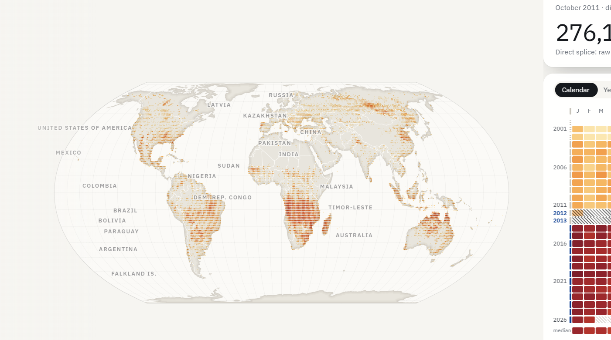

# Inspiratio Frontend Revision Prompt

Please take over the Svelte website under `inspiratio-site/`. Start a local preview with `npm run dev -- --port 5199`. First look at the two screenshots and the [previous handoff summary](PRIOR-STATUS.md), confirm which issues you can currently reproduce, then make the three changes below.

## 1. Make the data display explain what the model estimates

Look at the reading card in the top right of Figure 2, the `Harmonized / Direct splice` toggle at the top, and the story text on the left. Right now the largest number is the total detection count, and the `21.4× a usual September` below it describes how anomalous the month is compared with the same month historically. The page puts the visuals and the degree of anomaly front and center, but after reading it I still can't tell what the project's model actually does for the `estimate`.

Please shift the emphasis in these places. Pick a historical month where the model estimate is actually used, and let the user see, for the same region and month, what the raw count is, what the estimate is after converting to the VIIRS scale, and whether the current reading is a model estimate or a satellite observation. The relevant files are [ReadingCard.svelte](../src/components/ReadingCard.svelte) and [Story.svelte](../src/components/Story.svelte).

## 2. Fix the ghosting when switching into the second story section

Look at the center of Figure 2. The left side already shows `California, September 2020`, while the center shows the scatter plot and a basemap smeared into stripes at the same time. Please reproduce entering and leaving the second section, and scrolling to the California scene, and pin down when the ghosting appears. After a section switch, any leftover map, scatter or chart from the previous section should disappear. The relevant files are [Story.svelte](../src/components/Story.svelte) and [MapView.svelte](../src/components/MapView.svelte).

## 3. Fix map misalignment and restore location finding when zoomed in

Look at the world map in Figure 1. Labels such as `MEXICO`, `COLOMBIA` and `BRAZIL` sit far from their land areas, so it is hard to tell which place a label refers to. Place names are already there; next, please check the positions of the place names, basemap and fire cells in [MapView.svelte](../src/components/MapView.svelte). Using the old map's positioning and area selection as a reference, let users identify specific areas by boundaries, city names and fire locations when zoomed in. The current visual style can stay.

## Issue screenshots

**Figure 1 · World map, October 2011.** Check the country labels against their land areas.

**Figure 2 · California, September 2020.** Check the transition in the center and the reading card in the top right.

