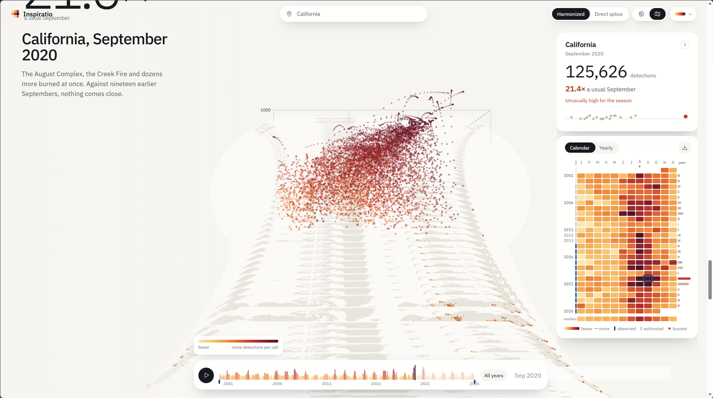

# Inspiratio 前端修改提示词

请接手 `inspiratio-site/` 下的 Svelte 网站。本地预览可用 `npm run dev -- --port 5199` 启动。先看两张截图和[上一轮交接摘要](PRIOR-STATUS.md)，确认现在能复现哪些问题，再按下面三点修改。

## 1. 让数据展示说清楚模型估计了什么

看图 2 的右上角读数卡、顶部 `Harmonized / Direct splice` 切换，以及左侧故事说明。现在最大的数字是总探测数，下面的 `21.4× a usual September` 讲的是和历史同期相比有多异常。页面把视觉效果和异常程度展示得很突出，但我看完还是不清楚项目的模型在 `estimate` 上具体做出了什么。

请调整这些位置的展示重点。找一个实际使用了模型估计的历史月份，让用户在同一地区、同一月份看懂原始计数是多少、转到 VIIRS 尺度后估计是多少，以及当前读数是模型估计还是卫星观测。对应位置是 [ReadingCard.svelte](../src/components/ReadingCard.svelte) 和 [Story.svelte](../src/components/Story.svelte)。

## 2. 修复第二个展示段落切换时的拖影

看图 2 的页面中央。左侧已经显示 `California, September 2020`，中央同时出现散点图和被拉伸成条纹的底图。请复现第二段切入、切出，以及滚到 California 这一幕时的画面，确认拖影什么时候出现。段落切换后，前一段的地图、散点或图表残影应该消失。相关位置是 [Story.svelte](../src/components/Story.svelte) 和 [MapView.svelte](../src/components/MapView.svelte)。

## 3. 修复地图错位，恢复放大后的定位能力

看图 1 的世界地图。`MEXICO`、`COLOMBIA`、`BRAZIL` 等标签离对应陆地区域很远，很难判断文字指的是哪块地方。现在已经有地名，接下来请检查 [MapView.svelte](../src/components/MapView.svelte) 中地名、底图和火点格的位置。参考旧版地图的定位和圈选功能，让用户放大后能根据边界、城市名和火点的位置辨认具体区域。视觉风格可以沿用现有版本。

## 问题截图

**图 1 · October 2011 世界地图。** 请看国家标签和对应陆地的位置。

**图 2 · California, September 2020。** 请看中央切换画面和右上角读数卡。

