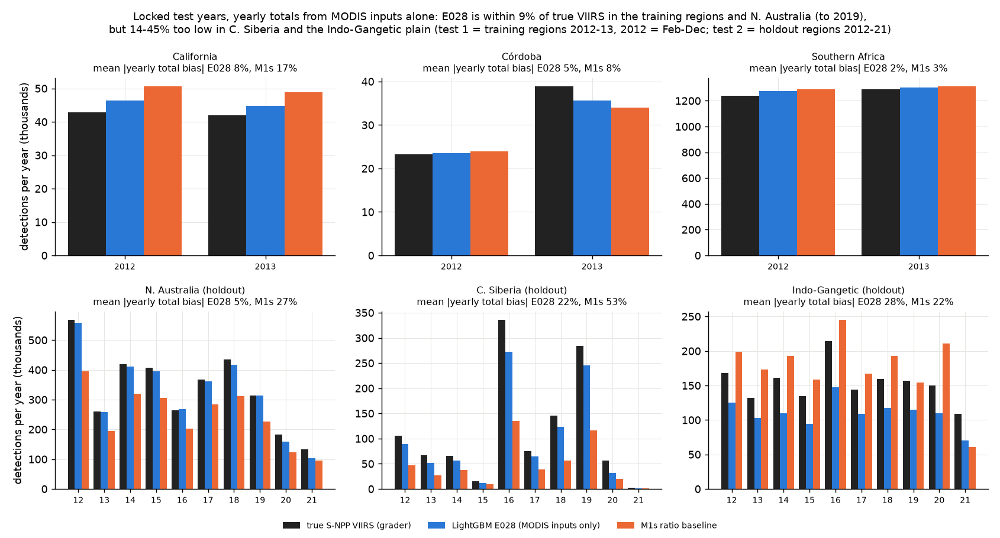
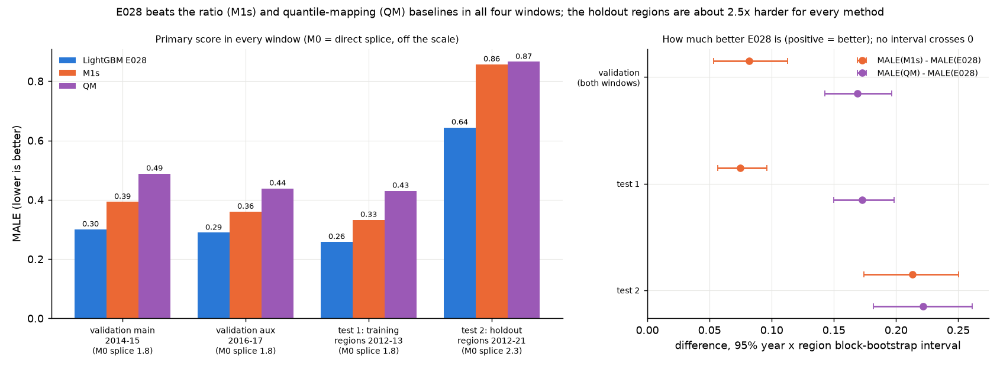
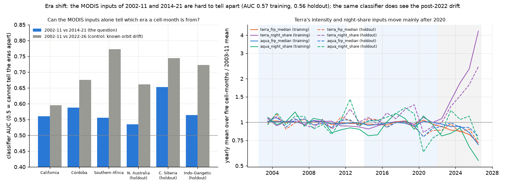

# Validation report (D1, S13)

> This report shows (and limits) what the harmonized dataset can be used for. It covers validation items 1–7 of plan section 3 and the 6 core figures of proposal D1.
> **Sources of the numbers**: validation scores from `reports/scores-v1.json` (M0, M1s, QM) and `reports/scores-s10.json` (E028); test scores computed by the GitHub grading workflow in `results/final-test/scores.json`, quoted as is and unchanged (full text in `reports/final-test.md`); numbers newly computed in S13 in `reports/validation.json`.
> **Reproduction**: `uv run python -X utf8 -m harmonization.validation all` (about 2 minutes; needs the grid tables, dataset v1, the S11 intermediate results and the GFED files in the data directory). Implementation details are in `docs/decisions/0010`.
> **Isolation**: this machine has never had 2012–2013 S-NPP or holdout-region VIIRS. Every number involving these data comes from the summary results returned by the grading workflow.

## Conclusions first

1. **The problem is real**: for the same fires, S-NPP VIIRS records 4.8–5.6 times as many hotspots as Aqua MODIS (southern Africa, 2014–2021). Direct stitching would conjure up 5 times as much "fire" in 2012 (figure 1).
2. **The harmonization works, including on years it has not seen**: using only MODIS inputs, the final model LightGBM E028 reaches MALE 0.258 on the locked Test 1 (training regions 2012–2013), 22% lower than the simple ratio method M1s (0.332), consistent with the 22% on the validation set; annual total bias is within 9% (figures 2 and 3).
3. **It gets clearly worse in regions it has not seen**: Test 2 (holdout regions) MALE 0.644, 2.5 times that of the training regions; still better than M1s (0.857), but more prone to estimating "fire out of nothing" where fires are rare, and annual totals in central Siberia and India's Ganges Plain are 14%–45% too low. **The dataset's trustworthy range is the 3 training regions (California, Córdoba, southern Africa)**; other regions can only be treated as low-confidence estimates.
4. **An independent reference supports the harmonization**: with GFED burned area as the reference, the harmonized "hotspots per square kilometer of burned area" stays at the same level across 2012 (southern Africa 2.77 versus 2.92, Córdoba 5.90 versus 5.86), while direct stitching jumps about 5 times (supplementary figure S1).
5. **Back to 2002, the inputs do not visibly change character**: a classifier can only barely tell the MODIS inputs of 2002–2011 from those of 2014–2021 (AUC 0.57; 0.5 means not at all), so when predicting backward the model sees inputs much like those it learned from (figure 6).
6. **Read the stability intervals with care**: the intervals reflect only "how much the estimate would change with a different set of training years". The raw intervals are too narrow; after the pre-registered calibration (multiplying by 5.37), coverage is 95.5% in the training regions and only 55.9% in the holdout regions. They are **not** "the true value has a 90% chance of falling inside".

## 1. Main and auxiliary metrics (plan section 3, item 1)

Main metric MALE = mean of |ln(estimate+1) − ln(VIIRS+1)| over random rectangles × months, counting only rectangle-months with VIIRS ≥ 10, first averaged by "region × year" and then pooled with equal weights (pre-registration section 2). Lower is better.

| Method | Validation main (2014–15) | Validation aux (2016–17) | Test 1 (training regions 2012–13) | Test 2 (holdout regions 2012–21) |
|---|---:|---:|---:|---:|
| **LightGBM E028 (final model)** | **0.300** | **0.289** | **0.258** | **0.644** |
| M1s simple ratio (λ = 20) | 0.393 | 0.360 | 0.332 | 0.857 |
| QM quantile mapping | 0.488 | 0.439 | 0.431 | 0.866 |
| M0 direct stitching | 1.799 | 1.791 | 1.813 | 2.263 |

Auxiliary metrics (E028 / M1s):

| Metric | Validation main | Validation aux | Test 1 | Test 2 |
|---|---|---|---|---|
| MALE over all samples (including VIIRS < 10) | 0.364 / 0.467 | 0.349 / 0.431 | 0.318 / 0.402 | 0.612 / 0.705 |
| Share with estimate ≥ 1 when VIIRS = 0 | 9.6% / 5.6% | 7.9% / 6.5% | 8.1% / 4.2% | **11.9% / 2.9%** |
| Share with estimate ≥ 5 when VIIRS = 0 | 2.9% / 5.2% | 3.7% / 6.5% | 3.6% / 3.2% | **9.6% / 2.5%** |
| Mean absolute error when VIIRS is 1–9 | 4.20 / 6.72 | 5.70 / 7.88 | 4.03 / 5.68 | **9.72 / 4.87** |
| Region × year total bias (mean absolute) | 5.3% / 3.0% | 6.1% / 11.2% | 4.7% / 9.3% | 18.3% / 34.1% |
| Seasonal shape correlation (mean) | 0.998 / 0.997 | 0.996 / 0.993 | 0.998 / 0.995 | 0.972 / 0.929 |

- Within the training regions (validation and Test 1), E028 is better on the main metric, the low-hotspot error and the seasonal shape; its share of estimates ≥ 1 hotspot on zero-hotspot samples is 1–4 percentage points higher than M1s, within the pre-registered tolerance of 5 percentage points.
- On Test 2, all three zero-hotspot and low-hotspot metrics are **worse than M1s**, and the gap in zero-hotspot ≥ 1 (9.0 percentage points) exceeds the tolerance used for model selection. These are only reported; the model is not changed (pre-registration section 9).
- MALE by region is in section 2 of `reports/final-test.md`: northern Australia 0.321 (close to the training regions), India's Ganges Plain 0.470, central Siberia 1.142 (above 1.1 for every method).

## 2. Confidence intervals for the comparisons (item 2)

"Year × region" block resampling 2000 times (seed 7); difference = MALE(comparison) − MALE(E028), positive means E028 is better. Overlapping rectangles are not independent samples; **no p-values are reported**.

| | vs M1s | vs QM |
|---|---|---|
| Validation (both windows combined) | 0.082 ± 0.016 (95% interval 0.053 to 0.113) | 0.169 ± 0.014 (0.143 to 0.197) |
| Test 1 | 0.075 ± 0.010 (0.057 to 0.096) | 0.173 ± 0.013 (0.150 to 0.198) |
| Test 2 | 0.213 ± 0.019 (0.174 to 0.250) | 0.222 ± 0.020 (0.182 to 0.261) |

None of the six intervals crosses 0. The improvement on Test 1 (0.075) is almost the same as on the validation set (0.082), which shows that model selection did not overfit the validation set.

## 3. Validation by use case: agreement of anomaly levels (item 3)

Method (pre-registration section 5): in the test period, for each rectangle-month, compute the percentile relative to the same month in past years from "the harmonized estimate" and from "real VIIRS", classify as high (≥ 90), normal or low (≤ 10), and measure how well the two agree (unweighted Cohen's κ).

| | Test 1 | Test 2 |
|---|---:|---:|
| E028 | **0.686** | **0.534** |
| M1s | 0.612 | 0.415 |
| Samples (rectangle-months) | 11,090 | 47,878 |

Agreement is "good" in the training regions and "moderate" in the holdout regions, and better than M1s in both tests. This directly answers the web page's core use: **in the training regions, judging "is this month's fire activity high" from the harmonized history is broadly reliable; in new regions, be cautious**. The confusion matrices are in `results/final-test/scores.json`. Because the VIIRS overlap period is only about 9 years, at least 8 reference years are required here, looser than the web product's ≥ 10 (stated in advance in the pre-registration).

## 4. Plausibility check against an independent reference (item 4, ESSD requirement)

Reference: GFED4.1s burned area (0.25°, derived from the MODIS MCD64A1 burned-area product, not from hotspot counts). The beta files after 2017 in the data directory contain only emissions and no burned area, so only **2003–2016** can be used (ADR 0010 item 2). For 2012–2013, the observations are the training regions' annual totals returned by the grader, and burned area is summed only over the months the grader used.

Hotspots per square kilometer of burned area (annual mean):

| Training region | Harmonized 2003–2011 (model estimates) | Observed 2012–2013 (grader) | Observed 2014–2016 | Direct stitching 2003–2011 (Aqua) |
|---|---:|---:|---:|---:|
| Southern Africa | 2.77 | 2.82 | 2.92 | 0.55 |
| Córdoba | 5.90 | 5.57 | 5.86 | 1.20 |
| California | 10.1 | 11.3 | 14.3 | 1.40 |

- **Southern Africa and Córdoba**: the ratio of the harmonized series is essentially unchanged across 2012 (differences of −6% to +5%). Southern Africa stays between 2.6 and 3.1 every year, very stable. Córdoba's burned area in 2014–2016 is about 57% lower than in 2003–2011, the harmonized hotspot count falls with it, and the ratio stays the same: the model kept the real change in fire activity rather than smoothing it away.
- **California**: burned area is small and varies a lot from year to year (one large fire can change the whole year), so the ratio jumps between 6.5 and 18.8, and is high in 2014–2016 (all three were severe drought years). The model estimates for 2012 and 2013 (9.2, 15.3) are close to the grader's observations (8.3, 14.4). No systematic step is visible in this region, but this also cannot prove there is none.
- **Direct stitching**: all three regions jump about 5 times in 2012 (southern Africa 0.55 → 2.92).
- **Comparison with the literature (qualitative only)**: Schroeder et al. (2014, *Remote Sensing of Environment* 143:85–96), introducing the VIIRS 375 m active-fire product, note that it detects more and smaller fires than the 1 km MODIS. In this data S-NPP counts 4.6–10 times as many hotspots as Aqua, consistent in direction. We could not verify the original source or basis of the plan's example "VIIRS counts about 70% more than MODIS in the tropics" (pixel counts, fire area or something else), so no numeric comparison is made (ADR 0010 item 2).

## 5. Is the uncertainty accurate? (item 5, Merchant 2017)

Stability intervals: resample the training years as whole years with replacement and retrain 100 times, taking the 5%–95% quantiles of regional monthly totals (pre-registration section 7).

| Coverage (nominal 90%) | Test 1 | Test 2 |
|---|---:|---:|
| Region × month, raw intervals | 37.9% (66 of them) | 12.9% (333 of them) |
| Region × month, multiplied by the calibration factor 5.37 | **95.5%** | **55.9%** |
| Cell × month, raw intervals | 64.7% | 73.5% |

- The raw intervals are below 80%, so per the pre-registration (ADR 0008 section 5, fixed before seeing scores) the calibration factor 5.37 set on the two validation windows applies, and both the tests and dataset v1 use the calibrated regional intervals.
- After calibration the intervals are adequate in the training regions (95.5%). They are not in the holdout regions (55.9%): the error there is mainly a systematic underestimate, which changing the training years cannot reveal.
- Cell-level coverage looks higher because a large number of cell-months have an estimate and an observation of 0, so the interval [0, 0] happens to cover them; this does not show that the intervals are accurate.
- **How to read them**: an interval shows "how much the estimate would move with a different set of training years"; it **does not include** errors from missed detections, long-term change, the Terra bridge or the NOAA-20 continuation, and **must not** be described as "the true value has a 90% chance of falling inside".

## 6. Era-shift investigation (item 6, required by proposal D1)

The question: the model learned from 2014–2021 but has to predict back to 2002–2011. If the MODIS inputs back then were very different from today's (for example, because the orbit or the product changed), predicting backward would be unreliable.

Method (pre-registration section 8; details in ADR 0010 item 1): using only the model's 18 MODIS inputs, train a classifier to guess whether a cell-month comes from 2002–2011 or 2014–2021, with 5-fold cross-validation by year. Only cell-months with at least one MODIS hotspot are used. **No input was removed to lower the AUC.**

| | Training regions | Holdout regions |
|---|---:|---:|
| Cell-months (old / new) | 120,478 / 99,336 | 58,457 / 53,870 |
| **AUC (mean over 5 folds)** | **0.566** | **0.562** |
| AUC per fold | 0.53–0.59 | 0.52–0.58 |
| AUC per region | California 0.56, Córdoba 0.59, southern Africa 0.56 | Northern Australia 0.54, Ganges Plain 0.56, central Siberia 0.65 |
| Only Aqua inputs / only Terra inputs / only latitude and month | 0.52 / 0.52 / 0.53 | 0.52 / 0.52 / 0.55 |
| **Control: 2002–2011 vs 2022–2026** | **0.749** | **0.696** |

- **Conclusion**: the inputs of the two eras can hardly be told apart (AUC 0.57, close to 0.5). In the training regions, no single input reaches more than 0.52 (latitude); that is, where fires occur has shifted slightly (the mean latitude of hotspot cells in the training regions moved from −11.7° to −10.6°), and fire intensity (FRP) has fallen slightly. These look more like real changes in fire activity than sensor changes.
- **The classifier can see a real shift**: when the same classifier separates 2002–2011 from 2022–2026, the AUC rises to 0.70–0.75, driven by Terra's FRP and night share. This is exactly the known Terra orbit drift (item 7 of `reports/findings.md`): Terra's overpass time changed, and in 2026 the night-time hotspot share is 4 times that of 2003–2011.
- **What it means for the dataset**: the 2002–2011 estimates have no problem of changed inputs. Terra's inputs are changing after 2020, and the model uses Terra features (the Terra hotspot count has 5% of the gain in the count model), so **model estimates after 2022 (which occur only in the holdout regions) are less reliable**. The training regions use observations from 2014 on and are not affected.
- Central Siberia has the highest AUC (0.65), possibly because fire activity in this region varies a lot from year to year anyway (figure 2), so where and in which season fires occur differs from year to year.

## 7. Record of how the selection rule was applied (item 7)

Per pre-registration section 4, looking only at the two validation windows (details in section 1 of `docs/decisions/0008` and `reports/scores-s10.md`):

| Condition | Threshold | E028 | Result |
|---|---|---|---|
| ① At least 10% better than M1s | Combined MALE ≤ 0.339 | 0.295 (21.8% lower) | Pass |
| ② Improvement of more than 1 standard error | 0.082 > 0.016 | Yes | Pass |
| ③ No window and no training region worse | Each region ≤ 1.05 × M1s | Highest 0.96× | Pass |
| ④ Guardrails: zero and low hotspots | ≤ M1s + 5 / + 2 percentage points; ≤ 1.10 × M1s | main zero hotspots +4.0 percentage points (the tightest) | Pass |
| ⑤ Leakage review | Review with a fresh context | `reports/model-review.md` | Pass |
| ⑥ Training-region total bias ±10% (reported only) | — | All 6 region-windows within ±10% on the validation set | — |

37 experiments (the budget was cut, ADR 0007); the differences among the top 3 are far smaller than the standard error. After selection the model was frozen and tested only once. The test scores are only reported; the model was not changed afterwards.

## 8. The six core figures

Each figure's title is the one point it makes.

### Figure 1: the problem: direct stitching conjures up a 5-fold jump in 2012

Monthly hotspot counts for southern Africa. Before 2012 Aqua MODIS is used, after it S-NPP VIIRS, and the count for the same fires suddenly rises 4.8–5.6 times. The dashed line is Aqua, which continues to exist, showing that the fires themselves did not increase. The gray band is 2012–2013: S-NPP for those two years is used only for the final test and is not on this machine.

### Figure 2: the main evidence: in the locked test years, MODIS alone gives accurate annual totals (training regions)

Black is the real VIIRS annual total computed by the grader, blue is E028 and orange is M1s, both using only MODIS inputs. Top row, training regions (Test 1): E028's mean annual total bias per region is 2%–8% (at most 9% in any single year), M1s's 3%–17%. Bottom row, holdout regions (Test 2): northern Australia is very accurate before 2019; central Siberia and India's Ganges Plain are clearly too low (M1s is too high in the Ganges Plain). This machine has no VIIRS for the test period, so only the annual totals returned by the grader can be plotted; the monthly comparison for the validation windows is in supplementary figure S2.

### Figure 3: the score table: E028 beats both comparisons in all four windows

Left: MALE in the four windows (same numbers as section 1). Right: how much better E028 is than M1s and QM, with 95% intervals (section 2). The holdout regions are about 2.5 times harder for every method.

### Figure 4: explanation: the model is mainly a "MODIS hotspot count converter"

- Left: feature importance of the frozen model (share of gain). The Aqua hotspot count takes the largest share in both stages (45% for deciding whether there is fire, 68% for estimating how much).
- Top middle: in cells where MODIS sees only one or two hotspots, VIIRS sees about 8 on average; in large fire clusters where MODIS sees hundreds, about 5. The direction fits "VIIRS 375 m sees more scattered small fires" (Schroeder et al. 2014). The model (blue) and the observations (black) almost coincide, but this is a fit on the training data and shows only that the model learned this relationship, not its accuracy.
- Top right, bottom middle: FRP and pixel area change the ratio by only 20%–30%, and the shape is not monotonic. Physical intuition says that the weaker the fire and the larger the MODIS pixel (farther from nadir), the more extra hotspots VIIRS should see; the data does not show this. These two inputs are mixed up with region and cannot be taken as evidence for a physical explanation.
- Bottom right: changing only latitude, the estimate steps up or down once within each training region's latitude band and is flat between bands. In other words, **latitude acts as a label for "which region this is"** (section 5 of `reports/model-review.md`). New regions get the conversion of the training region nearest in latitude, which is one of the reasons Test 2 is worse.
- Comparisons with the literature serve only as plausibility hints and are not used to change the model.

### Figure 5: the result: the complete harmonized series from 2000-11 to 2026-10, with no step in 2012 and the ups and downs kept

The blue line is the model estimate and the shading the calibrated stability interval; black is observed VIIRS (training regions from 2014); the gray dashed line is the raw MODIS before 2012; beige marks Terra-only months (low confidence).

- The training regions join up across 2012: southern Africa averages 1.25 million per year in 2003–2011 (model) and 1.22 million in 2014–2021 (observed); direct stitching gives only 250,000 for 2003–2011.
- Real changes are kept: Córdoba 54,000 → 36,000 (burned area is falling too, see section 4), California 39,000 → 90,000 (the megafires of 2017–2021). The model was never asked to "smooth away the 2012 step"; these changes come from the MODIS inputs themselves.
- In the training regions, 2012-02 to 2013-12 are model estimates, not observations (this machine never has S-NPP for these two years; ADR 0009 item 1, awaiting human confirmation). Every month in the holdout regions is a model estimate.

### Figure 6: era shift: the inputs of 2002–2011 and 2014–2021 can hardly be told apart

Left: classifier AUC (0.5 means not at all). Blue is the question to answer (0.54–0.65), gray is the control (2022–2026, with known Terra/Aqua orbit drift, 0.60–0.77). Right: the yearly means of several inputs (relative to 2003–2011), all near 1 before 2020; after that, Terra's night share rises quickly.

### Supplementary figures

- `figures/d1-s1-gfed.png`: the GFED plausibility check of section 4.
- `figures/d1-s2-validation-months.png`: regional monthly series for the validation windows 2014–2017 (real VIIRS, E028, M1s). On regional totals both methods are very close (mean log error E028 / M1s: California 0.11 / 0.20, Córdoba 0.13 / 0.17, southern Africa 0.12 / 0.11). Regional totals are easier than the 1°–5° rectangles used for scoring, so the errors here are smaller than MALE.

## 9. Limitations

1. **Trustworthy only in the 3 training regions**. In the holdout regions the error is 2.5 times that of the training regions, totals are 14%–45% too low (except northern Australia), and zero-hotspot and low-hotspot performance is worse than M1s. In central Siberia (boreal forest), MALE exceeds 1.1 for every method. Before extending to the globe (stage G), more training regions are needed, or estimates outside the training regions must be marked as low confidence.
2. **Latitude is used as a region label** (figure 4), so new regions get the conversion of the training region nearest in latitude.
3. **The stability intervals are not the full error**: they reflect only the effect of the training years; coverage in the holdout regions is only 56%. They do not include errors from missed detections, the Terra bridge or the NOAA-20 continuation.
4. **In the training regions, 2012-02 to 2013-12 are model estimates**, not observations (a red line on this machine; ADR 0009 item 1, awaiting human confirmation of whether a person will unlock and fill them in).
5. **Terra-only months** (2000-11 to 2002-09, and months with missing Aqua): Aqua inputs are built from Terra before going into the model; on the validation set the error is about 1.6 times that with Aqua (MALE 0.460 versus 0.295, ADR 0009 item 2); flagged as low confidence.
6. **Terra's orbit drift after 2020** changed the inputs (section 6), and the model uses Terra features, so model estimates after 2022 (only in the holdout regions) are less reliable.
7. **NOAA-20 continuation**: months with missing S-NPP use converted NOAA-20; the pass criterion for whether the continuation is "continuous" still awaits a person's decision (ADR 0005 item 4).
8. **The GFED check only goes to 2016**, and GFED also comes from MODIS (a burned-area product, not hotspot counts), so it is not fully independent; California's burned area is small, so the check is weak there.
9. **Missed detections from cloud, smoke and overpass timing** affect both sensors and cannot be corrected. The near real-time segment (VIIRS from 2026-08, MODIS from 2026-09) is preliminary.
10. **Experiment budget**: S10 ran only 37 experiments for time reasons (ADR 0007).
11. **Scoring basis**: MALE and total bias are relative to S-NPP VIIRS, not to real fires on the ground; "estimating fire on zero-hotspot samples" is relative to the VIIRS labels and is not a false-alarm rate.

## 10. Process disclosures

- The test was taken only once (the run record is in `reports/final-test.md`). All figures and new numbers in this report were made after the test, without changing the model, the data, the splits or any reported score.
- The methods for the two new items in S13 (GFED, era shift) were fixed after the test and are recorded in ADR 0010; they only describe the data and do not affect any choice.
- The decile comparisons in figure 4 are fits on the training data; accuracy is judged only from sections 1–3.
