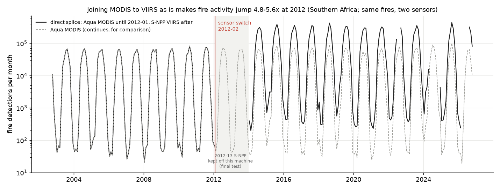
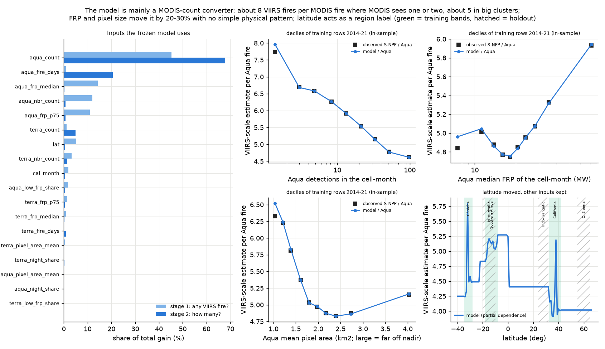
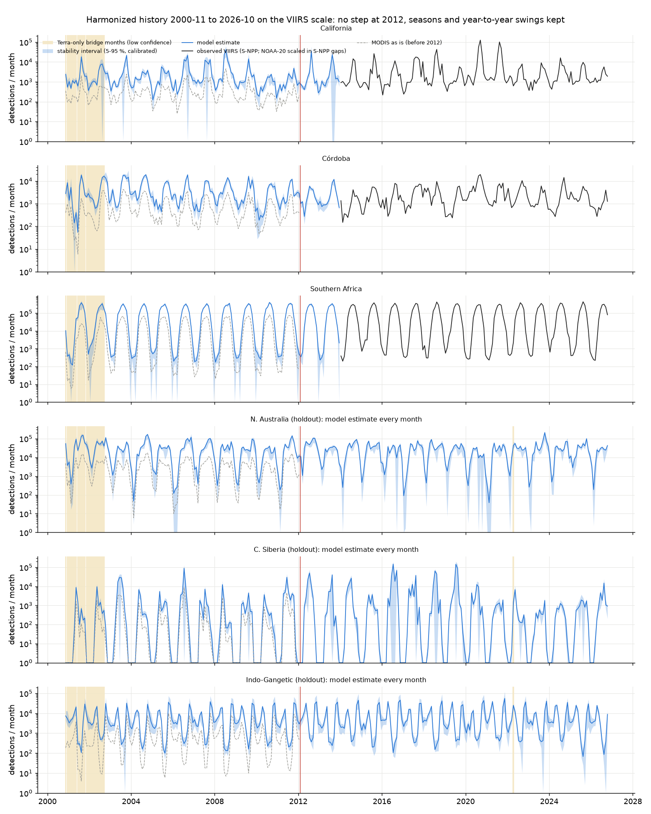

# 验证报告（D1，S13）

> 这份报告证明（以及限定）协调后数据集能用来做什么。对应计划第 3 节验证 1–7、提案 D1 的 6 张核心图。
> **数字来源**：验证集成绩 `reports/scores-v1.json`（M0、M1s、QM）和 `reports/scores-s10.json`（E028）；测试成绩是 GitHub 阅卷工作流算的 `results/final-test/scores.json`，原样引用、不改（全文见 `reports/final-test.md`）；S13 新算的数字在 `reports/validation.json`。
> **复现**：`uv run python -X utf8 -m harmonization.validation all`（约 2 分钟；需要数据目录里的网格表、数据集 v1、S11 中间结果和 GFED 文件）。实现细节见 `docs/decisions/0010`。
> **隔离**：本机从来没有 2012–2013 年 S-NPP 和留出区的 VIIRS。凡是涉及这些数据的数字，都来自阅卷工作流交回的汇总结果。

## 结论先看

1. **问题确实存在**：同一片火，S-NPP VIIRS 记到的火点数是 Aqua MODIS 的 4.8–5.6 倍（南部非洲，2014–2021 年）。直接拼接会在 2012 年凭空多出 5 倍的“火”（图 1）。
2. **协调有效，而且在没见过的年份上也成立**：只用 MODIS 输入，最终模型 LightGBM E028 在锁住的测试 1（训练区 2012–2013）上 MALE 0.258，比简单比例法 M1s（0.332）低 22%，和验证集上的 22% 一致；年总量偏差在 9% 以内（图 2、图 3）。
3. **换到没见过的地区就明显变差**：测试 2（留出区）MALE 0.644，是训练区的 2.5 倍；虽然仍比 M1s（0.857）好，但在火很少的地方更容易估出“凭空的火”，中西伯利亚和印度恒河平原的年总量偏低 14%–45%。**数据集的可信范围是 3 个训练区（加州、科尔多瓦、南部非洲）**，其他地区只能当作低置信度估计。
4. **独立参照支持协调结果**：用 GFED 燃烧面积当参照，协调后“每平方千米燃烧面积的火点数”在 2012 年前后保持同一水平（南部非洲 2.77 对 2.92，科尔多瓦 5.90 对 5.86），直接拼接则跳了约 5 倍（补充图 S1）。
5. **往回推到 2002 年，输入没有明显变样**：分类器只能勉强分出 2002–2011 年和 2014–2021 年的 MODIS 输入（AUC 0.57，0.5 表示完全分不出），所以模型往回推时用的输入和它学过的差不多（图 6）。
6. **稳定性区间要小心读**：区间只反映“换一批训练年份估计会变多少”。原始区间太窄，按预注册校准（乘 5.37）后，训练区覆盖率 95.5%，留出区只有 55.9%。它**不是**“真实值有 90% 的可能落在其中”。

## 1. 主指标和辅助指标（计划第 3 节第 1 条）

主指标 MALE = 随机矩形 × 月份上的平均 |ln(估计+1) − ln(VIIRS+1)|，只算 VIIRS ≥ 10 的矩形-月份，先按“区域 × 年”平均再等权汇总（预注册第 2 节）。越低越好。

| 方法 | 验证 main（2014–15） | 验证 aux（2016–17） | 测试 1（训练区 2012–13） | 测试 2（留出区 2012–21） |
|---|---:|---:|---:|---:|
| **LightGBM E028（最终模型）** | **0.300** | **0.289** | **0.258** | **0.644** |
| M1s 简单比例（λ = 20） | 0.393 | 0.360 | 0.332 | 0.857 |
| QM 分位数映射 | 0.488 | 0.439 | 0.431 | 0.866 |
| M0 直接拼接 | 1.799 | 1.791 | 1.813 | 2.263 |

辅助指标（E028 / M1s）：

| 指标 | 验证 main | 验证 aux | 测试 1 | 测试 2 |
|---|---|---|---|---|
| 全部样本的 MALE（含 VIIRS < 10） | 0.364 / 0.467 | 0.349 / 0.431 | 0.318 / 0.402 | 0.612 / 0.705 |
| VIIRS = 0 时估计 ≥ 1 的比例 | 9.6% / 5.6% | 7.9% / 6.5% | 8.1% / 4.2% | **11.9% / 2.9%** |
| VIIRS = 0 时估计 ≥ 5 的比例 | 2.9% / 5.2% | 3.7% / 6.5% | 3.6% / 3.2% | **9.6% / 2.5%** |
| VIIRS 1–9 时的平均绝对误差 | 4.20 / 6.72 | 5.70 / 7.88 | 4.03 / 5.68 | **9.72 / 4.87** |
| 区域 × 年总量偏差（绝对值平均） | 5.3% / 3.0% | 6.1% / 11.2% | 4.7% / 9.3% | 18.3% / 34.1% |
| 季节形状相关（平均） | 0.998 / 0.997 | 0.996 / 0.993 | 0.998 / 0.995 | 0.972 / 0.929 |

- 训练区内（验证和测试 1），E028 的主指标、低火点误差、季节形状都更好；零火点上估出 ≥ 1 个火点的比例比 M1s 高 1–4 个百分点，在预注册 5 个百分点的容差以内。
- 测试 2 上零火点和低火点三项**都比 M1s 差**，零火点 ≥ 1 的差距（9.0 个百分点）超过了选模时用的容差。这些只报告，不改模型（预注册第 9 节）。
- 各区 MALE 见 `reports/final-test.md` 第 2 节：北澳 0.321（和训练区差不多）、印度恒河平原 0.470、中西伯利亚 1.142（所有方法都超过 1.1）。

## 2. 比较的置信区间（第 2 条）

“年份 × 区域”块状重采样 2000 次（种子 7），差值 = MALE(对照) − MALE(E028)，正数表示 E028 更好。重叠的矩形不是独立样本，**不报 p 值**。

| | 对 M1s | 对 QM |
|---|---|---|
| 验证（两窗口合并） | 0.082 ± 0.016（95% 区间 0.053～0.113） | 0.169 ± 0.014（0.143～0.197） |
| 测试 1 | 0.075 ± 0.010（0.057～0.096） | 0.173 ± 0.013（0.150～0.198） |
| 测试 2 | 0.213 ± 0.019（0.174～0.250） | 0.222 ± 0.020（0.182～0.261） |

六个区间都不跨 0。测试 1 的提升（0.075）和验证集（0.082）几乎一样，说明选模型时没有对验证集过拟合。

## 3. 按用途验证：异常分级一致性（第 3 条）

做法（预注册第 5 节）：在测试期，每个矩形-月份分别用“协调后的估计”和“真实 VIIRS”算出相对历史同月的百分位，分成偏高（≥ 90）、正常、偏低（≤ 10），看两者多一致（不加权 Cohen's κ）。

| | 测试 1 | 测试 2 |
|---|---:|---:|
| E028 | **0.686** | **0.534** |
| M1s | 0.612 | 0.415 |
| 样本（矩形-月份） | 11,090 | 47,878 |

训练区的一致性属于“较好”，留出区属于“中等”，两个测试都比 M1s 好。这直接回答了网页的核心用途：**在训练区，用协调后的历史判断“这个月火多不多”，结论大体可靠；在新地区要谨慎**。混淆矩阵在 `results/final-test/scores.json`。因为 VIIRS 重叠期只有约 9 年，这里要求参考年数 ≥ 8，比网页产品的 ≥ 10 宽（预注册里事先写明）。

## 4. 独立参照的合理性检查（第 4 条，ESSD 要求）

参照：GFED4.1s 燃烧面积（0.25°，由 MODIS MCD64A1 燃烧面积产品得出，不用火点计数）。数据目录里 2017 年以后的 beta 文件只有排放、没有燃烧面积，所以只能用 **2003–2016 年**（ADR 0010 第 2 条）。2012–2013 年的观测值用阅卷交回的训练区年总量，燃烧面积只加阅卷用到的月份。

每平方千米燃烧面积的火点数（年平均）：

| 训练区 | 协调后 2003–2011（模型估计） | 观测 2012–2013（阅卷） | 观测 2014–2016 | 直接拼接 2003–2011（Aqua） |
|---|---:|---:|---:|---:|
| 南部非洲 | 2.77 | 2.82 | 2.92 | 0.55 |
| 科尔多瓦 | 5.90 | 5.57 | 5.86 | 1.20 |
| 加州 | 10.1 | 11.3 | 14.3 | 1.40 |

- **南部非洲和科尔多瓦**：协调后序列的比值在 2012 年前后基本不变（差 −6% 到 +5%）。南部非洲每年都在 2.6–3.1 之间，非常平稳。科尔多瓦的燃烧面积在 2014–2016 年比 2003–2011 年少了约 57%，协调后的火点数也跟着下降，比值仍然不变：这说明模型保留了真实的火情变化，没有把它抹平。
- **加州**：燃烧面积小、年际差别大（一场大火就能改变全年），比值逐年在 6.5–18.8 之间跳，2014–2016 年偏高（三年都是严重干旱年）。2012、2013 两年的模型估计（9.2、15.3）和阅卷观测（8.3、14.4）很接近。这个区看不出系统性台阶，但也证明不了没有台阶。
- **直接拼接**：三个区都在 2012 年跳了约 5 倍（南部非洲 0.55 → 2.92）。
- **文献对照（只做定性）**：Schroeder 等（2014，*Remote Sensing of Environment* 143:85–96）介绍 VIIRS 375 m 火点产品时指出，它比 1 km 的 MODIS 能探测到更多、更小的火。本数据中 S-NPP 火点数是 Aqua 的 4.6–10 倍，方向一致。计划里举的“热带 VIIRS 比 MODIS 多约 70%”我们没核到原始出处和口径（是像元数、火点面积还是别的），不做数值比较（ADR 0010 第 2 条）。

## 5. 不确定性是否准确（第 5 条，Merchant 2017）

稳定性区间：按整年有放回重抽训练年份、重训 100 次，取区域月总量的 5%–95% 分位数（预注册第 7 节）。

| 覆盖率（名义 90%） | 测试 1 | 测试 2 |
|---|---:|---:|
| 区域 × 月，原始区间 | 37.9%（66 个） | 12.9%（333 个） |
| 区域 × 月，乘校准系数 5.37 | **95.5%** | **55.9%** |
| 格子 × 月，原始区间 | 64.7% | 73.5% |

- 原始区间低于 80%，按预注册（ADR 0008 第 5 节，在看成绩前定）在两个验证窗口上定了校准系数 5.37，测试和数据集 v1 都用校准后的区域区间。
- 训练区校准后够用（95.5%）。留出区不够（55.9%）：那里的误差主要是系统性偏低，换训练年份反映不出来。
- 格子级覆盖率看起来较高，是因为大量格子-月份估计和观测都是 0，区间 [0, 0] 正好盖住，不能说明区间准。
- **怎么读**：区间表示“换一批训练年份，估计会变动多少”，**不包括**漏检、长期变化、Terra 桥接和 NOAA-20 接续的误差，**不能**说成“真实值有 90% 的可能落在其中”。

## 6. 年代偏移调查（第 6 条，提案 D1 必做）

问题：模型是用 2014–2021 年学的，却要往回推到 2002–2011 年。如果那时的 MODIS 输入和现在很不一样（比如轨道或产品变了），往回推就靠不住。

做法（预注册第 8 节，细节见 ADR 0010 第 1 条）：只用模型的 18 个 MODIS 输入，训练分类器猜一个格子-月份来自 2002–2011 年还是 2014–2021 年，按年份分 5 折交叉验证。只用至少有一个 MODIS 火点的格子-月份。**没有为了降低 AUC 删任何输入。**

| | 训练区 | 留出区 |
|---|---:|---:|
| 格子-月份（老 / 新） | 120,478 / 99,336 | 58,457 / 53,870 |
| **AUC（5 折平均）** | **0.566** | **0.562** |
| 各折 AUC | 0.53–0.59 | 0.52–0.58 |
| 各区 AUC | 加州 0.56、科尔多瓦 0.59、南部非洲 0.56 | 北澳 0.54、恒河平原 0.56、中西伯利亚 0.65 |
| 只用 Aqua 输入 / 只用 Terra 输入 / 只用纬度和月份 | 0.52 / 0.52 / 0.53 | 0.52 / 0.52 / 0.55 |
| **对照：2002–2011 对 2022–2026** | **0.749** | **0.696** |

- **结论**：两个年代的输入几乎分不出来（AUC 0.57，接近 0.5）。在训练区，单个输入最多只到 0.52（纬度），也就是说火出现的位置略有移动（训练区火点格子的年平均纬度从 −11.7° 变到 −10.6°），火强度（FRP）略有下降。这些更像真实的火情变化，而不是传感器变化。
- **分类器有能力看出真正的偏移**：同一个分类器分 2002–2011 和 2022–2026 时 AUC 升到 0.70–0.75，起作用的是 Terra 的 FRP 和夜间占比。这正是已知的 Terra 轨道漂移（`reports/findings.md` 第 7 条）：Terra 过境时间变了，夜间火点占比在 2026 年变成 2003–2011 年的 4 倍。
- **对数据集的含义**：2002–2011 年的估计没有输入变样的问题。2020 年以后 Terra 的输入在变，而模型用到 Terra 特征（计数模型里 Terra 火点数占 5% 的增益），所以 **2022 年以后的模型估计（只在留出区出现）可信度下降**。训练区 2014 年以后用的是观测值，不受影响。
- 中西伯利亚的 AUC 最高（0.65），可能因为这个区的火情年际波动本来就很大（图 2），火出现的位置和季节逐年不同。

## 7. 选定规则的执行记录（第 7 条）

按预注册第 4 节，只看两个验证窗口（详细见 `docs/decisions/0008` 第 1 节、`reports/scores-s10.md`）：

| 条件 | 门槛 | E028 | 结论 |
|---|---|---|---|
| ① 比 M1s 至少好 10% | 合并 MALE ≤ 0.339 | 0.295（低 21.8%） | 通过 |
| ② 改进超过 1 个标准误 | 0.082 > 0.016 | 是 | 通过 |
| ③ 两个窗口、每个训练区都不退步 | 每区 ≤ 1.05 × M1s | 最高 0.96 倍 | 通过 |
| ④ 护栏：零火点、低火点 | ≤ M1s + 5 / + 2 个百分点；≤ 1.10 × M1s | main 零火点 +4.0 个百分点（最紧） | 通过 |
| ⑤ 泄漏审查 | 全新上下文审核 | `reports/model-review.md` | 通过 |
| ⑥ 训练区总量偏差 ±10%（只报告） | — | 验证集 6 个区-窗口都在 ±10% 内 | — |

37 次实验（ADR 0007 缩减了预算），前 3 名之间差距远小于标准误。选定后冻结，只考一次。测试成绩只报告，没有回头改模型。

## 8. 六张核心图

每张图的标题就是它要说的那一件事。

### 图 1：问题，直接拼接在 2012 年凭空跳 5 倍

南部非洲的月度火点数。2012 年以前用 Aqua MODIS，之后用 S-NPP VIIRS，同一片火的计数一下子多了 4.8–5.6 倍。虚线是继续存在的 Aqua，证明火本身没有变多。灰色是 2012–2013 年：那两年的 S-NPP 只用于最终测试，本机没有。

### 图 2：主要证据，锁住的测试年份里只给 MODIS 也能估准年总量（训练区）

黑色是阅卷算出的真实 VIIRS 年总量，蓝色是 E028，橙色是 M1s，都只用 MODIS 输入。上排训练区（测试 1）：E028 各区年总量偏差平均 2%–8%（单年最大 9%），M1s 3%–17%。下排留出区（测试 2）：北澳 2019 年以前很准；中西伯利亚、印度恒河平原明显偏低（M1s 在恒河平原偏高）。本机没有测试期 VIIRS，所以只能画阅卷交回的年总量；验证窗口的月度对比见补充图 S2。

### 图 3：成绩表，四个窗口里 E028 都比两个对照好

左：四个窗口的 MALE（数字同第 1 节）。右：E028 比 M1s、QM 好多少，以及 95% 区间（第 2 节）。留出区对所有方法都难约 2.5 倍。

### 图 4：解释，模型主要是一个“MODIS 火点数换算器”

- 左：冻结模型的特征重要性（增益占比）。Aqua 火点数在两段模型里都占最大头（判断有没有火 45%，估多少 68%）。
- 中上：MODIS 只看到一两个火点的格子，VIIRS 平均约 8 个；MODIS 看到上百个的大火群，约 5 个。方向符合“VIIRS 375 m 能看到更多零散小火”（Schroeder 等 2014）。模型（蓝）和观测（黑）几乎重合，但这是训练数据上的拟合，只说明模型学到了这个关系，不说明准确性。
- 右上、中下：FRP 和像元面积对比值的影响只有 20%–30%，形状不单调。按物理直觉，火越弱、MODIS 像元越大（偏离天底），VIIRS 多出的应该越多，数据并不是这样。这两项和地区混在一起，不能当作物理解释的证据。
- 右下：只改纬度时，估计在每个训练区的纬度带里跳一级，带与带之间是平的。也就是说**纬度起了“这是哪个区”的标签作用**（`reports/model-review.md` 第 5 节）。新地区会套用纬度最近的训练区的换算，这正是测试 2 变差的原因之一。
- 与文献的对照只当合理性线索，不用来改模型。

### 图 5：结果，2000-11 至 2026-10 的完整协调序列，2012 年没有台阶，起伏保留

蓝线是模型估计，阴影是校准后的稳定性区间；黑线是观测 VIIRS（训练区 2014 年起）；灰色虚线是 2012 年以前的原始 MODIS；米色是只有 Terra 的月份（低置信度）。

- 训练区 2012 年前后接得上：南部非洲 2003–2011 年平均每年 125 万个（模型），2014–2021 年 122 万个（观测）；直接拼接的 2003–2011 年只有 25 万个。
- 真实的变化被保留了：科尔多瓦 5.4 万 → 3.6 万（燃烧面积也在下降，见第 4 节），加州 3.9 万 → 9.0 万（2017–2021 年的特大火灾）。模型没有被要求“抹平 2012 年的台阶”，这些变化来自 MODIS 输入本身。
- 训练区 2012-02 至 2013-12 是模型估计，不是观测（本机永远没有这两年的 S-NPP，ADR 0009 第 1 条，待人确认）。留出区每个月都是模型估计。

### 图 6：年代偏移，2002–2011 和 2014–2021 的输入几乎分不出来

左：分类器 AUC（0.5 表示完全分不出）。蓝色是要回答的问题（0.54–0.65），灰色是对照（2022–2026，已知 Terra/Aqua 轨道漂移，0.60–0.77）。右：几个输入的逐年平均（相对 2003–2011 年），2020 年以前都在 1 附近，之后 Terra 的夜间占比迅速上升。

### 补充图

- `figures/d1-s1-gfed.png`：第 4 节的 GFED 合理性检查。
- `figures/d1-s2-validation-months.png`：验证窗口 2014–2017 的区域月度序列（真实 VIIRS、E028、M1s）。按区域总量算，两种方法都很接近（平均对数误差 E028 / M1s：加州 0.11 / 0.20，科尔多瓦 0.13 / 0.17，南部非洲 0.12 / 0.11）。区域总量比评分用的 1°–5° 矩形容易，所以这里的误差比 MALE 小。

## 9. 局限性

1. **只在 3 个训练区可信**。留出区误差是训练区的 2.5 倍，总量偏低 14%–45%（北澳除外），零火点和低火点表现比 M1s 差。中西伯利亚（北方森林）所有方法 MALE 都超过 1.1。推广到全球（阶段 G）之前，需要更多训练区，或者把训练区以外的估计标成低置信度。
2. **纬度当成了区域标签**（图 4），新地区会套用纬度最近的训练区的换算。
3. **稳定性区间不是完整误差**：只反映训练年份的影响；留出区覆盖率只有 56%。不包括漏检、Terra 桥接、NOAA-20 接续的误差。
4. **训练区 2012-02 至 2013-12 是模型估计**，不是观测（本机红线；ADR 0009 第 1 条，待人确认是否由人解锁后补上）。
5. **只有 Terra 的月份**（2000-11 至 2002-09，以及 Aqua 缺测月）：用 Terra 造出 Aqua 输入再进模型，验证集上误差约是有 Aqua 时的 1.6 倍（MALE 0.460 对 0.295，ADR 0009 第 2 条），标为低置信度。
6. **Terra 2020 年后的轨道漂移**改变了输入（第 6 节），模型用到 Terra 特征，2022 年以后的模型估计（只在留出区）可信度下降。
7. **NOAA-20 接续**：S-NPP 缺测月用 NOAA-20 换算，接续是否“连续”的通过标准还待人决定（ADR 0005 第 4 条）。
8. **GFED 检查只到 2016 年**，而且 GFED 也来自 MODIS（燃烧面积产品，不是火点计数），算不上完全独立；加州燃烧面积小，检查力度弱。
9. **云、烟、过境时间**造成的漏检两种传感器都有，无法校正。近实时数据段（VIIRS 2026-08 起、MODIS 2026-09 起）是初步结果。
10. **实验预算**：S10 因时间原因只做了 37 次实验（ADR 0007）。
11. **评分口径**：MALE 和总量偏差是相对 S-NPP VIIRS 的，不是相对地面真实火灾；“零火点上估出火”是相对 VIIRS 标签而言，不是误报率。

## 10. 过程披露

- 测试只考了一次（运行记录见 `reports/final-test.md`）。本报告的所有图和新数字都在测试之后做，没有改模型、数据、切分或任何已报告的成绩。
- S13 新做的两项（GFED、年代偏移）的具体做法是测试后定的，记录在 ADR 0010；它们只描述数据，不影响任何选择。
- 图 4 的十分位对比是训练数据上的拟合；评估准确性只看第 1–3 节。
